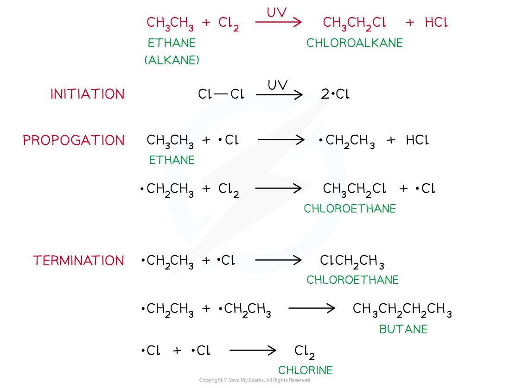
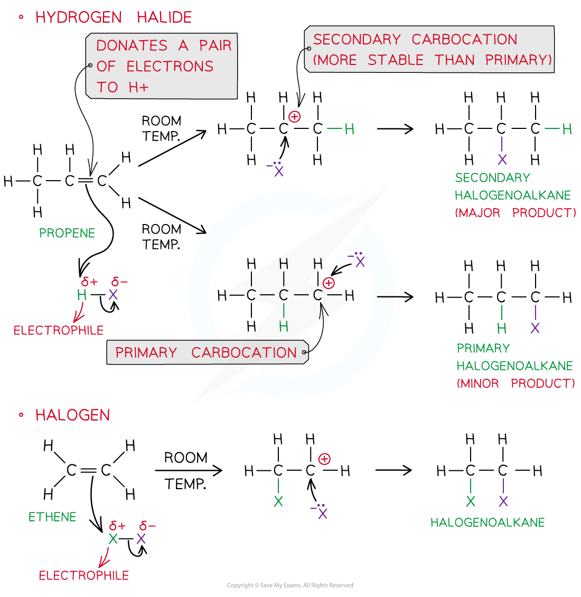
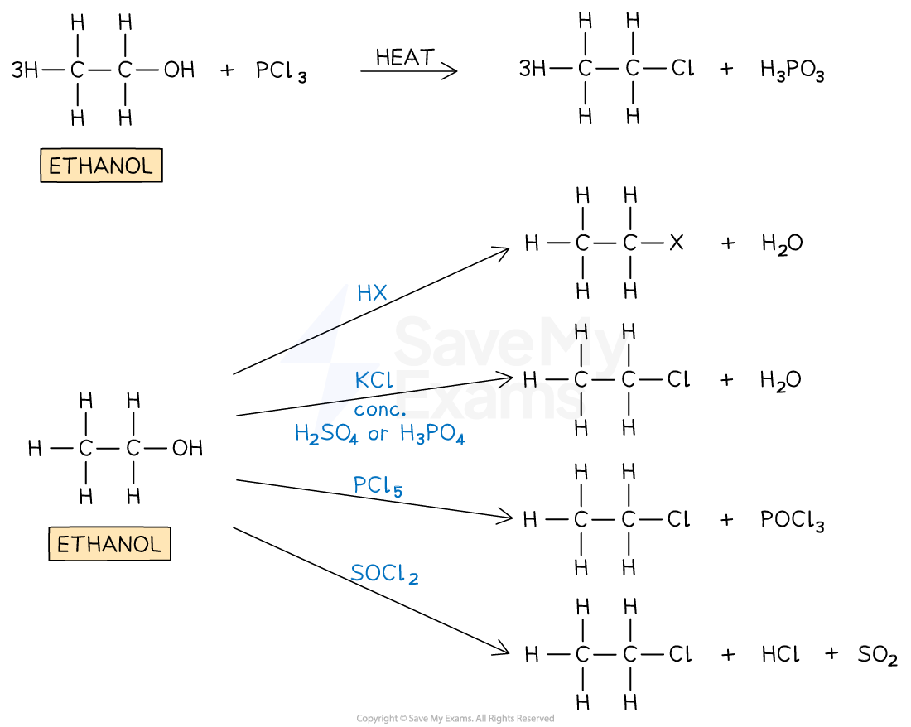
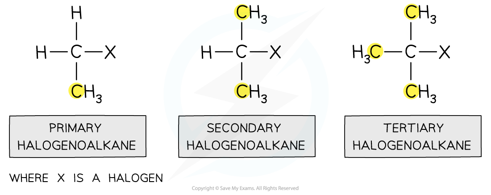

# Producing Halogenoalkanes

## Production of Halogenoalkanes: Substitution & Addition Reactions

> **Spec point** — `spcpt_673NfkypZM8mGB2P`

## Production of Halogenoalkanes: Substitution & Addition Reactions

- **Halogenoalkanes **are alkanes that have one or more halogens
- They can be produced from:

  - **Free-radical substitution **of **alkanes**
  - **Electrophilic addition **of **alkenes**
  - **Substitution **of an **alcohol**

### Free-radical substitution of alkanes

- A free-radical substitution reaction involves **three main steps**: **initiation**, **propagation**, and **termination**
- This reaction occurs between an alkane and a halogen, such as **chlorine (Cl****2****)** or **bromine (Br****2****)**, in the presence of **ultraviolet (UV) light**

  - **Initiation**:
  
    - UV light provides energy to break the Cl–Cl or Br–Br bond by **homolytic fission**, producing two identical **halogen free radicals** (Cl• or Br•)
  - **Propagation**:
  
    - The halogen radicals react with alkane molecules in a **chain reaction**, producing new radicals and continuing the substitution of hydrogen atoms with halogen atoms
  - **Termination**:
  
    - The reaction stops when **two free radicals combine** to form a stable molecule, ending the chain process

#### Free-radical substitution reactions of alkanes

*Free-radical substitution reactions of alkanes produce halogenoalkanes*

### Electrophilic addition

- Halogenoalkanes can also be produced from the addition of **hydrogen** **halides** (HX) or **halogens** (X2) at **room temperature **to alkenes
- In hydrogen halides, the hydrogen acts as the electrophile and accepts a pair of electrons from the C-C bond in the alkene

  - The major product is the one in which the halide is bonded to the most substituted carbon atom (**Markovnikov’s rule)**
- In the addition of halogens to alkenes, one of the halogen atoms acts as an electrophile and the other as a nucleophile

#### Electrophilic addition to alkenes

*Electrophilic addition of hydrogen halides or hydrogen at room temperatures to alkenes results in the formation of halogenoalkanes*

### Substitution of alcohols

- In the **substitution of alcohols **an alcohol group is replaced by a halogen to form a halogenoalkane
- The substitution of the alcohol group for a halogen can be achieved by reacting the alcohol with:

  - **HX** (or KBr with H2SO4 or H3PO4 to make HX)
  - **PCl****3** and heat
  - **PCl****5** at room temperature
  - **SOCl****2**

#### Substitution of alcohols

*Substitution of alcohols produces halogenoalkanes*

#### Different methods of forming halogenoalkanes

*Overview of the different ways to produce halogenoalkanes*

## Classifying Halogenoalkanes

> **Spec point** — `spcpt_3bDDxYkPb9GXRjpm`

## Classifying Halogenoalkanes

- Depending on the carbon atom the halogen is attached to, halogenoalkanes can be classified as **primary**, **secondary** and **tertiary**

  - A **primary halogenoalkane **is when a halogen is attached to a carbon that itself is attached to one other alkyl group
  - A **secondary halogenoalkane **is when a halogen is attached to a carbon that itself is attached to two other alkyl groups
  - A **tertiary halogenoalkane **is when a halogen is attached to a carbon that itself is attached to three other alkyl groups

#### Primary, secondary and tertiary halogenoalkanes

*The number of alkyl groups attached determines if the halogenoalkane is primary, secondary or tertiary*
