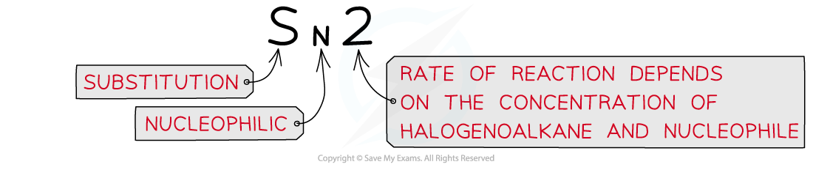
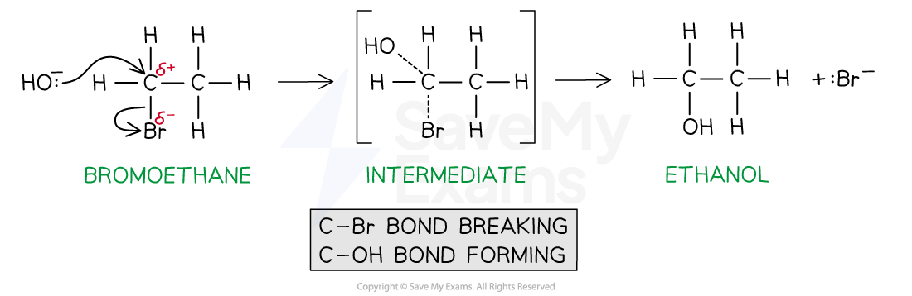
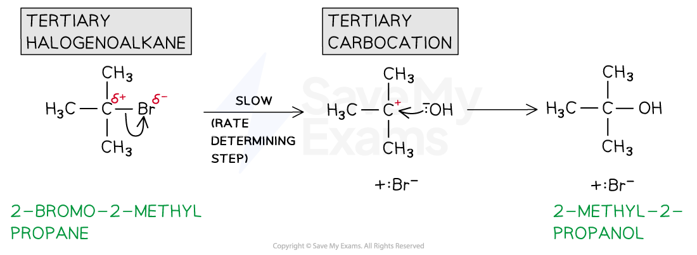
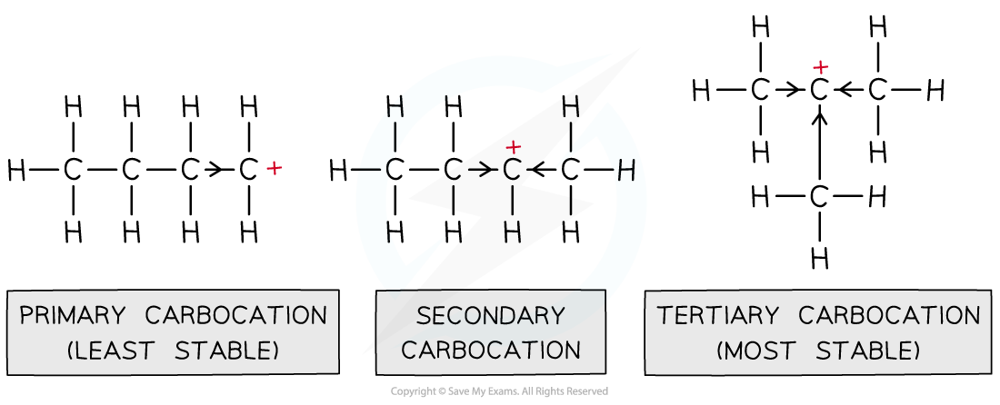

# SN1 & SN2

## SN1 & SN2 Mechanisms of Halogenoalkanes

> **Spec point** — `spcpt_D6kPPr4Nhg5W7SKd`

## Halogenoalkanes: SN1 & SN2 Mechanisms

- In **nucleophilic substitution **reactions involving halogenoalkanes, the halogen atom is replaced by a nucleophile
- These reactions can occur in two different ways (known as **S****N****2** and **S****N****1 **reactions) depending on the structure of the halogenoalkane involved

### SN2 reactions

- In** primary halogenoalkanes, **the carbon that is attached to the halogen is bonded to **one alkyl group**
- These halogenoalkanes undergo nucleophilic substitution by an **S****N****2** mechanism

  - ‘S’ stands for ‘substitution’
  - ‘N’ stands for ‘nucleophilic’
  - ‘2’ means that the rate of the reaction (which is determined by the slowest step of the reaction) depends on the concentration of both the halogenoalkane and the nucleophile ions

#### Defining an SN2 mechanism

*Each term in the SN2 expression has a specific meaning*

- The SN2 mechanism is a **one-step** reaction

  - The nucleophile donates a pair of electrons to the δ+ carbon atom to form a new bond
  - At the same time, the C-X bond is breaking and the halogen (X) takes both electrons in the bond (**heterolytic fission**)
  - The halogen leaves the halogenoalkane as an X- ion
- For example, the nucleophilic substitution of bromoethane by hydroxide ions to form ethanol

#### The nucleophilic substitution of bromoethane by hydroxide ions

*In this mechanism, the bromoethane is a primary halogenoalkane*

### SN1 reactions

- In** tertiary halogenoalkanes, **the carbon that is attached to the halogen is bonded to **three alkyl groups**
- These halogenoalkanes undergo nucleophilic substitution by an **S****N****1** mechanism

  - ‘S’ stands for ‘substitution’
  - ‘N’ stands for ‘nucleophilic’
  - ‘1’ means that the rate of the reaction (which is determined by the slowest step of the reaction) depends on the concentration of only one reagent, the **halogenoalkane**

#### Defining an SN1 mechanism

*Each term in the SN1 expression has a specific meaning*

- The SN1 mechanism is a two-step reaction

  - In the first step, the C-X bond breaks **heterolytically **and the halogen leaves the halogenoalkane as an X- ion (this is the **slow** and **rate-determining step**)
  - This forms a **tertiary carbocation (which is a tertiary carbon atom with a positive charge)**
  - In the second step, the tertiary carbocation is attacked by the **nucleophile**

- For example, the nucleophilic substitution of 2-bromo-2-methylpropane by hydroxide ions to form 2-methyl-2-propanol

#### The nucleophilic substitution of 2-bromo-2-methylpropane by hydroxide ions

*In this mechanism, the 2-bromo-2-methylpropane is a tertiary halogenoalkane*

### Carbocations

- In the SN1 mechanism, a **tertiary** **carbocation **is formed
- This is not the case for SN2 mechanisms as a **primary carbocation **would have been formed which is much **less **stable than tertiary carbocations
- This has to do with the **positive inductive effect **of the alkyl groups attached to the carbon which is bonded to the halogen atom

  - The alkyl groups push electron density towards the positively charged carbon, reducing the **charge** **density**
  - In tertiary carbocations, there are three alkyl groups stabilising the carbocation whereas in primary carbocations there is only one alkyl group
  - This is why tertiary carbocations are much more stable than primary ones

#### Stability of primary, secondary and tertiary carbocations

*The carbocations become more stable moving from primary to secondary to tertiary*

- **Secondary** **halogenoalkanes** undergo a **mixture** of both SN1 and SN2 reactions depending on their structure
