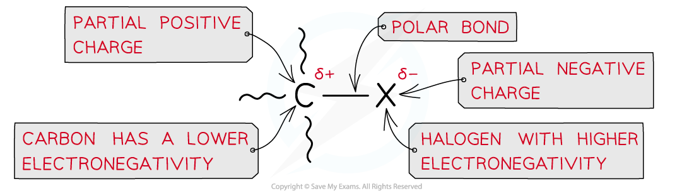
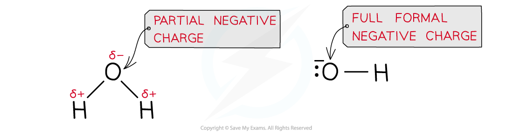

# Substitution Reactions of Halogenoalkanes

## Nucleophilic Substitution Reactions of Halogenoalkanes

> **Spec point** — `spcpt_h3dWFWW4DjhmpkJ2`

## Nucleophilic Substitution Reactions of Halogenoalkanes

- **Halogenoalkanes **are much more reactive than alkanes due to the presence of the **electronegative **halogens

  - The halogen-carbon bond is polar causing the carbon to carry a partial positive and the halogen a partial negative charge
- A **nucleophilic substitution **reaction is one in which a **nucleophile **attacks a carbon atom which carries a **partial** **positive** **charge**
- An atom that has a **partial** **negative** **charge** is replaced by the nucleophile

#### Explaining the polarity of a carbon-halogen bond

*Due to large differences in electronegativity between the carbon and halogen atom, the C-X bond is polar*

### Reaction with NaOH

- The reaction of a halogenoalkane with **aqueous alkali **results in the formation of an alcohol
- The halogen is **replaced** by the OH-
- The **aqueous** **hydroxide** (OH- ion) behaves as a **nucleophile** by donating a pair of electrons to the carbon atom bonded to the halogen
- For example, bromoethane reacts with aqueous alkali when heated to form ethanol

  - Hence, this reaction is a **nucleophilic substitution**
  - The halogen is replaced by a nucleophile, :OH–

**CH****3****CH****2****Br + :OH****–**** → CH****3****CH****2****OH + :Br****–**

### Reaction with KCN

- The **nucleophile** in this reaction is the **cyanide**, CN- ion
- **Ethanolic** **solution** of **potassium** **cyanide** (KCN in ethanol) is **heated** **under** **reflux** with the halogenoalkane
- The product is a **nitrile**

  - For example, bromoethane reacts with ethanolic potassium cyanide when heated under reflux to form propanenitrile
  - The halogen is replaced by a nucleophile, :CN–

**CH****3****CH****2****Br + :CN****–**** → CH****3****CH****2****CN + :Br****–**

- The nucleophilic substitution of halogenoalkanes with KCN adds an **extra **carbon atom to the carbon chain
- This reaction can therefore be used by chemists to make a compound with one more carbon atom than the best available organic starting material

### Reaction with NH3

- The **nucleophile** in this reaction is the **ammonia**, NH3 molecule
- An** ethanolic** **solution** of **excess ammonia **(NH3 in ethanol) is **heated** **under pressure **with the halogenoalkane
- For example, bromoethane reacts with excess ethanolic ammonia when heated under pressure to form ethylamine

  - The product is a **primary amine**
  - The halogen is replaced by an amine group NH2

**CH****3****CH****2****Br + NH****3**** → CH****3****CH****2****NH****2**** + HBr **

- It is very important that the ammonia is in excess as the product of the nucleophilic substitution reaction, the **ethylamine**, can act as a nucleophile and attack another bromoethane to form the **secondary amine**, **diethylamine**

### Reaction with aqueous silver nitrate

- Halogenoalkanes can be broken down **under reflux **by water to form **alcohols**
- The breakdown of a substance by water is also called **hydrolysis**
- The water in aqueous silver nitrate will hydrolyse the halogenoalkane

  - The fastest nucleophilic substitution reactions take place with the iodoalkanes as the C-I bond is the **weakest (longest)**
  - The slowest nucleophilic substitution reactions take place with the fluoroalkanes as the bond is the **strongest (shortest)**
- For example, bromoethane reacts with aqueous silver nitrate solution to form ethanol and a Br- ion

  - The Br- ion will form a cream precipitate with Ag+
- This reaction is classified as a nucleophilic substitution reaction with **water molecules **in aqueous **silver nitrate **solution acting as nucleophiles, **replacing **the halogen in the halogenoalkane

**C****2****H****5****Br + OH****-**** **$\overset{\mathrm{reflux}}{\rightarrow}$** C****2****H****5****OH + Br****-**

#### Nucleophilic substitution with OH–

*In nucleophilic substitution with OH–, the bond that forms and the bond that breaks must both involve the carbon atom that is bonded to the leaving group*

- This reaction is similar to the nucleophilic substitution reaction of halogenoalkanes with aqueous alkali, however, hydrolysis with water is much **slower** than with the OH- ion in alkalis

  - The hydroxide ion is a better nucleophile than water as it carries a full formal negative charge
  - In water, the oxygen atom only carries a partial negative charge

#### Comparing water and the hydroxide ion as nucleophiles

*A hydroxide ion is a better nucleophile as it has a full formal negative charge whereas the oxygen atom in water only carries a partial negative charge; this causes the nucleophilic substitution reaction with water to be much slower than with aqueous alkali*

- The halogenoalkanes have different **rates** **of** **hydrolysis**
- This reaction can be used as a **test** to identify halogens in a halogenoalkane by measuring how long it takes for the test tubes containing the halogenoalkane and aqueous silver nitrate solutions to become **opaque**
