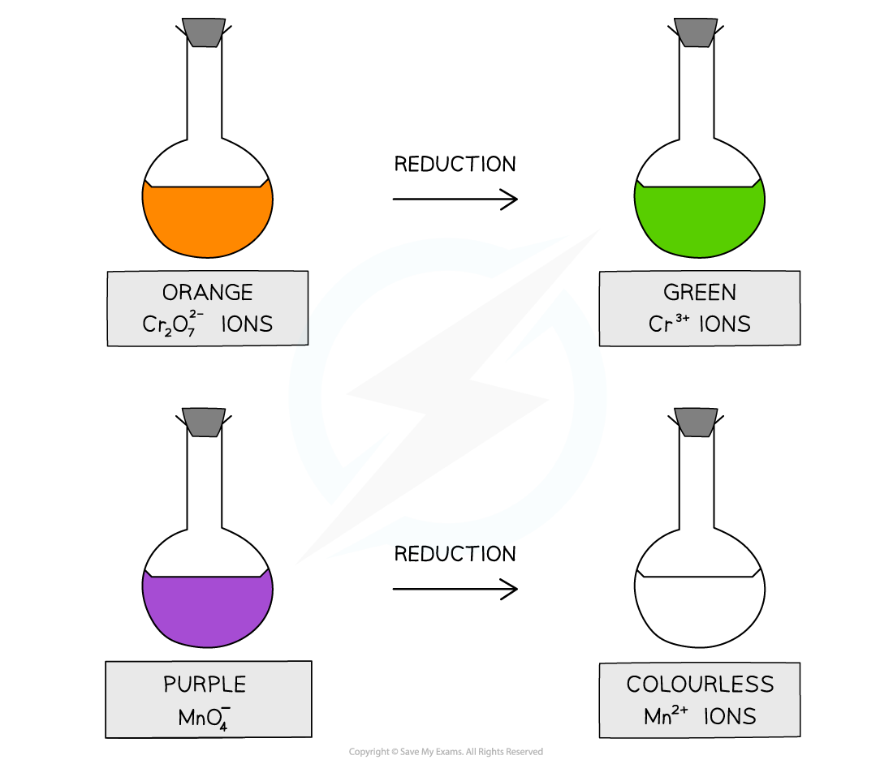
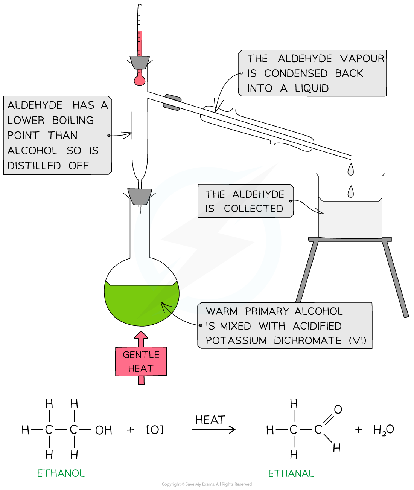

# Producing Aldehydes & Ketones

## Production of Aldehydes & Ketones

> **Spec point** — `spcpt_fpBXy2gVyzDKcP3V`

## Production of Aldehydes & Ketones

- **Aldehydes **and **ketones **are carbonyl compounds containing a C=O group
- They can be prepared from the oxidation of **primary** and **secondary** **alcohols **respectively

### Oxidising agents

- The oxidising agents used to prepare aldehydes and ketones from alcohols include **acidified potassium dichromate **(K2Cr2O7) and **acidified potassium manganate **(KMnO4)
- Acidified with dilute sulfuric acid, **potassium dichromate(VI)**, K2Cr2O7, is an orange oxidising agent

  - When the alcohols are **oxidised **the orange dichromate ions (Cr2O72-) are reduced to green Cr3+ ions
- Acidified with dilute sulfuric acid, **potassium manganate(VII)**, KMnO4 is a purple oxidising agent

  - When the alcohols are **oxidised **the purple manganate ions (MnO4-) are reduced to colourless Mn2+ ions

#### The colour change in common oxidising agents

*The oxidising agents change colour when they oxidise an alcohol and get reduced themselves*

### Synthesis of aldehydes

- To make an aldehyde, **warm primary alcohol **is slowly added to the oxidising agent
- The formed aldehyde has a lower boiling point than the alcohol and can therefore be **distilled off **as soon as it forms
- The aldehyde is then condensed into a liquid and **collected**

#### Using distillation to oxidise a primary alcohol to an aldehyde

*Aldehydes are formed from the oxidation of primary alcohols*

### Synthesis of ketones

- To make a ketone, **warm secondary alcohol **is slowly added to the oxidising agent
- Since the formed **ketone **cannot be further oxidised it does not need to be **distilled off straightaway **after it has been formed

#### Oxidation of propan-2-ol

*Ketones are formed from the oxidation of secondary alcohols*

> **Exam Hint**
> If the aldehyde formed is not distilled off, further **refluxing **with excess oxidising agent will oxidise the aldehyde to a **carboxylic acid**
