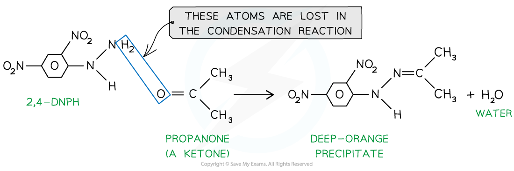
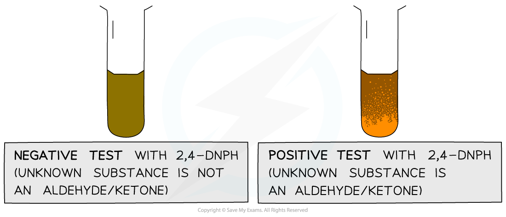
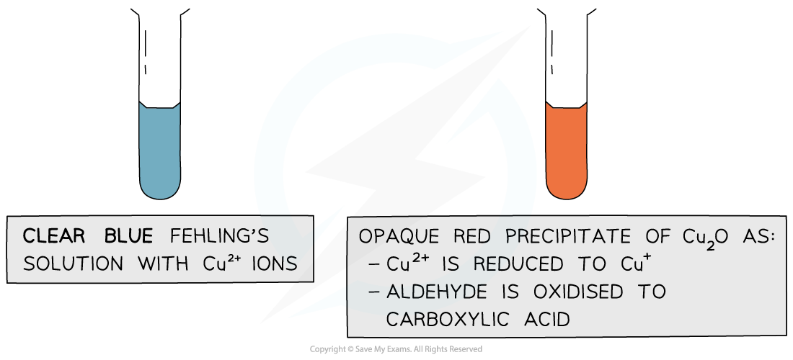
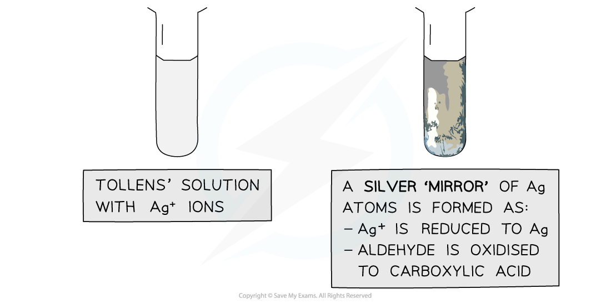

# Testing for Carbonyl Compounds

## Testing for Carbonyls: 2,4-DNPH

> **Spec point** — `spcpt_9Jt8CxZZvRgp4DFm`

## Testing for Carbonyls: 2,4-DNPH

- 2,4-dinitrophenylhydrazine (also known as **2,4-DNPH**) is a reagent which detects the presence of **carbonyl compounds **(compounds with -C=O group)
- The carbonyl group of **aldehydes **and **ketones **undergoes a **condensation **reaction with 2,4-dinitrophenylhydrazine

  - A condensation reaction is a reaction in which two molecules join together and a small molecule (such as H2O or HCl) is eliminated
- The **product **formed when 2,4-DNPH is added to a solution that contains an aldehyde or ketone is a **deep-orange precipitate** which can be purified by recrystallisation
- The **melting** **point** of the formed precipitate can then be measured and compared to literature values to find out which specific aldehyde or ketone had reacted with 2,4-DNPH

#### Example reaction of a ketone with 2,4-DNPH

*Ketones and aldehydes react with 2,4-DNPH in a condensation reaction*

#### Results of chemical tests using 2,4-DNPH

*The test tube on the left shows a negative 2,4-DNPH test and the tube on the right shows a positive test*

> **Exam Hint**
> The 2,4-DNPH is especially useful as other carbonyl compounds such as **carboxylic** **acids** and **esters** do not give a **positive** test

## Identifying Carbonyls: Fehling's Solution & Tollens' Reagent

> **Spec point** — `spcpt_Y9pDHpH88VpnFWft`

## Identifying Carbonyls: Fehling's Solution & Tollens' Reagent

- The presence of an aldehyde group (-CHO) in an **unknown compound **can be determined by the **oxidising agents** Fehling’s and Tollens’ reagents

### Fehling’s solution

- **Fehling’s solution** is an alkaline solution containing copper(II) ions which act as the oxidising agent
- When **warmed** with an aldehyde, the aldehyde is oxidised to a carboxylic acid and the Cu2+ ions are reduced to Cu+ ions

  - In the alkaline conditions, the carboxylic acid formed will be neutralised to a carboxylate ion (the -COOH will lose a proton to become -COO- )
  - The carboxylate ion (-COO-) will form a salt with a positively charged metal ion such as sodium (-COO-Na+)
- The **clear blue** solution turns **opaque **due to the formation of a **red precipitate**, **copper(I) oxide**
- **Ketones **cannot be oxidised and therefore give a **negative test** when warmed with Fehling’s solution

#### Colour change using Fehling's solution

*The copper(II) ions in Fehling’s solution are oxidising agents. They can oxidise an aldehyde to a carboxylic acid and are themselves reduced to copper(I) ions in the copper(I)oxide precipitate*

### Tollens’ reagent

- **Tollens' reagent **is an aqueous alkaline solution of silver nitrate in excess ammonia solution

  - Tollens' reagent is also called **ammoniacal silver nitrate solution**
- When **warmed** with an aldehyde, the aldehyde is oxidised to a carboxylic acid and the Ag+ ions are reduced to Ag atoms

  - In the alkaline conditions, the carboxylic acid will become a carboxylate ion and form a salt
- The Ag atoms form a silver ‘mirror’ on the inside of the tube
- **Ketones **cannot be oxidised and therefore give a **negative test** when warmed with Tollens’ reagent

#### Colour change using Tollens' reagent

*The Ag+ ions in Tollens’ reagent are oxidising agents. They can oxidise an aldehyde to a carboxylic acid and are themselves reduced to silver atoms*
