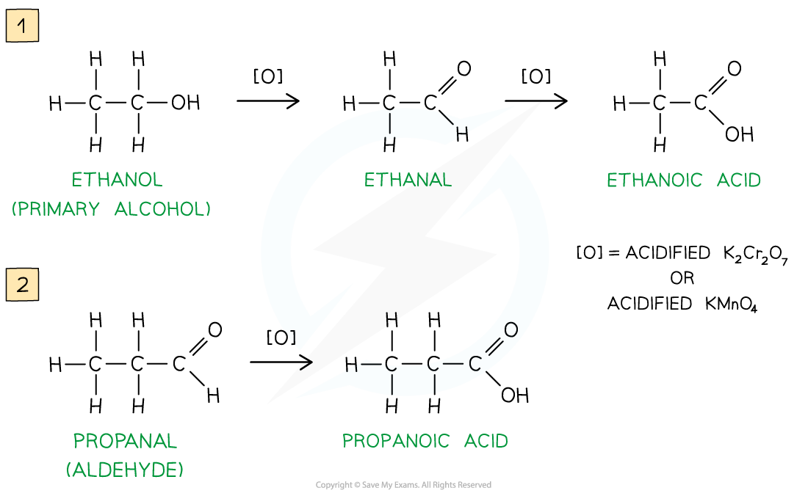
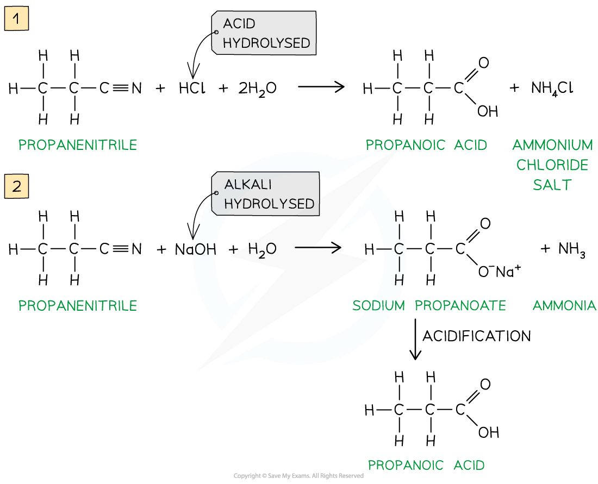
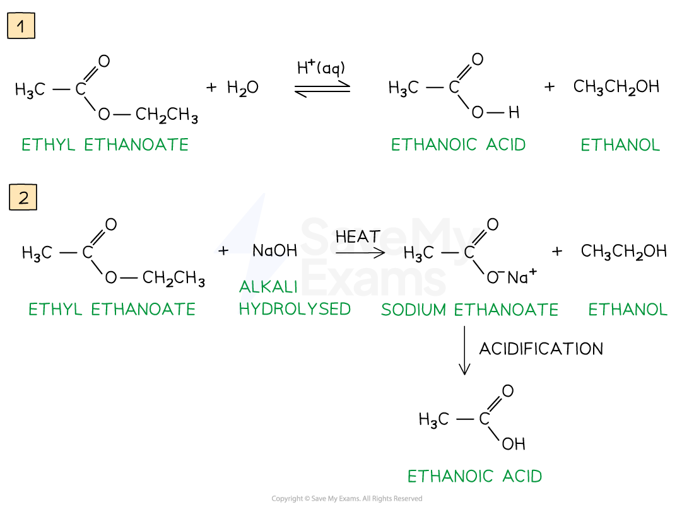
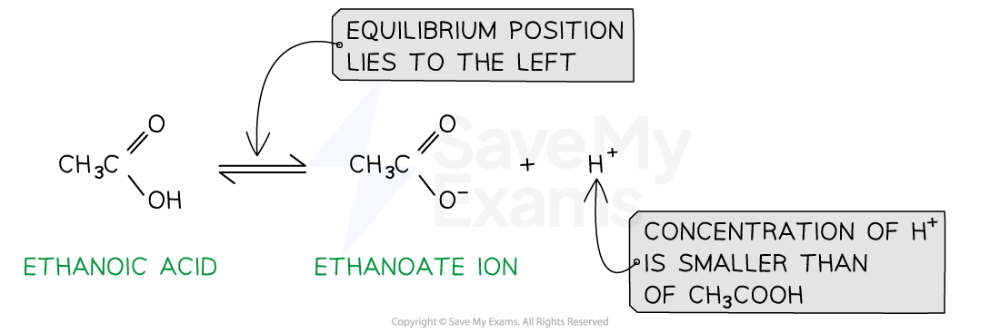
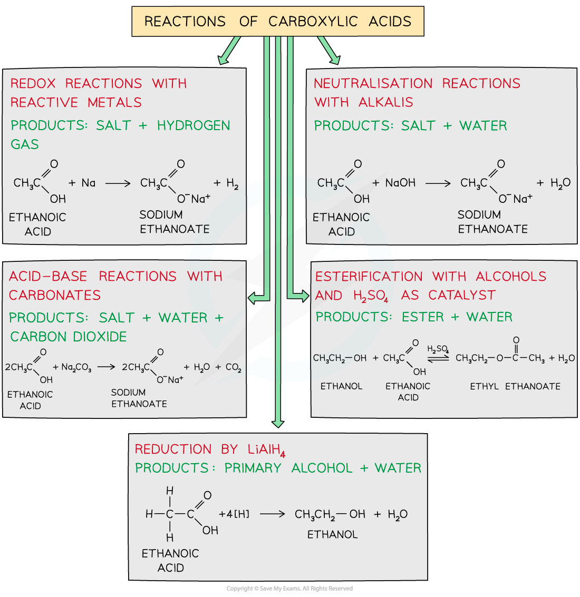

# Carboxylic Acids

## Production of Carboxylic Acids

> **Spec point** — `spcpt_6YfvHjjFc2k2CbQy`

## Production of Carboxylic Acids

- **Carboxylic acids **are compounds with a -COOH functional group
- They can be prepared by a series of different reactions

### Oxidation of primary alcohols & aldehydes

- Carboxylic acids can be formed from the **oxidation** of **primary alcohols **and **aldehydes **by either **acidified K****2****Cr****2****O****7**** **or **acidified KMnO****4**** **and **reflux**
- The oxidising agents themselves get reduced causing the solutions to change colour

  - In K2Cr2O7 the orange dichromate ions (Cr2O72-) are reduced to green Cr3+ ions
  - In KMnO4**  **the purple manganate ions (MnO4-) are reduced to colourless Mn2+ ions

#### Oxidation of primary alcohols and aldehydes

*Oxidation of primary alcohols (1) and aldehydes (2) gives carboxylic acids*

### Hydrolysis of nitriles

- Carboxylic acids can also be prepared from the **hydrolysis **of **nitriles** using either **dilute acid **or **dilute alkali followed by acidification**

  - Hydrolysis by dilute acid results in the formation of a carboxylic acid and ammonium salt
  - Hydrolysis by dilute alkali results in the formation of a sodium carboxylate salt and ammonia; Acidification is required to change the carboxylate ion into a carboxylic acid
- The -CN group at the end of the hydrocarbon chain is converted to a -COOH group

#### Hydrolysis of nitriles

*Hydrolysis of nitriles by either dilute acid (1) or dilute alkali and acidification (2) will form a carboxylic acid*

### Hydrolysis of esters

- Esters are formed from the condensation reaction between an alcohol and a carboxylic acid
- **Hydrolysis** of **esters** by **dilute acid **or **dilute alkali and heat followed by acidification **will reform the alcohol and the carboxylic acid

  - Hydrolysis by dilute acid is a **reversible reaction **where an equilibrium is established
  - Hydrolysis by dilute alkali is an **irreversible** **reaction** as all the ester is broken down to form a sodium carboxylate salt and an alcohol; acidification is required to change the carboxylate ion into a carboxylic acid

#### Hydrolysis of esters

*Hydrolysis of esters by either dilute acid (1) or dilute alkali and heat followed acidification (2) will form a carboxylic acid*

## Reactions of Carboxylic Acids

> **Spec point** — `spcpt_JfRPXN7DCM7b7FdC`

## Reactions of Carboxylic Acids

- **Carboxylic acids **are **weak acids **as they do not completely **dissociate** in water
- This means that the position of the equilibrium lies to the left and that the concentration of H+ is much smaller than the concentration of the carboxylic acid
- The solution has a pH value of less than 7

#### Example dissociation of a carboxylic acid

*Carboxylic acids are weak acids that do not fully dissociate in water, the position of the equilibrium lies to the left*

- **Carboxylic acids **are reactive compounds which can undergo many types of reactions including:

  - Redox reactions with reactive metals
  - Neutralisation reactions with alkali
  - Acid-base reactions with carbonates
  - Esterification with alcohols
  - Reduction by LiAlH4

#### Different reactions of carboxylic acids

*Carboxylic acids undergo a wide variety of reactions*
