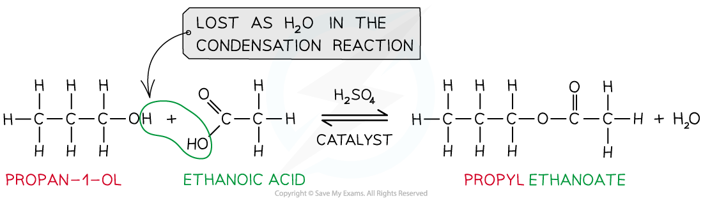
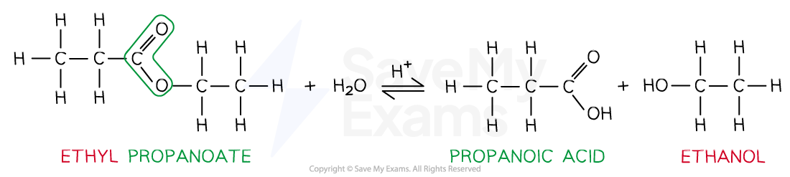
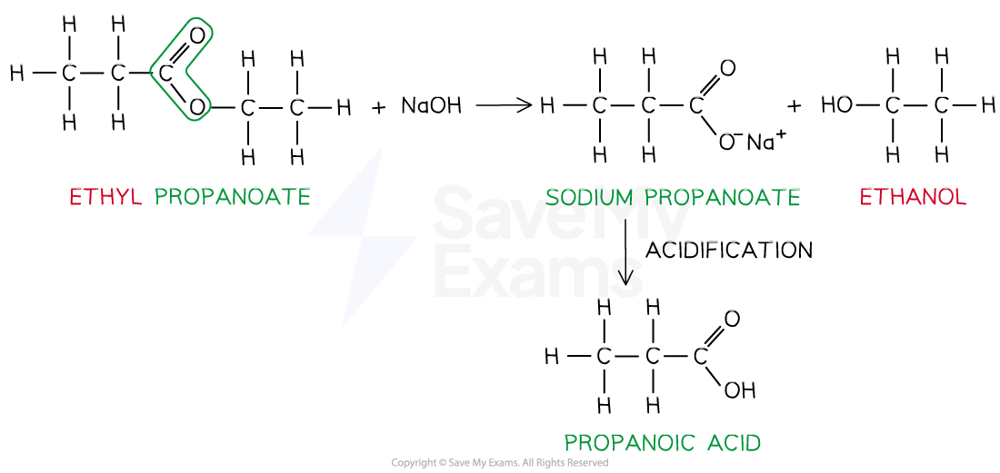

# Esters

## Production of Esters

> **Spec point** — `spcpt_qd7Tc37DJzJjRrmk`

## Production of Esters

- **Esters **are compounds with an -COOR functional group and are characterised by their **sweet** and **fruity** smells
- They are prepared from the **condensation **reaction between a **carboxylic acid **and **alcohol **with **concentrated H****2****SO****4**** **as **catalyst**

  - This is also called **esterification**
- The first part of the ester’s name comes from the alcohol and the second part of the name comes from the carboxylic acid

  - E.g. Propanol and ethanoic acid will give the ester propyl ethanoate

#### Example esterification reaction

*Esters are formed from the condensation reaction between carboxylic acids and alcohols*

## Hydrolysis of Esters

> **Spec point** — `spcpt_4DtZjfdMP642yhQs`

## Hydrolysis of Esters

- Esters can be **hydrolysed **to reform the carboxylic acid and alcohol by either **dilute acid **or **dilute alkali **and **heat**
- When an ester is **heated under reflux **with **dilute acid **(eg. sulfuric acid) an equilibrium mixture is established as the reaction is **reversible**

#### Example acid hydrolysis of an ester

*Ester hydrolysis by dilute acid is a reversible reaction forming carboxylic acid and alcohol*

- However, **heating **the ester **under reflux **with **dilute alkali** (eg. sodium hydroxide) is an **irreversible **reaction as the ester is fully hydrolysed
- This results in the formation of a **sodium** **carboxylate** salt which needs further **acidification** to turn into a **carboxylic** **acid**

  - The sodium carboxylate (-COO-) ion needs to get protonated by an acid (such as HCl) to form the carboxylic acid (-COOH)

#### Example alkaline hydrolysis of an ester

*Ester hydrolysis by dilute alkali is an irreversible reaction forming a sodium carboxylate salt and alcohol*
