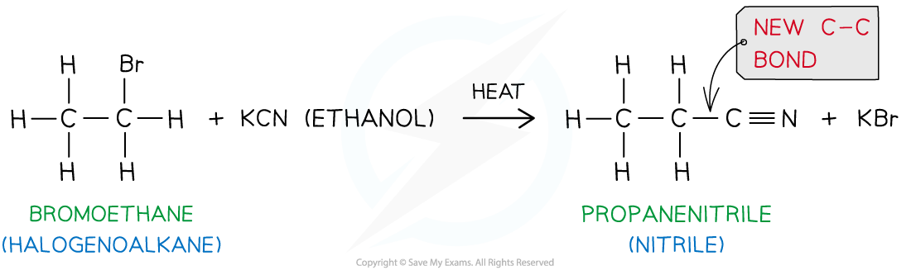
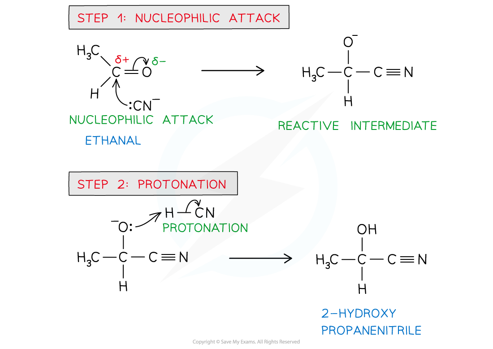

# Nitriles & Hydroxynitriles

## Production of Nitriles

> **Spec point** — `spcpt_XQ97pkXbbVSfgqZD`

## Production of Nitriles

- **Nitriles **are compounds with a -CN functional group
- They can be prepared from the **nucleophilic substitution **of halogenoalkanes

#### Propanenitrile, an example of a nitrile

*There are 2 alkyl type carbon atoms and the nitrile carbon for a total of 3 carbon atoms in propanenitrile*

### Reaction with KCN

- The **nucleophile** in this reaction is the **cyanide**, CN- ion
- **Ethanolic** **solution** of **potassium** **cyanide** (KCN in ethanol) is **heated** **under** **reflux** with the halogenoalkane
- The product is a **nitrile**

  - If an **aqueous** solution of potassium cyanide (KCN (aq)) is heated under reflux with the halogenoalkane, an alcohol can be formed instead of the nitrile

#### The reaction of bromoethane with ethanolic KCN

*Bromoethane reacts with ethanolic potassium cyanide when heated under reflux to form propanenitrile*

> **Exam Hint**
> The nucleophilic substitution of halogenoalkanes with KCN adds an **extra **carbon atom to the carbon chain
> 
> This reaction can therefore be used by chemists to make a compound with one more carbon atom than the best available organic starting material

## Production of Hydroxynitriles

> **Spec point** — `spcpt_Ytmx9DyG2jXQB5D6`

## Production of Hydroxynitriles

- **Hydroxynitriles **are compounds with both a hydroxy (-OH) and cyanide (-CN) functional group
- They can be prepared from the **nucleophilic addition **of **aldehydes **and **ketones**

#### 2-hydroxy-2-methylpropanenitrile, an example of a hydroxynitrile compound

*Hydroxynitriles contain an OH and a CN group, typically attached to the same carbon atom*

### Reaction with HCN

- The nucleophilic addition of hydrogen cyanide to carbonyl compounds is a two-step process
- In **step 1,** the cyanide ion attacks the carbonyl carbon to form a negatively charged intermediate
- In **step 2,** the negatively charged oxygen atom in the reactive intermediate quickly reacts with aqueous H+ (either from HCN, water or dilute acid) to form a 2-hydroxynitrile

#### Nucleophilic addition of HCN to carbonyl compounds

*The cyanide ion attacks the carbonyl carbon to form a negatively charged intermediate which quickly reacts with a proton to form a 2-hydroxynitrile compound*

> **Exam Hint**
> The actual negative charge on the cyanide ion is on the **carbon atom **and not on the **nitrogen atom**

## Hydrolysis of Nitriles

> **Spec point** — `spcpt_rnnkkqH8zPwjNSRH`

## Hydrolysis of Nitriles

- **Nitriles **are hydrolysed by either **dilute acid **or **dilute **alkali followed by **acidification **to give a carboxylic acid

  - Hydrolysis is the breakdown of a compound using water

### Hydrolysis of nitriles

- Nitriles are **hydrolysed by** either **dilute acid **or **dilute alkali followed by acidification**

  - Hydrolysis by dilute acid results in the formation of a carboxylic acid and ammonium salt
  - Hydrolysis by dilute alkali results in the formation of a sodium carboxylate salt and ammonia; **Acidification** is required to change the carboxylate ion into a carboxylic acid
- The -CN group at the end of the hydrocarbon chain is converted to a -COOH group

#### Hydrolysis of nitriles

*Hydrolysis of nitriles by either dilute acid (1) or dilute alkali and acidification (2) will form a carboxylic acid*

> **Exam Hint**
> Unlike the **formation** of nitriles which add an extra carbon atom to the carbon chain, **hydrolysis** doesn’t change the number of carbon atoms
