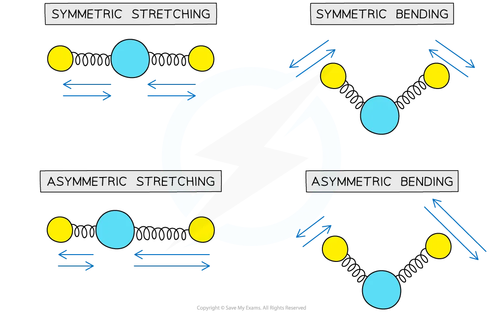

# Infrared Spectroscopy

## Interpreting Infrared Spectra

> **Spec point** — `spcpt_tgKS2RtYzPtRMytJ`

## Interpreting IR Spectra

- **Infrared (IR) spectroscopy** is a technique used to identify compounds

  - It works by measuring how covalent bonds in molecules absorb infrared radiation
  - This absorption causes the bonds to vibrate in specific ways
- A **spectrophotometer** irradiates the sample with infrared waves

  - Then, it detects how much radiation is absorbed at each frequency
  - The resulting spectrum shows which types of bonds are present

### Bond vibrations and absorption

- All **covalent bonds** behave like tiny **springs** rather than rigid bars
- Like springs, they can **vibrate in different ways**, such as stretching and bending

*Different modes of vibration in molecules. Each mode has a characteristic frequency of vibration*

- These vibrations occur at **specific frequencies** in the **infrared (IR)** region of the electromagnetic spectrum
- When IR radiation matches a bond’s natural frequency, the bond **absorbs energy** and vibrates more strongly
- Each **vibration mode** (e.g. symmetric stretch, bending) has its own **characteristic frequency**
- These absorbed frequencies are expressed as **wavenumbers** (cm⁻¹), which are the **reciprocal of wavelength**

### Absorption patterns and functional groups

- Each organic compound has a **unique IR spectrum**

  - Particularly in the region below 1500 cm⁻¹, known as the **fingerprint region**
- This region contains many small peaks caused by complex bond vibrations that are difficult to assign to specific groups
- However, comparing the fingerprint region to spectra from a database allows **exact identification** of a compound
- This is useful, for example, for identifying a particular isomer in a homologous series

  - They will all have the same functional groups but **different fingerprint regions**

*The superimposed spectra of propan-1-ol and propan-2-ol show the same bonds above 1500 cm-1 but different fingerprint regions*

- Each bond type absorbs within a **characteristic wavenumber range**
- Absorptions vary in **width** (broad or sharp) and **intensity** (strong or weak)
- For example:

  - O–H bonds in alcohols and carboxylic acids give **broad** peaks due to hydrogen bonding
  - C=O bonds in carbonyl compounds give **sharp**, strong peaks.
- Comparing an unknown IR spectrum with data for known compounds helps identify **functional groups**

#### Absorption range of bonds table

| **Bond** | **Functional groups containing the bond** | **Characteristic infrared absorption range (in wavenumbers) / cm****-1** |
|---|---|---|
| C-O | Hydroxy, ester | 1040 - 1300 |
| C=C | Aromatic compound, alkene | 1500 - 1680 |
| C=O | Amide  Carbonyl, carboxyl  Ester | 1640 - 1690  1670 - 1740  1710 - 1750 |
| C$\equiv$N | Nitrile | 2200 - 2250 |
| C–H | Alkane | 2850 - 2950 |
| N–H | Amine, amide | 3300 - 3500 |
| O–H | Carboxyl  Hydroxyl | 2500 - 3000  3200 - 3600 |

- Due to some absorption bands overlapping each other, other analytical techniques such as mass spectroscopy should be used alongside IR spectroscopy to identify an unknown compound

> **Worked Example**
> Look at the two infrared spectra below and determine which one corresponds to propanone and which one to propan-2-ol.
> 
> 
> 
> **Answer:**
> 
> - IR spectrum **A** is **propanone **and spectrum **B** is **propan-2-ol**.
> - In IR spectrum **A **the presence of a strong, sharp absorption around 1710 cm-1 corresponds to the characteristic C=O, carbonyl, group in a ketone.
> - In spectrum **B** the presence of a strong, broad absorption around 3200-3500 cm-1 suggests that there is an alcohol group present, which corresponds to the -OH group in propan-2-ol.
