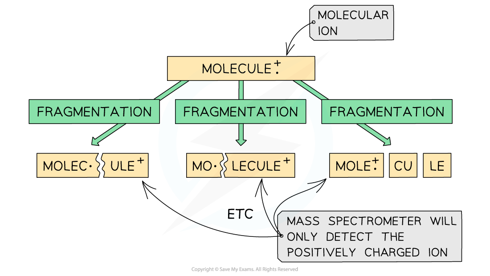

# Mass Spectrometry

## Interpreting Mass Spectra

> **Spec point** — `spcpt_6MsBdyQnRPtPSJW7`

## Interpreting Mass Spectra

- **Mass spectroscopy **is an analytical technique used to identify unknown compounds
- The molecules in the small sample are **bombarded** with high energy electrons which can cause the molecule to lose an electron
- This results in the formation of a positively charged **molecular** **ion** with one unpaired electron

  - One of the electrons in the pair has been **removed** by the beam of electrons

**MOLECULE **$\overset{\mathrm{Electron} \mathrm{bombardment}}{\rightarrow}$** MOLECULE****+****• + e****–**

- **MOLECULE****+****• **represents the molecular ion

- The molecular ion can further **fragment **to form new ions, molecules, and radicals

#### Fragmentation of a molecule in mass spectroscopy

*The same molecule can produce several different fragments in mass spectroscopy*

- These **fragmentation** ions are **accelerated **by an electric field
- Based on their mass (***m***) to charge (***e***) ratio, the fragments of ions are then separated by deflecting them into the **detector**

  - For example, an ion with mass 16 and charge 2+ will have a *m/e* value of 8
- The smaller and more positively charged fragment ions will be **detected** first as they will get **deflected** the most and are more attracted to the **negative** **pole** of the magnet
- Each fragment corresponds to a specific **peak** with a particular *m/e* value in the mass spectrum
- The **base peak **is the peak corresponding to the most **abundant** ion

### Isotopes

- Isotopes are different atoms of the **same** **element** that contain the same number of **protons** and **electrons** but a different number of **neutrons**.

  - These are atoms of the same **elements **but with different mass number
  - For example, Cl-35 and Cl-37 are isotopes as they are both atoms of the same element (chlorine, Cl) but have a different mass number (35 and 37 respectively)
- Mass spectroscopy can be used to find the **relative abundance **of the isotopes experimentally
- The **relative abundance **of an isotope is the proportion of one particular isotope in a mixture of isotopes found in nature

  - For example, the relative abundance of Cl-35 and Cl-37 is 75% and 25% respectively
  - This means that in nature, 75% of the chlorine atoms is the Cl-35 isotope and 25% is the Cl-37 isotope
- The **heights** of the peaks in mass spectroscopy show the proportion of each isotope present

#### Example mass spectrum of boron

*The peak heights show the relative abundance of the boron isotopes: boron-10 has a relative abundance of 19.9% and boron-11 has a relative abundance of 80.1%*

> **Worked Example**
> In a sample of iron, the ions 54Fe2+ and 56Fe3+ are detected.
> 
> Calculate the *m/e* value ratio and determine which ion is deflected more inside the spectrometer.
> 
> **Answer:**
> 
> - *m/e* (54Fe2+) =** **$\frac{54}{2}=27$
> - *m/e* (56Fe3+) =** **$\frac{56}{3}=18.7\,=19$

> **Exam Hint**
> A small *m/e* value corresponds to fragments that are either **small **or have a **high positive charge **or a combination of **both**
