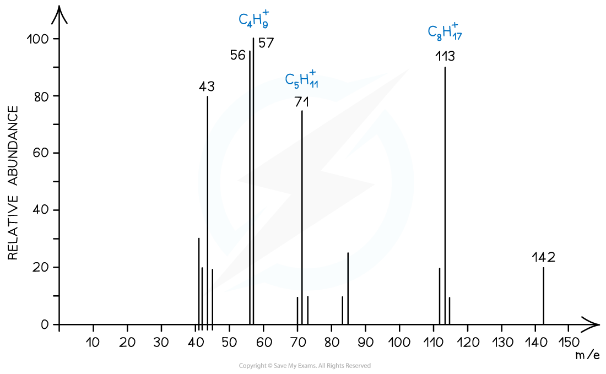
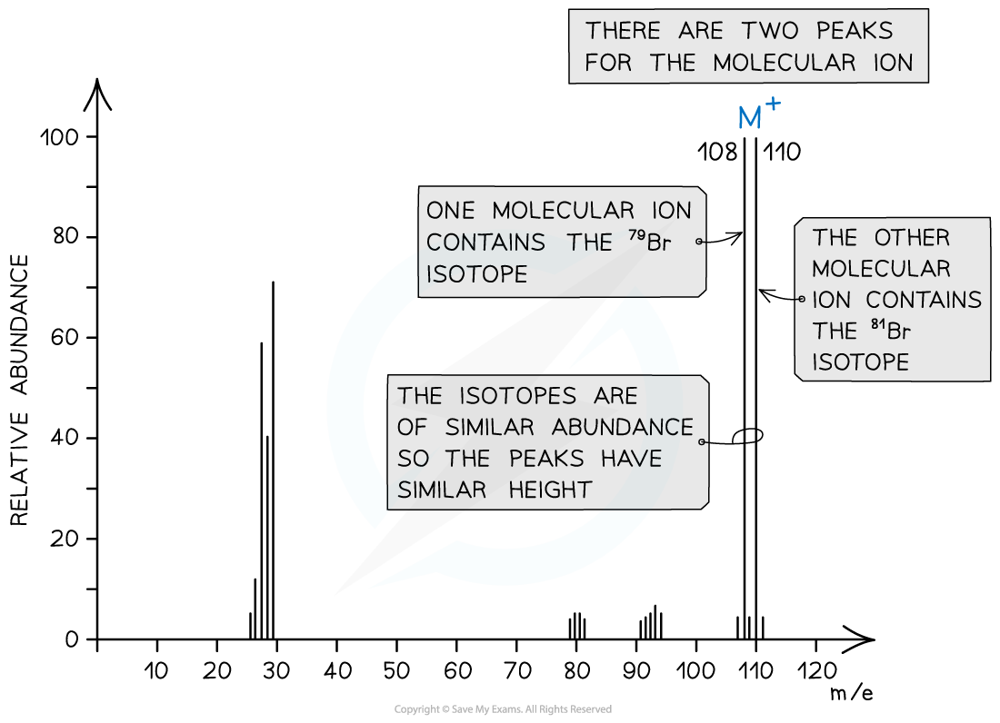
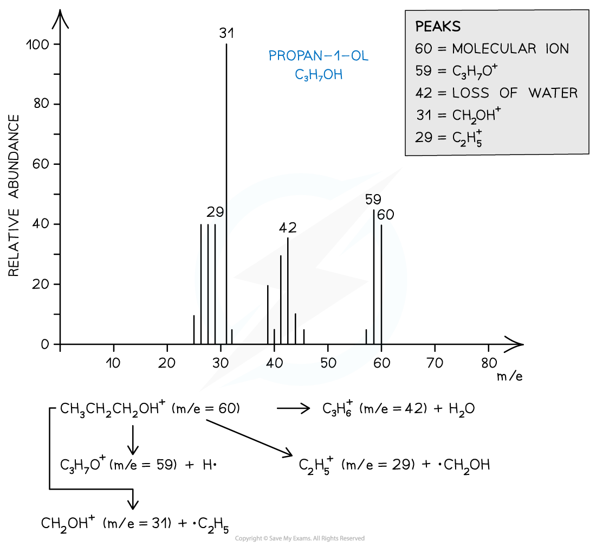

# Molecular Ion Peak & Fragmentation

## Mass Spectrometry: Deducing Molecular Formula

> **Spec point** — `spcpt_vDvxQ62H6Hs4cSz4`

## Mass Spectrometry: Deducing Molecular Formula

- Each **peak** in the mass spectrum corresponds to a certain **fragment** with a particular ***m/e***** **value
- The peak with the highest ***m/e***** **value is the molecular ion (**M****+**) peak which gives information about the **molecular** **mass** of the compound
- The molecular ion is the entire molecule that has lost one electron when bombarded with a beam of electrons

**MOLECULE  **$\overset{\mathrm{Electron} \mathrm{bombardment}}{\rightarrow}$**MOLECULE****+****• + e****–**

- The **[M+1] **peak is a smaller peak which is due to the natural abundance of the isotope carbon-13
- The height of the [M+1] peak for a particular ion depends on how many carbon atoms are present in that molecule; the more carbon atoms, the larger the [M+1] peak is

  - For example, the height of the [M+1] peak for an hexane (containing six carbon atoms) ion will be greater than the height of the [M+1] peak of an ethane (containing two carbon atoms) ion

> **Worked Example**
> Determine whether the following mass spectrum corresponds to propanal or butanal.
> 
> 
> 
> **Answer:**
> 
> - The mass spectrum corresponds to propanal as the molecular ion peak is at *m/e* = 58
> - Propanal arises from the CH3CH2CHO+ ion which has a molecular mass of 58
> - Butanal arises from the CH3CH2CH2CHO+ ion which has a molecular mass of 72

## Identifying Molecules using Fragmentation

> **Spec point** — `spcpt_yvtTnSvdhCFZfhBr`

## Identifying Molecules using Fragmentation

- The molecular ion peak can be used to identify the **molecular mass** of a compound
- However, different compounds may have the same molecular mass
- To further determine the structure of the unknown compound, **fragmentation **is used
- Fragments may appear due to the formation of **characteristic** **fragments** or the **loss** **of** **small** **molecules**

  - For example, a peak at 29 is due to the characteristic fragment C2H5+­­
  - Loss of small molecules gives rise to peaks at 18 (H2O), 28 (CO), and 44 (CO2)

### Alkanes

- Simple alkanes are fragmented in mass spectroscopy by breaking the C-C bonds
- ***M/e ***values of some of the common alkane fragments are given in the table below

#### m/e values of fragments table

| **Fragment** | **m/e** |
|---|---|
| CH3+ | 15 |
| C2H5+ | 29 |
| C3H7+ | 43 |
| C4H9+ | 57 |
| C5H11+ | 71 |
| C6H13+ | 85 |

#### Mass spectrum showing fragmentation of alkanes

*Straight chain alkanes show characteristic peaks *

### Halogenoalkanes

- Halogenoalkanes often have multiple peaks around the molecular ion peak
- This is caused by the fact that there are different isotopes of the halogens

#### Mass spectrum for a bromine containing species

*Mass spectra show different halogen isotopes in the molecular ion*

### Alcohols

- Alcohols often tend to lose a **water molecule **giving rise to a peak at **18 below the molecular ion**
- Another common peak is found at *m/e* value 31 which corresponds to the CH2OH+­­ fragment
- For example, the mass spectrum of propan-1-ol shows that the compound has fragmented in four different ways:

  - Loss of H• to form a C3H7O+ fragment with *m/e* = 59
  - Loss of a water molecule to form a C3H6+ fragment with *m/e* = 42
  - Loss of a •C2H5 to form a CH2OH+ fragment with *m/e* = 31
  - And the loss of •CH2OH to form a C2H5+ fragment with *m/e* = 29

#### Mass spectrum of propan-1-ol

*Mass spectrum showing the fragmentation patterns in propan-1-ol (alcohol)*

> **Worked Example**
> Which of the following statements about the mass spectrum of CH3Br is correct?
> 
> 1. There is one peak for the molecular ion with an m/e value of 44
> 2. There is one peak for the molecular ion with an m/e value of 95
> 3. The last two peaks have abundances in the ratio 3:1 and occur at m/e values of 94 and 96
> 4. The last two peaks are of equal size and occur at m/e values of 94 and 96
> 
> **Answer:**
> 
> - The correct answer is **D** as bromomethane (CH3Br) will fragment into 3 peaks
> 
>   - CH381Br → [CH381Br]+ + e− at m/e 96
>   - CH379Br → [CH379Br]+ + e− at m/e 94
>   - CH3Br → [CH3]+ + •Br at m/e 15
> - The last two peaks (which correspond to the molecular ion peak) therefore are equal in size and occur at *m/e* values of 94 and 96
> 
> 

> **Worked Example**
> Which alcohol is not likely to have a fragment ion at *m/e* at 43 in its mass spectrum?
> 
> 1. (CH3)2CHCH2OH
> 2. CH3CH(OH)CH2CH2CH3
> 3. CH3CH2CH2CH2OH
> 4. CH3CH2CH(OH)CH3
> 
> **Answer:**
> 
> - The correct answer is **D** because a line at *m/e* = 43 corresponds to an ion with a mass of 43 for example:
> 
>   - [CH3CH2CH2]+
>   - [(CH3)2CH]+
> - 2-butanol is not likely to have a fragment at *m/e* = 43 as it does not have either of these fragments in its structure
