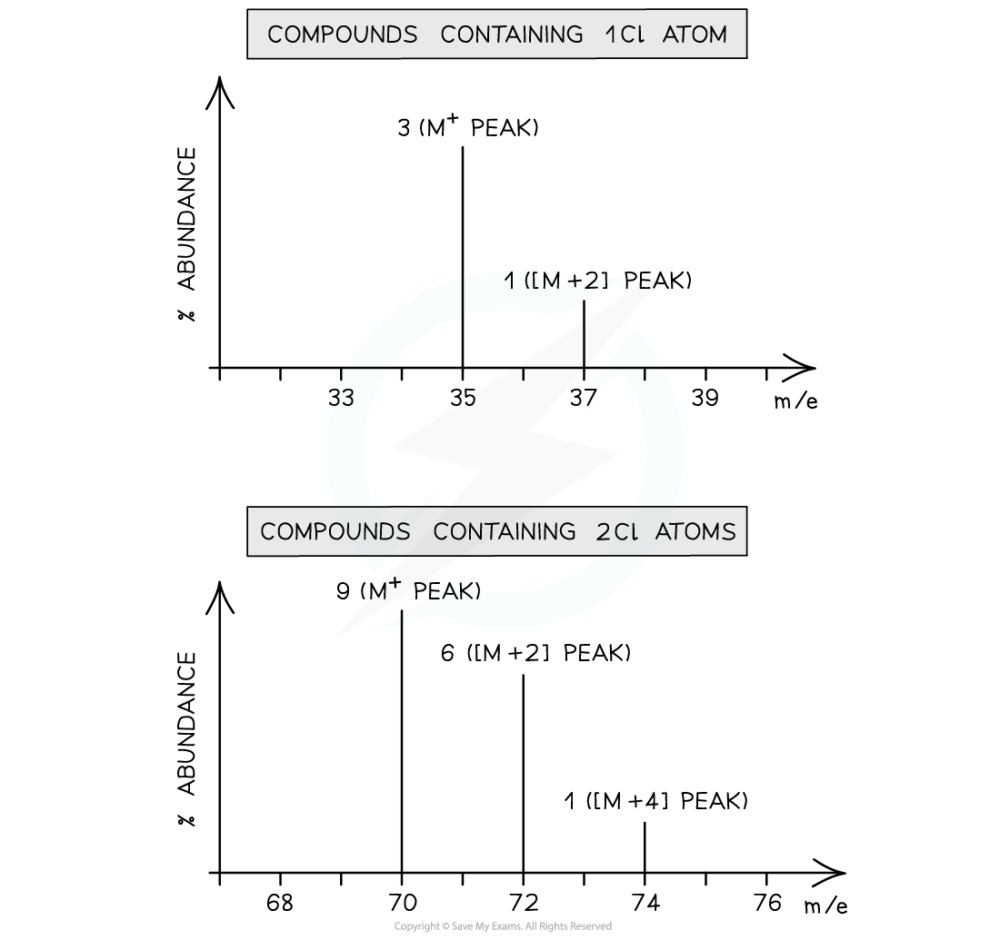
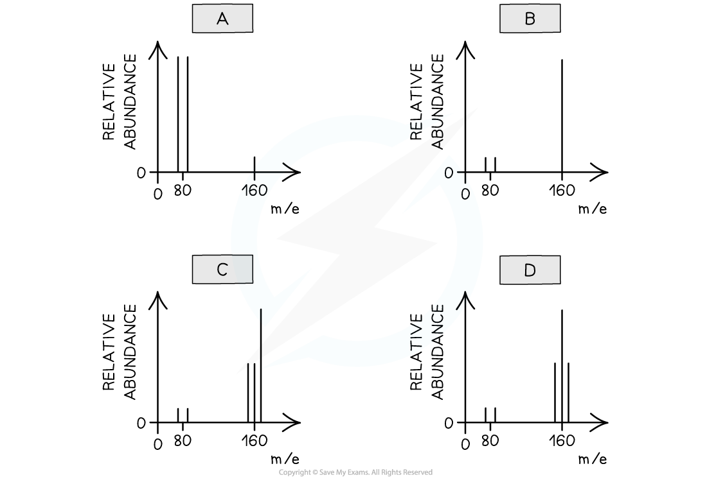

# The M+1 & M+2 Peaks

## Determine Number of Carbon Atoms Using M+1 Peak

> **Spec point** — `spcpt_YrYDsWrSzvMs3n9H`

## Determine Number of Carbon Atoms Using M+1 Peak

- The **[M+1] **peak is caused by the presence of the carbon-13 (13C) isotope in the molecule
- Carbon-13 makes up approximately 1.1% of all carbon atoms
- Therefore, the [M+1] peak is much smaller than the M peak as the isotope is less common

  - The ratio of 13C to 12C is approximately 1:99
- Thus, the greater the number of carbon atoms present in a molecule the greater the height of the [M+1] peak
- The number of carbon atoms, **n**, in a compound can be deduced using the [M+1] peak and the following formula:

  - $\mathrm{n} = \frac{100 \times \text{abundance} of [ \mathrm{M} + 1 ] }{1.1 \times \text{abundace} of \mathrm{M} ^{ + } ion}$

> **Worked Example**
> Determine the number of carbon atoms of compound **X** with the following mass spectrum:
> 
> 
> 
> **Answer:**
> 
> - The M+ ion peak is at *m/e* 58 with a relative abundance of around 85
> - The [M+1] peak is at *m/e* 59 with a relative abundance of 3
> - Therefore, the number of carbon atoms (n) is:
> 
>   - $n=\frac{100\times3}{1.1\times85}=3.21$
> - There are therefore 3 carbon atoms present in compound **X**

## Detecting Bromine & Chlorine Atoms Using M+2 Peak

> **Spec point** — `spcpt_DpGRDmhkgcmVqWnd`

## Detecting Bromine & Chlorine Atoms Using M+2 Peak

- The presence of bromine or chlorine atoms in a compound gives rise to a **[M+2] **and possibly** [M+4] **peak

### Chlorine

- Chlorine exists as two isotopes, 35Cl and 37Cl
- A compound containing **one **chlorine atom will therefore have two molecular ion peaks due to the two different isotopes it can contain

  - 35Cl = **M****+**** **peak
  - 37Cl = **[M+2] **peak
  - The ratio of the peak heights is 3:1 (as the relative abundance of 35Cl is 3x greater than that of 37Cl)
- A compound containing **two **chlorine atoms will have three molecular ion peaks due to the different combinations of chlorine isotopes they can contain

  - 35Cl + 35Cl = **M****+**** **peak
  - 35Cl + 37Cl = **[M+2] **peak
  - 37Cl + 37Cl = **[M+4]** peak
  - The ratio of the peak heights is **9:6:1**

#### Mass spectra of chlorine containing compounds

*Mass spectrum of compounds containing one chlorine atom (1) and two chlorine atoms (2)*

### Bromine

- Bromine too exists as two isotopes, 79Br and 81Br
- A compound containing **one **bromine atom will have two molecular ion peaks

  - 79Br = **M****+**** ** peak
  - 81Br = **[M+2] **peak
  - The ratio of the peak heights is 1:1 (they are of **similar **heights as their relative abundance is the same!)
- A compound containing **two **bromine atoms will have three molecular ion peaks

  - 79Br + 79Br= **M****+**** **peak
  - 79Br+ 81Br = **[M+2] **peak
  - 81Br + 81Br= **[M+4]** peak
  - The ratio of the peak heights is **1:2:1**

#### Mass spectra of bromine containing compounds

*Mass spectra of four bromine-containing compounds (A–D), illustrating characteristic patterns due to the presence of two isotopes:  79 Br 79  Br and  81 Br 81  Br. Each spectrum shows distinctive peak groupings depending on the number of bromine atoms in the molecule.*

> **Worked Example**
> Two stable isotope of bromine have relative masses of 79 and 81
> 
> Which is the correct pattern of peaks in the mass spectrum of molecular bromine?
> 
> 
> 
> **Answer:**
> 
> - The correct answer is **D**
> - Bromine is a diatomic molecule there will be 5 peaks on the mass spectrum of bromine
> - Bromine consists of molecules, not individual atoms
> - When bromine is passed through the mass spectrometer, an electron is given off to give the **molecular ion, Br****2****+**
> - Some of these will fragment to make Br + Br+
> 
>   - Br2+ → Br + Br+
> - The Br atom passes through the machine, and the Br+ ions will give lines at 79 and 81
> - There will also be a line for the unfragmented Br2+ ion
> - This will give 3 molecular ion peaks
> 
>   - Br2+ ion containing the isotopes 79 + 79 = 158
>   - Br2+ containing the isotopes 79 + 81 = 160
>   - Br2+ containing the isotopes 81 + 81 = 162
