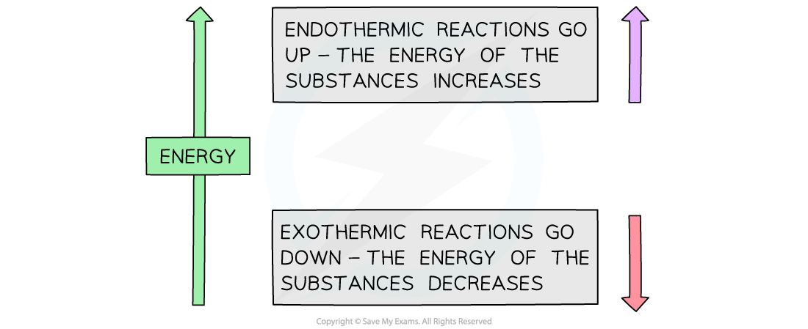
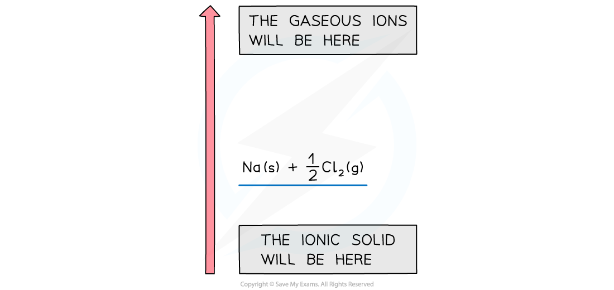
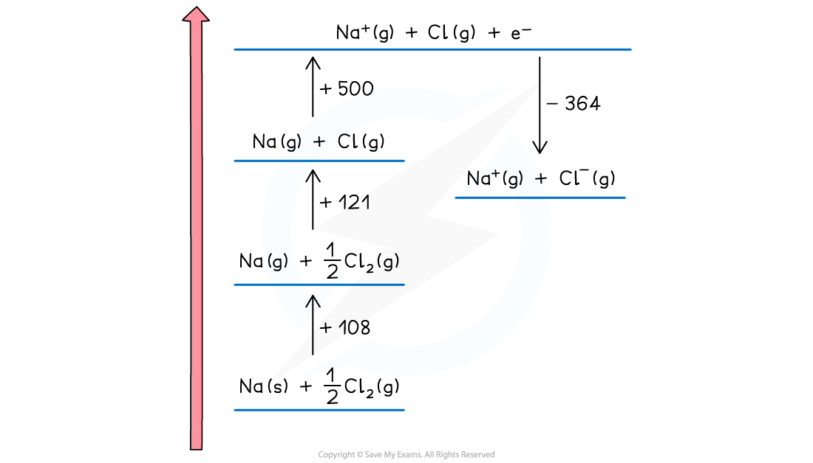
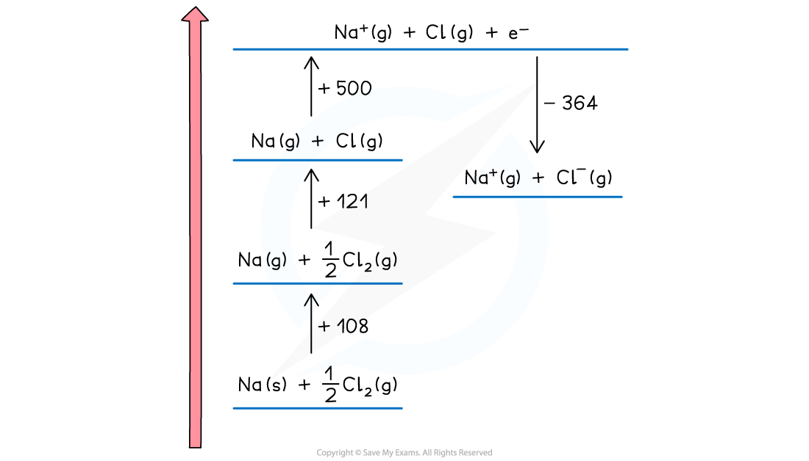
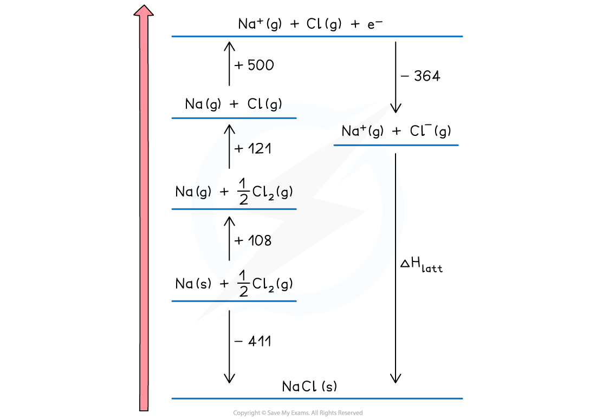

# Constructing Born-Haber Cycles

## Constructing Born-Haber Cycles

> **Spec point** — `spcpt_Z3wNfBSPr5NfYZkB`

## Constructing Born-Haber Cycles

- A **Born-Haber cycle** is a specific application of ***Hess's Law*** for ionic compounds and enable us to calculate lattice enthalpy which cannot be found by experiment
- The basic principle of drawing the cycle is to construct a diagram in which energy increases going up the diagram

#### The basic principle of a Born-Haber cycle

*The direction of the arrows in Born-Haber cycles indicates if a reaction is exothermic or endothermic*

- The cycle shows all the steps needed to turn atoms into gaseous ions and from gaseous ions into the ionic lattice
- The alternative route to the ionic lattice begins from the enthalpy of formation of the elements in their standard states

### Drawing the cycle for sodium chloride

- A good starting point is to draw the elements with their state symbols about a third of the way up the diagram
- This is shown as the left-hand side of the equation for the process indicated
- The location is marked by drawing a horizontal bar or line which represents the starting energy level

#### Drawing a Born-Haber cycle step 1

- Next, we need to create the gaseous ions
- This is a two-step process of first creating the gaseous atoms and then turning them into ions
- Creating gaseous atoms is a bond-breaking process, so arrows must be drawn upwards
- It doesn't matter whether you start with sodium or chlorine
- The enthalpy of atomisation of sodium is

**Na (s) → Na (g)           Δ*****H******at*****θ**** = +108 kJ mol**** -1**

- The enthalpy of atomisation of chlorine is

**½Cl****2**** (g) → Cl (g)       Δ*****H******at*****θ ****= +121 kJ mol**** -1**

- We can show the products of the process on the horizontal lines and the energy value against a vertical arrow connecting the energy levels

#### Drawing a Born-Haber cycle step 2 - creating the gaseous atoms

- Now the ions are created
- The sodium ion loses an electron, so this energy change is the first ionisation energy for sodium

**Na (g) → Na****+**** (g) + e****–****          Δ*****H******ie*****θ ****= +500 kJ mol****-1**

- The change is endothermic so the direction continues upwards
- The chlorine atom gains an electron, so this is electron affinity

**Cl (g) + e****–**** → Cl****-**** (g)           Δ*****H******ea*****θ ****= -364 kJ mol****-1**

- The exothermic change means this is downwards
- The change is displaced to the right to make the diagram easier to read

#### Drawing a Born-Haber cycle step 3 - creating the gaseous ions

- The two remaining parts of the cycle can now be completed
- The enthalpy of formation of sodium chloride is added at the bottom of the diagram

**Na(s) + ½Cl****2 ****(g) → NaCl (s)            Δ*****H******f*****θ**** = -411 kJ mol**** -1**

- This is an exothermic change for sodium chloride so the arrow points downwards
- Enthalpy of formation can be exothermic or endothermic, so you may need to show it above the elements ( and displaced to the right) for a endothermic change
- The final change is lattice enthalpy, which is usually shown a formation. For sodium chloride the equation is

**Na****+****(g) + Cl****-****(g) → NaCl (s)  Δ*****H******latt******θ**** *

#### Drawing a Born-Haber cycle step 4 - completing the cycle

- The cycle is now complete
- The cycle is usually used to calculate the lattice enthalpy of an ionic solid, but can be used to find other enthalpy changes if you are given the lattice enthalpy

> **Worked Example**
> Construct a Born-Haber Cycle which can be used to calculate the lattice energy of potassium chloride.
> 
> | **Step** | **Equation** | **Enthalpy Change** |
> |---|---|---|
> | Convert K (s) atoms into K (g) atoms | K (s) → K (g) | Δ*H*atθ |
> | Convert K (g) atoms into K+ (g) ions | K (g) → K+ (g) | *IE*1 |
> | Convert Cl2 (g) molecules into Cl (g) atoms | ½Cl2 (g) → Cl (g) | Δ*H*atθ |
> | Convert Cl (g) atoms into Cl– (g) ions | Cl (g) + e– → Cl– (g) | *EA*1 |
> | Add up all values to get Δ*H*1θ |   | Δ*H*1θ |
> | Apply Hess's Law to find Δ*H**latt*θ |   | Δ*H**latt*θ |
> 
> **Answer:**
> 
> 

> **Worked Example**
> Construct a Born-Haber Cycle which can be used to calculate the lattice energy of magnesium oxide.
> 
> | **Step** | **Equation** | **Enthalpy Change** |
> |---|---|---|
> | Convert Mg (s) atoms into Mg (g) atoms | Mg (s) → Mg (g) | Δ*H*atθ |
> | Convert Mg (g) atoms into Mg+ (g) ions | Mg (g) → Mg+ + e– (g) | *IE*1 |
> | Convert Mg+ (g) atoms into Mg2+ (g) ions | Mg+ (g) → Mg2+ + e– (g) | *IE*2 |
> | Convert O2 (g) molecules into O (g) atoms | ½O (g) → O (g) | Δ*H*atθ |
> | Convert O (g) atoms into O– (g) ions | O (g) + e– → O– (g) | *EA*1 |
> | Convert O– (g) atoms into O2– (g) ions | O– (g) + e– → O2– (g) | *EA*2 |
> | Add up all values to get Δ*H*1θ |   | Δ*H*1θ |
> | Apply Hess's Law to find Δ*H**latt*θ |   | Δ*H**latt*θ |
> 
> **Answer:**
> 
> 
