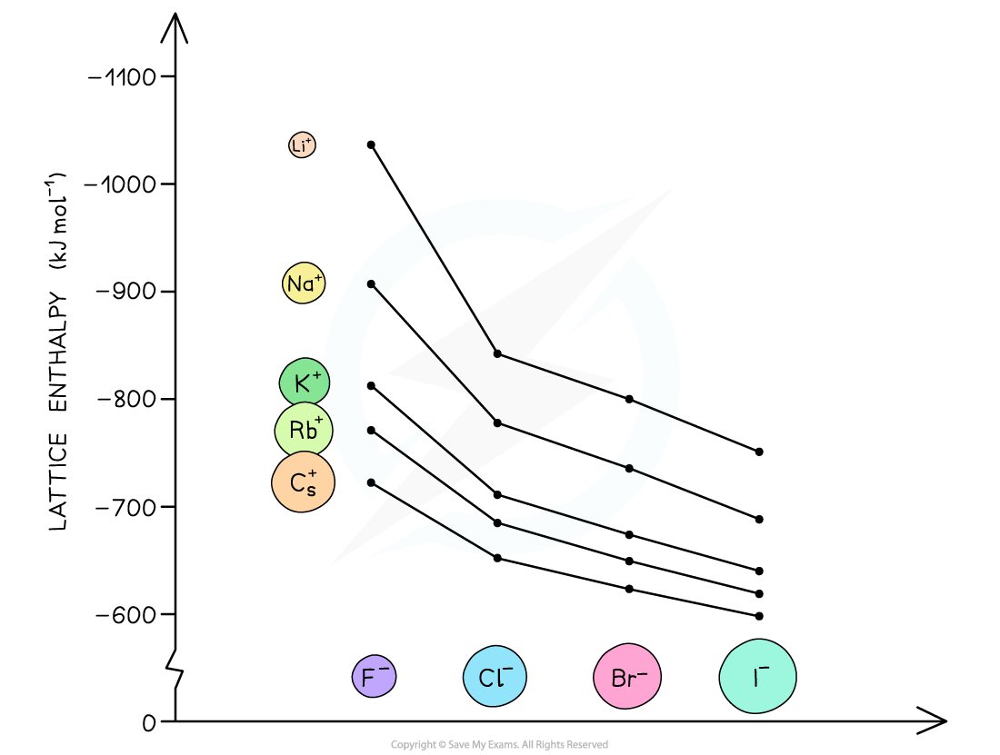

# Factors Affecting Lattice Energy

## Lattice Energy: Ionic Charge & Radius

> **Spec point** — `spcpt_89JCGbqQYkZ6dyRt`

## Lattice Energy: Ionic Charge & Radius

- The two key factors which affect lattice energy, Δ*H**latt*ꝋ, are the **charge **and **radius **of the ions that make up the **crystalline lattice**

### Ionic radius

- The lattice energy becomes **less exothermic** (numerically less negative) as the **ionic radius increases**

  - In larger ions, the **charge is spread over a greater volume**, so **charge density is lower**
  - The ions are also **further apart** in the lattice, increasing the distance between their centres
  - As a result, the **electrostatic attraction between oppositely charged ions is weaker**, and less energy is released when the lattice forms
- For example:

  - Both CsF and KF contain F⁻ ions
  - Cs⁺ is larger than K⁺, so the lattice energy of CsF is **less exothermic** than that of KF

#### Trends in the lattice energy of different metal halides

*The lattice energies get less exothermic as the ionic radius of the ions increases*

### Ionic charge

The lattice energy becomes **more exothermic** (more negative) as the **ionic charge increases**.

- Higher ionic charge leads to **higher charge density**
- This results in **stronger electrostatic attractions** between oppositely charged ions
- Consequently, **more energy is released** when the lattice is formed
- For example:

  - CaO is composed of Ca²⁺ and O²⁻ ions, while KCl contains K⁺ and Cl⁻ ions
  - The ions in CaO have **higher charges**, so the electrostatic forces are stronger
  - Therefore, the lattice energy of CaO is **more exothermic** than that of KCl
  - Additionally, Ca²⁺ and O²⁻ ions are smaller than K⁺ and Cl⁻, further increasing the exothermic value
