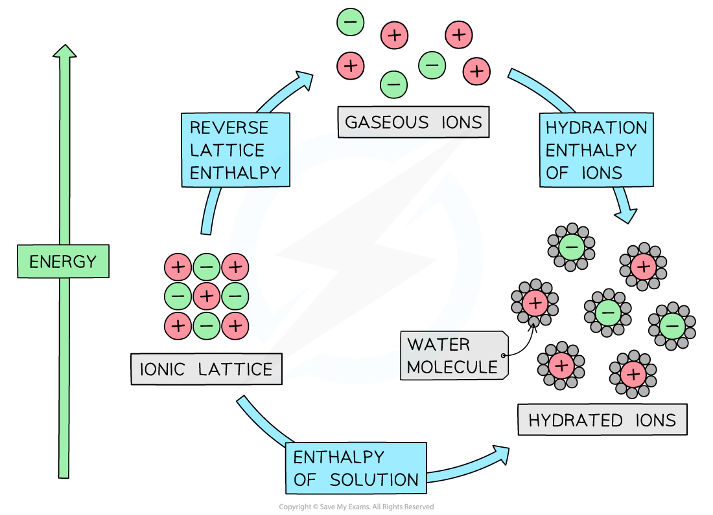

# Constructing Energy Cycles

## Energy Cycle Using Enthalpy Changes & Lattice Energy

> **Spec point** — `spcpt_WmYZtcYYX3SNC8x6`

## Energy Cycle Using Enthalpy Changes & Lattice Energy

- The standard enthalpy change of hydration (Δ*H**hyd*θ) can be calculated by constructing **energy cycles **and applying Hess’s law

#### Example energy cycle

*Energy cycle involving enthalpy change of solution, lattice energy, and enthalpy change of hydration*

- The energy cycle shows that there are two routes to go from the ionic lattice to the hydrated ions in an aqueous solution:

  - **Route 1**: going from ionic solid → ions in aqueous solution (this is the **direct route**)

**Δ*****H******sol*****θ** **= enthalpy of solution**

- **Route 2**: going from ionic lattice →  gaseous ions  →  ions in aqueous solution (this is the** indirect route**)

**-Δ*****H******latt*****θ**** + Δ*****H******hyd*****θ ****= reverse lattice enthalpy + hydration enthalpies of each ion**

- Lattice enthalpy usually means Lattice *formation* enthalpy, in other words bond forming

  - If we are breaking the lattice then this is reversing the enthalpy change so a negative sign is added in front of the term (alternatively it is called lattice *dissociation* enthalpy)
- According to **Hess’s law,** the enthalpy change for both routes is the same, such that:

**Δ*****H******sol*****θ ****= -Δ*****H******latt*****θ**** + Δ*****H******hyd*****θ**

**Δ*****H******hyd*****θ ****= Δ*****H******sol*****θ** **+ Δ*****H******latt*****θ**** **

- Each ion will have its own enthalpy change of hydration, Δ*H**hyd*θ, which will need to be taken into account during calculations

  - The total Δ*H**hyd*θ is found by adding the  Δ*H**hyd*θ values of both anions and cations together

> **Worked Example**
> Construct an energy cycle and energy level diagram to calculate the Δ*H**hyd*θ** **of the chloride ion in KCl.
> 
> **Answer:**
> 
> - Energy cycle:
> 
> 
> 
> - Energy level diagram:
> 
> 
> 
> 

> **Worked Example**
> Construct an energy cycle and energy level diagram to calculate the Δ*H*hydθ of magnesium ions in magnesium chloride.
> 
> **Answer:**
> 
> - Energy cycle:
> 
> 
> 
> - Energy level diagram:
> 
> 
