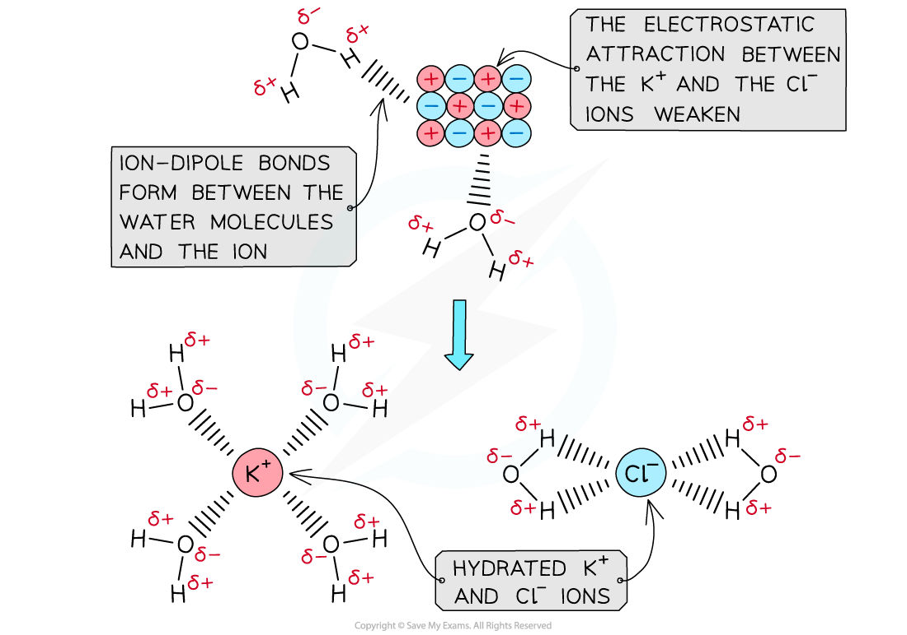

# Enthalpies of Solution & Hydration

## Enthalpy Change of Hydration & Solution

> **Spec point** — `spcpt_7m3szDrWFP2SZ2tK`

## Enthalpy Change of Hydration & Solution

### Enthalpy change of solution

- The **standard enthalpy change of solution (Δ*****H******sol*****θ****) **is the enthalpy change when **1 mole** of an ionic substance **dissolves** in sufficient water to form a **very dilute solution** under standard conditions
- The symbol **(aq) **is used to show that the solid is dissolved in **sufficient water**

  - For example, the enthalpy changes of solution for potassium chloride are described by the following equations:

**KCl (s) + aq → KCl (aq)**

**OR**

**KCl (s) + aq → K****+**** (aq) + Cl****– ****(aq)**

- Δ*H**sol*θ can be **exothermic **(negative) or **endothermic **(positive)

### Enthalpy change of hydration

- The lattice energy (**Δ*****H******latt*****θ**) of KCl is -711 kJ mol**-**1

  - This means that 711 kJ mol**-1** is **released **when the KCl ionic lattice is **formed**
  - Therefore, to **break **the attractive forces between the K**+** and Cl**-** ions, +711 kJ mol**-**1 is needed
- However, the **Δ*****H******sol*****θ** of KCl is +26 kJ mol**-**1
- This means that another +685 kJ mol**-**1** **(711 - 26) is required to break the KCl lattice
- This is **compensated **for by the **standard enthalpy change of hydration **(**Δ*****H******hyd*****θ**)

  - The **standard enthalpy change of hydration (Δ*****H******hyd*****θ****) **is the enthalpy change when **1 mole** of a specified **gaseous ion dissolves** in sufficient water to form a very dilute **solution** under standard conditions

**Mg****2+****(g) + aq → Mg****2+****(aq)**

- Hydration enthalpies are the measure of the energy that is released when there is an attraction formed between the ions and water molecules

  - Hydration enthalpies are **exothermic**

#### Ion–Dipole interactions during dissolution

- When an **ionic solid dissolves in water**, it breaks into **positive and negative ions**
- Water is a **polar molecule**, with a δ⁻ oxygen atom and δ⁺ hydrogen atoms
- The **oxygen atom** is attracted to **positive ions (cations)**
- The **hydrogen atoms** are attracted to **negative ions (anions)**
- These attractions form **ion–dipole bonds** between the water molecules and the ions

#### Interactions of polar water molecules and other ions in solution

*The polar water molecules will form ion-dipole bonds with the ions in solution (a) causing the ions to become hydrated (b)*
