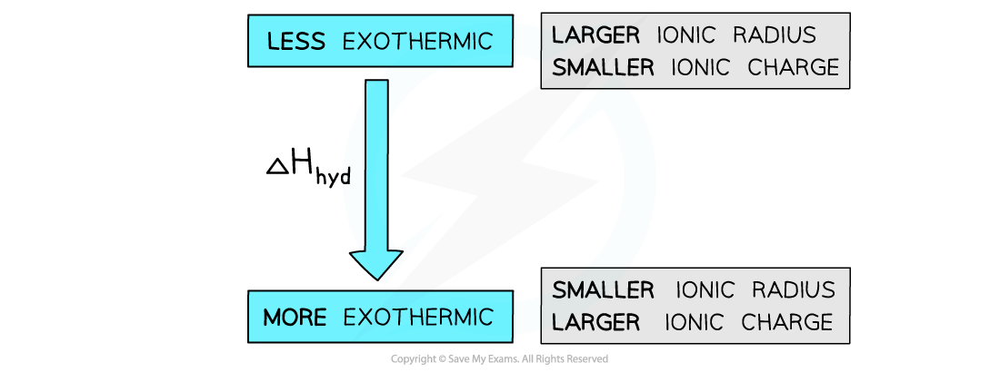

# Factors Affecting Enthalpy of Hydration

## Enthalpy of Hydration: Ionic Charge & Radius

> **Spec point** — `spcpt_ysSdxYn8jvXccKdS`

## Enthalpy of Hydration: Ionic Charge & Radius

- The standard enthalpy change of hydration (Δ*H**hyd*θ) is affected by the amount that the ions are attracted to the water molecules
- The factors which affect this attraction are the **ionic charge **and **radius**

### Ionic radius

- The standard enthalpy change of hydration ( Δ*H**hyd*θ) becomes **more exothermic** (more negative) as the **ionic radius decreases**
- Smaller ions have a **higher charge density**, resulting in stronger **ion–dipole attractions** with water molecules
- Therefore, **more energy is released** when these ions are hydrated
- **For example:**

  - Mg²⁺ in MgSO4 is smaller than Ba²⁺ in BaSO4
  - As a result,  Δ*H**hyd*θ** of MgSO****4**** is more exothermic** than that of BaSO4

### Ionic charge

- The enthalpy of hydration becomes **more exothermic** as the **ionic charge increases**
- Higher charge leads to a **greater charge density**, strengthening ion–dipole attractions with water molecules
- This means **more energy is released** during hydration
- **For example:**

  - Ca²⁺ and O²⁻ in CaO have higher charges than K⁺ and Cl⁻ in KCl
  - Therefore, **ΔH***hyd*θ** of CaO is more exothermic** than that of KCl

#### Comparing enthalpies of hydration

*The enthalpy of hydration is more exothermic for smaller ions and ions with a greater ionic charge*
