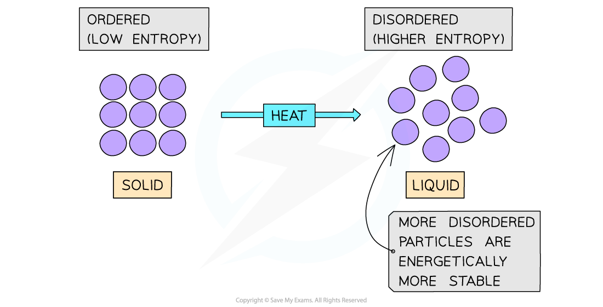
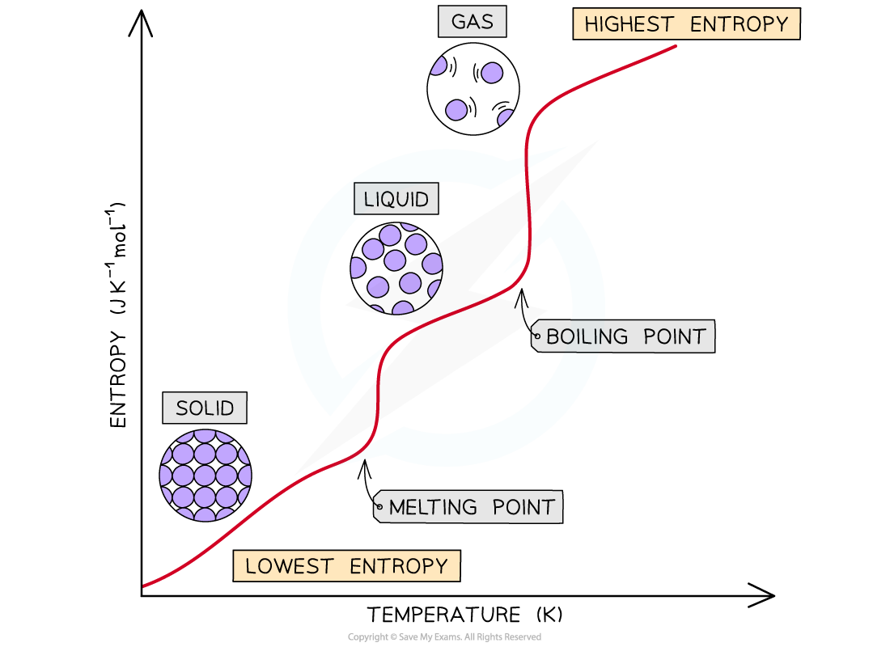
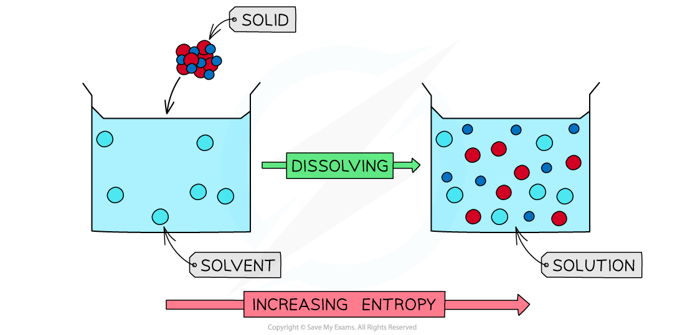

# Entropy & Entropy Change

## Defining Entropy

> **Spec point** — `spcpt_2bdCnmX39NwgH4bK`

## Defining Entropy

- The **entropy (*****S*****) **of a given system is the number of possible arrangements of the particles and their energy in a given system

  - In other words, it is a measure of how **disordered** a system is
- When a system becomes **more disordered**, its entropy will **increase**
- An increase in entropy means that the system becomes **energetically more stable**

#### Examples

- Thermal decomposition of calcium carbonate

**CaCO****3 ****(s) → CaO (s) + CO****2**** (g)**

- The entropy of the system increases

  - In this decomposition reaction, a **gas** molecule (CO2) is formed
  - The CO2 gas molecule is more disordered than the solid reactant (CaCO3), as it is constantly moving around
  - The system has become more **disordered** and there is an **increase **in **entropy**
- Melting ice to form liquid water:

**H****2****O (s) → H****2****O (l)**

- The water molecules in ice are in fixed positions and can only vibrate about those positions
- In the liquid state, the particles are still quite close together but are arranged more randomly, in that they can move around each other
- Water molecules in the liquid state are therefore more **disordered**

  - Thus, for a given substance, the **entropy** **increases** when its solid form melts into a liquid
- In both examples, the system with the **higher** **entropy** will be **energetically** **the** **most** **stable **(as the energy of the system is more spread out when it is in a disordered state)

#### Entropy between physical states

*Melting a solid will cause the particles to become more disordered resulting in a more energetically stable system*

> **Exam Hint**
> Make sure you don’t confuse the system with your surroundings!
> 
> The system consists of the molecules that are reacting in a chemical reaction
> 
> The surroundings are everything else such as the solvent, the air around the reaction, test-tube, etc

## Entropy Changes

> **Spec point** — `spcpt_26qcCY45Rx3S5Q75`

## Entropy Changes

- All elements have positive standard molar entropy values
- The order of entropy for the different states of matter are as follows:

**gas > liquid > solid**

- There are some exceptions such as calcium carbonate (solid) which has a higher entropy than mercury (liquid)
- **Simpler** **substances** with fewer atoms have **lower entropy **values than complex substances with more atoms

  - For example, calcium oxide (CaO) has a smaller entropy than calcium carbonate (CaCO3)
- **Harder** substances have **lower entropy **than softer substances of the **same type**

  - For example, diamond has a smaller entropy than graphite

### Change in state

- The entropy of a substance changes during a **change** **in** **state**

**Solid to liquid**

- The entropy **increases** when a substance melts

  - Increasing the temperature of a solid causes the particles to vibrate more
  - The **regularly** arranged lattice of particles changes into an **irregular** arrangement of particles
  - These particles are still close to each other but can now **rotate** and **slide** over each other in the liquid
  - As a result, there is an **increase in disorder**

**Liquid to gas**

- The entropy **increases** when a substance boils

  - The particles in a gas can now freely move around and are far apart from each other
  - The entropy increases **significantly** as the particles become very disordered

**Gas to liquid and liquid to solid**

- Similarly, the entropy **decreases** when a substance **condenses** (change from **gas **to **liquid**) or freezes (change from **liquid **to **solid**)

  - The particles are brought together and get arranged in a more regular arrangement
  - The ability of the particles to move decreases as the particles become more ordered
  - There are fewer ways of arranging the energy so the entropy decreases

#### Graph of entropy against temperature

*The entropy of a substance increases when the temperature is raised as particles become more disordered*

**Dissolving**

- The entropy also **increases** when a solid is **dissolved **in a solvent
- The solid particles are more ordered in the solid lattice as they can only slightly vibrate
- When dissolved to form a dilute solution, the entropy increases as:

  - The particles are more spread out
  - There is an increase in the number of ways of arranging the energy

**Crystallisation**

- The **crystallisation **of a salt from a solution is associated with a **decrease **in entropy

  - The particles are spread out in solution but become more **ordered** in the solid

#### Entropy changes during the dissolving of a solid

*When a solid is dissolved in a solvent to form a dilute solution, the entropy increases as the particles become more disordered*

### Entropy changes in reactions

- **Gases** have higher entropy values than **solids**
- So, if the number of **gaseous molecules **in a reaction changes, there will also be a change in entropy
- The greater the number of gas molecules, the greater the number of ways of arranging them, and thus the greater the entropy

#### Examples

- The decomposition of calcium carbonate (CaCO3)

** CaCO****3**** (s) → CaO (s) + CO****2**** (g)**

- The CO2 gas molecule is more disordered than the solid reactant (CaCO3) as it can freely move around whereas the particles in CaCO3 are in fixed positions in which they can only slightly vibrate

  - The system has therefore become more **disordered** and there is an **increase **in **entropy**
- The formation of ammonia in the Haber process

**N****2**** (g) + 3H****2**** (g) ⇋ 2NH****3**** (g)**

- In this case, all of the reactants and products are gases

  - Before the reaction occurs, there are **four gas molecules **(1 nitrogen and 3 hydrogen molecules) in the reactants
  - After the reaction has taken place, there are now only **two gas molecules **(2 ammonia molecules) in the products
  - So there are fewer ways of arranging the energy of the system over the products
  - The system has become **more ordered** causing a **decrease in entropy**
  - The reactants (N2 and H2) are **energetically more stable **than the product (NH3)
