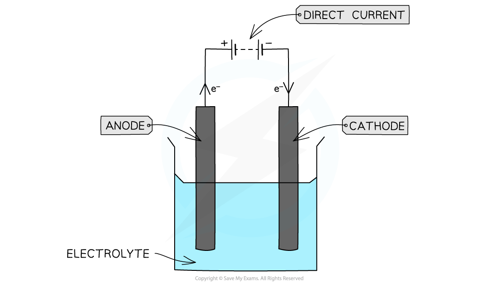

# Electrolysis

## Products of Electrolysis

> **Spec point** — `spcpt_m3t673F5zKPpKkb6`

## Products of Electrolysis

- **Electrolysis **is the breaking down of a compound into its elements using an **electric current**
- For example, the electrolysis of zinc chloride (ZnCl2) into its elements zinc and chlorine

**ZnCl****2**** → Zn + Cl****2**** **

- This method is often used to:

  - Extract **metals **from their **metal ores** when the metals cannot be extracted by heating their ores with carbon
  - Purify metals
  - Produce non-metals such as fluorine
- Electrolysis is carried out in an electrolysis cell which consists of:

  - An **electrolyte** - this is the compound that is broken down during electrolysis and it is either a **molten ionic compound **or a **concentrated aqueous solution of ions**
  - Two **electrodes** - these are metal or graphite rods conduct electricity to the electrolyte and away from the electrolyte
  
    - The positive electrode is called the **anode**
    - The negative electrode is called the **cathode**
  - The power supply, which is **direct current**

#### An electrochemical cell

***Electrolysis takes place in an electrochemical cell; this type of electrochemical cell is called an electrolytic cell***

### Electrolysis of molten electrolytes

- **Cations **(positively charged ions) move to the **negatively charged cathode** where they **gain electrons**

  - **Reduction** takes place at the cathode
  - If a **metal** is formed, a layer of metal is deposited on a cathode or it forms a **molten layer** in the cell
  - If **hydrogen** gas is formed, bubbles are seen
  - For example, silver and hydrogen both form positively charged ions which would be **reduced **at the cathode as follows:

**Ag****+**** + e****-**** → Ag**

**2H****+ ****+ 2e****-**** → H****2**

- **Anions **(negatively charged ions) move to the **positively charged** **anode** where they **lose electrons**

  - **Oxidation** takes place at the anode
  - For example, bromine forms negatively charged ions which would be **oxidised **at the anode as follows:

**2Br****-**** → Br****2**** + 2e****-**

#### Products formed by electrolysis when a pure molten ionic compound containing two simple ions is electrolysed

- Al2O3

  - Cathode = Al
  - Anode = O2
- MgBr2

  - Cathode = Mg
  - Anode = Br2
- NaCl

  - Cathode = Na
  - Anode = Cl2
- ZnI2

  - Cathode =Zn
  - Anode = I2

### Electrolysis of aqueous solutions

- **Aqueous** **solutions** have more than one cation and anion in solution due to the presence of **water**
- Water contributes H+ and OH- ions to the solution, which makes things more complicated

  - Water is a weak electrolyte and splits into H+ and OH- ions as follows:

**H****2****O ⇌ H****+**** + OH****-**

- The actual ions that are **discharged** during electrolysis will depend on:

  - The relative electrode potential of the ions
  - The concentration of the ions

### Relative electrode potential of ions

- The **relative electrode potential **(*E***θ**) of ions describes how easily an ion is discharged during electrolysis
- The **positively charged** **cation** with the most **positive** *E*θ will be discharged at the **cathode** as this is the cation that is most easily **reduced**

  - For example, a concentrated **aqueous solution** of NaF will contain hydrogen (H+) and sodium (Na+) ions
  - The half-equations for the reduction of these ions and their *E*θ values are as follows:

**2H****+**** (aq) + 2e****-  ****⇌ H****2 ****(g)     *****E*****θ**** *****=  *****0.00 V**

**Na****+ ****(aq) + e****-  ****⇌ Na (s)     *****E*****θ**** *****= *****-2.71 V**

- Since H+ ions have a higher *E*θ value, hydrogen gas (H2) is formed at the **cathode **instead of sodium (Na)
- The negatively charged anion that is **most easily oxidised** will be discharged at the **anode**
- This corresponds to the half-reaction with the **least positive** (or most negative) *E*θ

  - For example, a concentrated aqueous solution of NaF will contain hydroxide (OH⁻) and fluoride (F⁻) ions
  - The half-equations for the reduction of the products and their *E*θ values are as follows (this is the standard way they are shown in data booklets):

** O****2 ****(g) + 2H****2****O (l) + 4e****- ****⇌ 4OH****- ****(aq) ****         *****E*****θ**** *****= *****+0.40 V**

** F****2 ****(g) + 2e****- ****⇌ 2F****- ****(aq) ****      *****E*****θ *****= *****+2.87 V**

- Since the OH-/O2 half-reaction has a **less positive *****E*****θ**** value** (+0.40 V) than the F⁻/F2 half-reaction (+2.87 V), hydroxide ions are **more easily oxidised** than fluoride ions

  - Therefore, **oxygen (O****2****) gas is formed at the anode**

### Concentration of ions

- Ions that are present in **higher** **concentrations** are more likely to be discharged
- For example, when a **concentrated **solution of NaF is electrolysed, there are far more **fluoride **ions which are discharged at the anode, instead of the **hydroxide** ions as the fluoride ions are in higher concentration

  - So, mainly fluorine will form at the electrode
- However, if a **very** **dilute** solution of NaF is electrolysed, there will be much more **oxygen** and much less fluorine gas formed at the anode

  - In reality, a mixture of both oxygen and fluorine gas is formed

> **Exam Hint**
> Electrolysis is a redox reaction as a reduction reaction takes place at one electrode and an oxidation reaction at the other electrode
> 
> When writing the overall redox equation make sure that the electrons lost at the anode balance the electrons gained at the cathode
> 
> For example:
> 
> - Cathode: Cu2+ + 2e- → Cu
> - Anode: 2Cl- → Cl2 + 2e-
> - Overall: CuCl2 → Cu + Cl2
