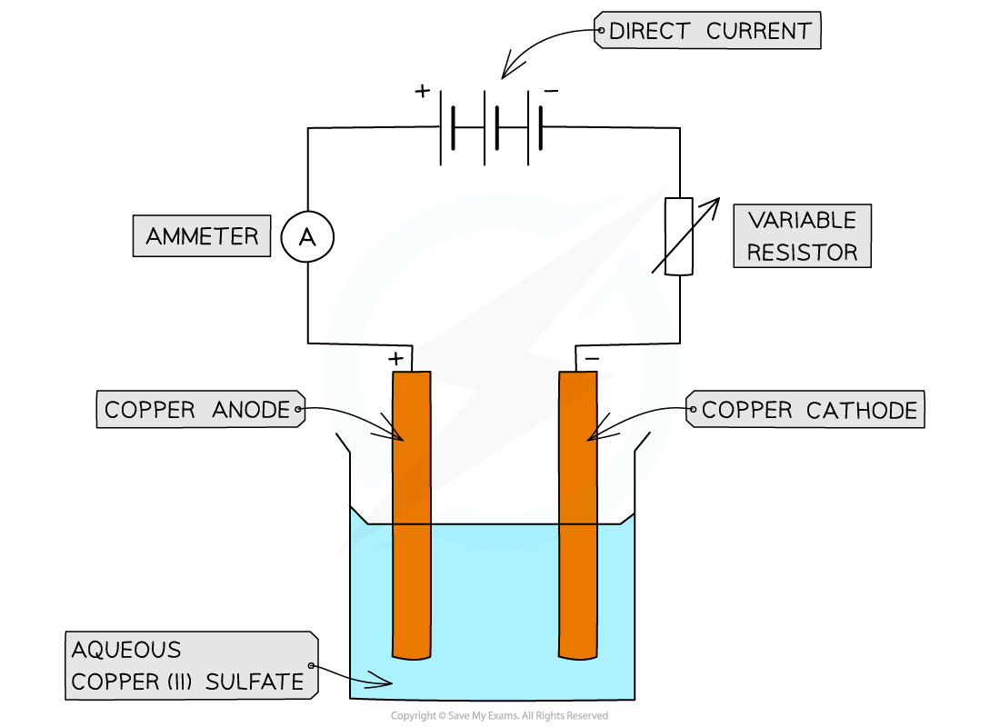

# Faraday's Law & Avogadro

## Faraday's Law

> **Spec point** — `spcpt_5Htx34tTFk52Gr3T`

## Faraday's Law

- The **amount** of substance that is formed at an electrode during **electrolysis** is proportional to:

  - The amount of **time** where a constant current to passes
  - The **amount** **of** **charge**, in coulombs, that passes through the electrolyte (strength of electric **current**)
  - The relationship between the current and time is:

***Q = I x t***

- **Q** = charge (coulombs, C)

  - **I** = current (amperes, A)
  - **t **= time, (seconds, s)
- The **amount **or the **quantity of electricity **can also be expressed by the **faraday** **(*****F*****) **unit

  - One faraday is the amount of **electric charge **carried by 1 mole of electrons or 1 mole of singly charged ions
  - 1 faraday is 96 500 C mol-1
  - Thus, the relationship between the Faraday constant and the Avogadro constant (*L*) is:

***F = L x e***

- **F** = Faraday’s constant (96 500 C mol-1)

  - **L** = Avogadro’s constant (6.02 x 1023 mol-1)
  - **e** = charge on an electron

> **Worked Example**
> Determine the amount of electricity required for the following reactions:
> 
> 1) To deposit 1 mol of sodium
> 
> Na+ (aq) + e– → Na (s)
> 
> 2) To deposit 1 mol of magnesium
> 
> Mg2+ (aq) + 2e– → Mg (s)
> 
> 3) To form 1 mol of fluorine gas
> 
> 2F– (aq)  → F2 (g) + 2e–
> 
> 4) To form 1 mole of oxygen
> 
> 4OH– (aq)  → O2 (g) + 2H2O (l) +  4e–
> 
> **Answers:**
> 
> - One Faraday is the amount of charge (96 500 C) carried by 1 mole of electrons
> 
> **Answer 1:**
> 
> - As there is one mole of electrons, one faraday of electricity (96 500 C) is needed to deposit one mole of sodium.
> 
> **Answer 2:**
> 
> - Now, there are two moles of electrons, therefore, two faradays of electricity (2 x 96 500 C) are required to deposit one mole of magnesium.
> 
> **Answer 3:**
> 
> - Two moles of electrons are released, so it requires two faradays of electricity (2 x 96 500 C) to form one mole of fluorine gas.
> 
> **Answer 4:**
> 
> - Four moles of electrons are released, therefore it requires four faradays of electricity (4 x 96 500 C) to form one mole of oxygen gas.

## Determining Avogadro's Constant by Electrolysis

> **Spec point** — `spcpt_gPKQX6szPddTgJ9j`

## Determining Avogadro's Constant by Electrolysis

- The Avogadro’s constant (*L*) is the number of entities in **one mole**

  - *L* = 6.02 x 1023 mol-1
  - For example, **four moles **of water contains 2.41 x 1024 (6.02 x 1023 x 4) molecules of H2O
- The value of *L* (6.02 x 1023 mol-1) can be **experimentally **determined by electrolysis using the following equation:

***L *****=** $\frac{chargeon1molofelectrons}{chargeon1electron}$

### Finding L experimentally

- The charge on **one mole of electrons **is found by using a simple **electrolysis** experiment using copper electrodes

#### Apparatus set-up for finding the value of L experimentally

*Electrolysis of copper(II) sulfate solution*

- **Method**

  - The pure copper** anode **and pure copper** cathode **are **weighed**
  - A **variable** **resistor** is kept at a constant current of about 0.17 A
  - An **electric** **current** is then passed through for a certain time interval (e.g. 40 minutes)
  - The anode and cathode are then removed, washed with distilled water, dried with propanone, and then **reweighed**
- **Results**

  - The **cathode** has **increased** in mass as copper is deposited
  - The **anode** has **decreased** in mass as the copper goes into solution as copper ions
  - Often, it is the decreased mass of the anode which is used in the calculation, as the solid copper formed at the cathode does not always stick to the cathode properly
  - Let’s say the amount of copper deposited in this experiment was 0.13 g
- **Calculation:**

  - The amount of charge passed can be calculated as follows:

**Q = I x t**

**= 0.17 x (60 x 40)**

**= 408 C**

- To deposit 0.13 g of copper (2.0 x 10-3 mol), 408 C of electricity was needed
- The amount of electricity needed to deposit 1 mole of copper can therefore be calculated using simple proportion using the relative atomic mass of Cu

#### Calculating the amount of charge required to deposit one mole of copper table

- To scale our experimental results up to the molar level, we can use a ratio method
- The scaling factor tells us how many times larger our target amount (1 mole) is compared to our experimental result.

| **Charge (C)** | **Scaling factor** | **Amount of Cu deposited (g)** |
|---|---|---|
| 408 | $\frac{63.5}{0.13}$ = 488.5 | 0.13 |
| $\frac{63.5}{0.13}\times408=199,292$ | 1 (the target is 488.5 times bigger | 63.5 |

- Therefore, 199 292 C of electricity is needed to deposit 1 mole of Cu
- The half-equation shows that **2 mol of electrons **are needed to deposit one mol of copper:

**Cu****2+ ****(aq) +  2e****-**** →   Cu (s)**

- So, the charge on **1 mol** of electrons is:

  - Q = $\frac{199292}{2}=99646C$
- Given that the charge on **one electron** is 1.60 x 10-19 C, then *L* equals:

  - *L* = $\frac{\mathrm{charge} \mathrm{on}1\mathrm{mol} \mathrm{of} \mathrm{electrons}}{\mathrm{charge} \mathrm{on}1\mathrm{electron}}$
  - *L* = $\frac{99646}{1.60\times10^{-19}}$ = 6.23 x 1023 mol-1

- The **experimentally** **determined** value for *L* of 6.23 x 1023 mol-1 is very close to the **theoretical **value of 6.02 x 1023 mol-1
