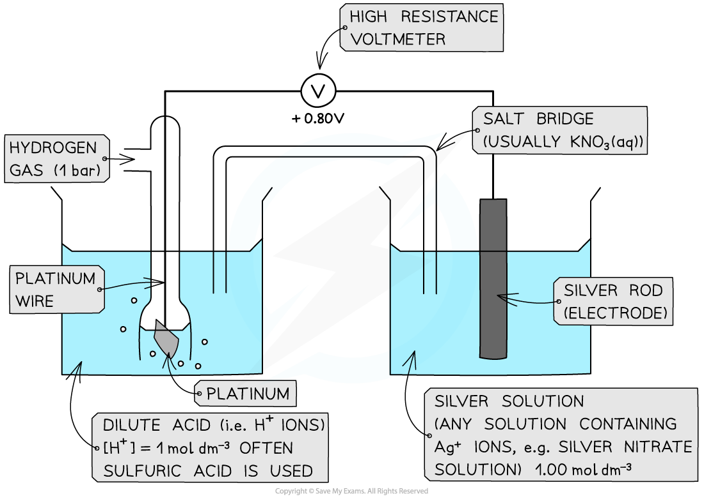
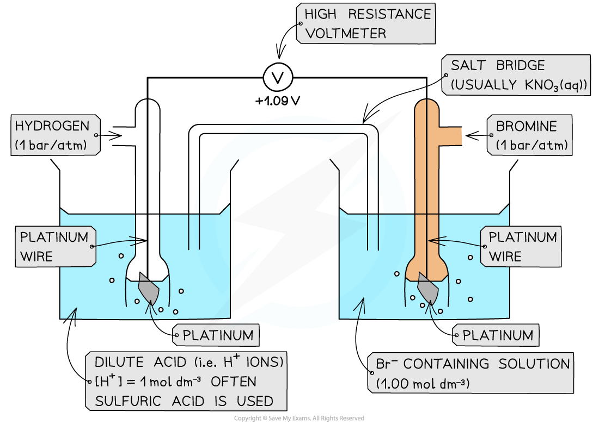
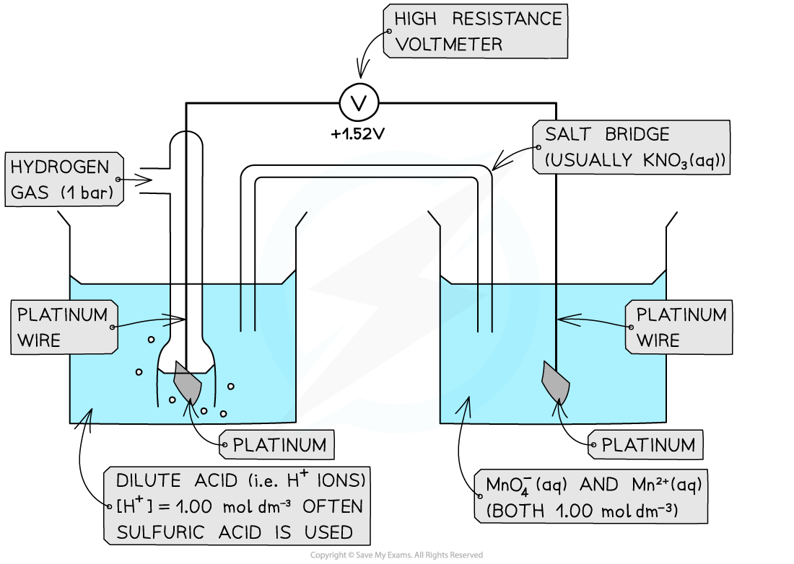
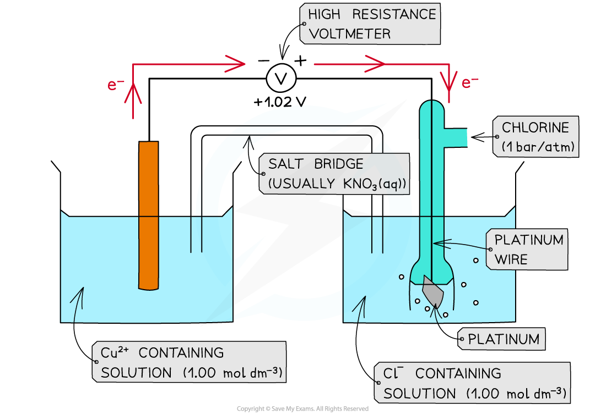
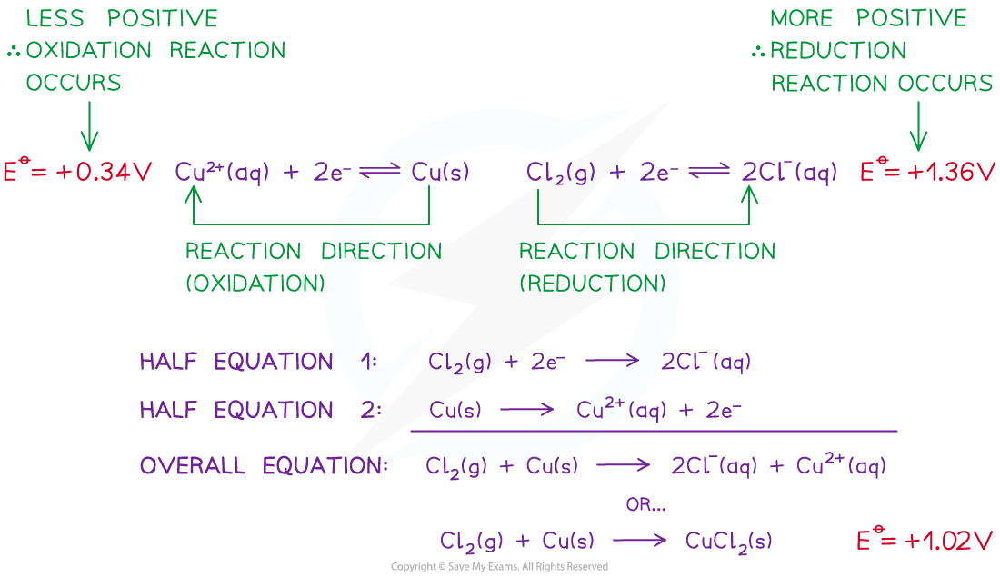

# Measuring the Standard Electrode Potential

## Measuring the Standard Electrode Potential

> **Spec point** — `spcpt_YpKqb5HsZsxDZymV`

## Measuring the Standard Electrode Potential

- There are three different types of half-cells that can be connected to a standard hydrogen electrode

  - A metal / metal ion half-cell
  - A non-metal / non-metal ion half-cell
  - An ion / ion half-cell (the ions are in different oxidation states)
- When a half-cell is connected to a standard hydrogen electrode, or when two half-cells are connected, a** salt bridge** is required

  - A salt bridge has **mobile ions** that complete the circuit
  - A salt bridge is typically a strip of filter paper soaked in a saturated solution of **potassium nitrate **or **potassium chloride **as nitrates and chlorides are usually soluble
  - This should ensure that no precipitates form which can affect the equilibrium position of the half-cells

### Metal / metal ion half-cell

- An example of a metal / metal ion half-cell is the Ag+/ Ag half-cell

  - Ag is the metal
  - Ag+ is the metal ion
- This half-cell is connected to a **standard hydrogen electrode** and the two half-equations are:

**Ag****+**** (aq) + e****- ****⇌ Ag (s)        *****E*****ꝋ ****= + 0.80 V**

**2H****+**** (aq) + 2e****- ****⇌ H****2**** (g)        *****E*****ꝋ ****= 0.00 V **

- Since the Ag+ / Ag half-cell has a more positive *E*ꝋ value, this is the **positive pole **and the H+ / H2 half-cell is the **negative** pole
- The **standard cell potential (***E**cell*ꝋ) is ***E******cell*****ꝋ**** = (+ 0.80) - (0.00) = + 0.80 V**
- The Ag+ ions are more likely to get **reduced **than the H+ ions as it has a greater *E*ꝋ value

  - Reduction occurs at the **positive pole**
  - Oxidation occurs at the **negative pole**

#### Example of an electrochemical cell containing a metal / metal ion half-cell

*Under standard conditions, a metal / metal ion half-cell is connected to the standard hydrogen electrode to measure the cell potential*

### Non-metal / non-metal ion half-cell

- In a **non-metal / non-metal ion **half-cell **platinum **wire or foil is used as an electrode to make electrical contact with the solution

  - Like graphite, platinum is inert and does not take part in the reaction
  - The redox equilibrium is established on the platinum surface
- An example of a non-metal/non-metal ion is the Br2 / Br- half-cell

  - Br is the non-metal
  - Br- is the non-metal ion
- The half-cell is connected to a **standard hydrogen electrode** and the two half-equations are:

**Br****2**** (l) + 2e****- ****⇌ 2Br****-**** (aq)        *****E*****ꝋ**** = +1.09 V**

**2H****+**** (aq) + 2e****- ****⇌ H****2**** (g)        *****E*****ꝋ**** = 0.00 V   **

- The Br2 / Br- half-cell is the **positive pole** and the H+ / H2 is the **negative** pole
- ***E*****cell****ꝋ**** = (+ 1.09) - (0.00) = + 1.09 V**
- The Br2 molecules are more likely to get **reduced **than H+ as they have a greater *E*ꝋ value

#### Example of an electrochemical cell containing a non-metal / non-metal ion half-cell

*Under standard conditions, a non-metal / non-metal ion half-cell is connected to the standard hydrogen electrode to measure the cell potential*

#### Ion / Ion half-cell

- A **platinum electrode **is again used to form a half-cell of ions that are in **different oxidation states**
- An example of such a half-cell is the MnO4- / Mn2+ half-cell

  - MnO4- is an ion containing Mn with an oxidation number of +7
  - The Mn2+ ion contains Mn with an oxidation number of +2
- This half-cell is connected to a **standard hydrogen electrode** and the two half-equations are:

**MnO****4****-**** (aq) + 8H****+**** (aq) + 5e****- ****⇌ Mn****2+**** (aq) + 4H****2****O (l)       *****E*****ꝋ**** = +1.52 V**

**2H****+**** (aq) + 2e****- ****⇌ H****2**** (g)       *****E*****ꝋ ****= 0.00 V   **

- The H+ ions are also present in the half-cell as they are required to convert MnO4- into Mn2+ ions
- The MnO4- / Mn2+ - half-cell is the **positive pole** and the H+ / H2 is the **negative** pole
- ***E******cell*****ꝋ**** = (+ 1.52) - (0.00) = + 1.52 V**

#### Example of an electrochemical cell containing an ion / ion half-cell

*Under standard conditions, an ion / ion half-cell is connected to the standard hydrogen electrode to measure the cell potential*

## Standard Cell Potential: Direction of Electron Flow & Feasibility

> **Spec point** — `spcpt_6kfKxfq3Q9w2RBGz`

## Standard Cell Potential: Direction of Electron Flow & Feasibility

### Direction of electron flow

- The **direction of electron flow **can be determined by comparing the *E*ꝋ values of two half-cells in an electrochemical cell

**Cl****2**** (g) + 2e****- ****⇌ 2Cl****-**** (aq)        *****E*****ꝋ**** = +1.36 V**

**Cu****2+**** (aq) + 2e****- ****⇌ Cu (s)        *****E*****ꝋ**** = +0.34 V**

- The Cl2 more **readily accept** electrons from the Cu2+/Cu half-cell

  - This is the **positive pole**
  - Cl2 gets more readily reduced
- The Cu2+ more **readily loses **electrons to the Cl2/Cl- half-cell

  - This is the **negative pole**
  - Cu2+ gets more readily oxidised
- The electrons flow from the Cu2+/Cu half-cell to the Cl2/Cl- half-cell
- The flow of electrons is from the **negative pole **to the **positive pole**

#### Flow of electrons through an electrochemical cell

*The electrons flow through the wires from the negative pole to the positive pole*

### Feasibility

- The *E*ꝋ values of a species indicate how **easily **they can get **oxidised **or **reduced**
- The **more **positive the value, the easier it is to reduce the species on the **left** of the half-equation

  - The reaction will tend to proceed in the **forward direction**
- The **less **positive the value, the easier it is to **oxidise** the species on the **right **of the half-equation

  - The reaction will tend to proceed in the backward direction
  - A reaction is **feasible **(likely to occur) when the *E**cell*ꝋ is **positive**
- For example, two half-cells in the following electrochemical cell are:

**Cl****2**** (g) + 2e****- ****⇌ 2Cl****-**** (aq)        *****E*****ꝋ**** = +1.36 V**

**Cu****2+**** (aq) + 2e****- ****⇌ Cu (s)        *****E*****ꝋ**** = +0.34 V**

- Cl2 molecules are **reduced **as they have a more positive *E*ꝋ value
- The chemical reaction that occurs in this half-cell is:

**Cl****2**** (g) + 2e****- ****→ 2Cl****-**** (aq)          **

- Cu2+ ions are **oxidised **as they have a less positive *E*ꝋ value
- The chemical reaction that occurs in this half-cell is:

**Cu (s) → Cu****2+**** (aq) + 2e****-**

- The **overall equation **of the electrochemical cell is (after cancelling out the electrons):

**Cu (s) + Cl****2**** (g) → 2Cl****- ****(aq) + Cu****2+**** (aq)**

OR

**Cu (s) + Cl****2**** (g) → CuCl****2**** (s)**

- The **forward** reaction is **feasible** (spontaneous) as it has a **positive** *E*ꝋ  value of +1.02 V ((+1.36) - (+0.34))
- The **backward **reaction is **not feasible** (not spontaneous) as it has a **negative** *E*ꝋ value of -1.02 ((+0.34) - (+1.36))

#### Reaction feasibility and the standard cell potential

*A reaction is feasible when the standard cell potential Eꝋ is positive*

> **Exam Hint**
> Remember that the electrons only move through the wires in the external circuit and not through the electrolyte solution.

## Redox Equations

> **Spec point** — `spcpt_K7DVtxNwskw68ZgZ`

## Redox Equations

- The main ways to construct redox equations using the relevant half-equations:

  - Using changes in oxidation numbers to help balance chemical equations
  - Using the number of electrons for each half-cell
  
    - Both of these are discussed in the [Redox Reactions](https://www.savemyexams.com/a-level/chemistry/cie/25/revision-notes/6-electrochemistry/6-1-redox-processes-electron-transfer-and-changes-in-oxidation-number-oxidation-state/redox-reactions/) topic
  - Interpreting the information given to you and predicting any other chemicals involved in the reaction

> **Worked Example**
> Write the balanced chemical equation for hydrogen iodide reacting with sulfuric acid to form hydrogen sulfide, iodine and one other product
> 
> **Answer:**
> 
> - There are 2 possible methods:
> 
>   1. Using ionic half-equations
>   2. Interpreting the information and predicting any other chemicals involved
> 
> **Using ionic half-equations method:**
> 
> - **Step 1:** Identify possible half-equations from the information
> 
>   - Iodide → iodine
>   - Sulfuric acid → hydrogen sulfide
> - **Step 2:** Construct the half equations
> 
>   - Iodide → iodine
>   
>     - I– → I2
>     - This requires 2 iodide ions and 2 electrons as products to balance the equation
>     - 2I– → I2 + 2e–
>   - Sulfuric acid → hydrogen sulfide
>   
>     - H2SO4 → H2S
>     - The 4 oxygen atoms will form 4 water molecules as products
>     - H2SO4 → H2S + 4H2O
>     - The 8 hydrogen atoms in the water molecules will require 8 protons as reactants
>     - H2SO4 + 8H+ → H2S + 4H2O
>     - The 8 protons will require 8 electrons to balance the charge
>     - H2SO4 + 8H+ + 8e– → H2S + 4H2O
> - **Step 3:** Combine the half-equations
> 
>   - Iodide → iodine
>   
>     - 2I– → I2 + 2e–
>     - The iodide half-equation needs to be multiplied by 4 to have the same number of electrons as the sulfuric acid half-equation
>     - 8I– → 4I2 + 8e–
>   - Sulfuric acid → hydrogen sulfide
>   
>     - H2SO4 + 8H+ + 8e– → H2S + 4H2O
>   - Combining the half-equations
>   
>     - 8I– + H2SO4 + 8H+ + 8e– → 4I2 + 8e– H2S + 4H2O
>   - Cancelling, where appropriate
>   
>     - The electrons cancel on both sides
>     - The 8I– and 8H+ can be re-written as 8HI
>     - 8HI + H2SO4 → 4I2 + H2S + 4H2O
> 
> **Interpreting and predicting method:**
> 
> - **Step 1:** Start with what you know:
> 
>   - HI + H2SO4 → H2S + I2
> - **Step 2:** Consider any elements that are not accounted for
> 
>   - The only element that is not currently considered is oxygen
> - **Step 3:** Make a common and appropriate suggestion for the missing product
> 
>   - Most of these questions are in solution so there is always H2O, H+ and OH- available
>   - Missing product suggestion = 4H2O
>   - HI + H2SO4 → H2S + I2 + 4H2O
> - **Step 4:** Balance the remaining chemicals
> 
>   - 8HI + H2SO4 → H2S + 4I2 + 4H2O

> **Exam Hint**
> - Similar approaches can be used to balance more complicated ionic half-equations
> - In these situations, you will have H2O, H+, OH- and electrons available
