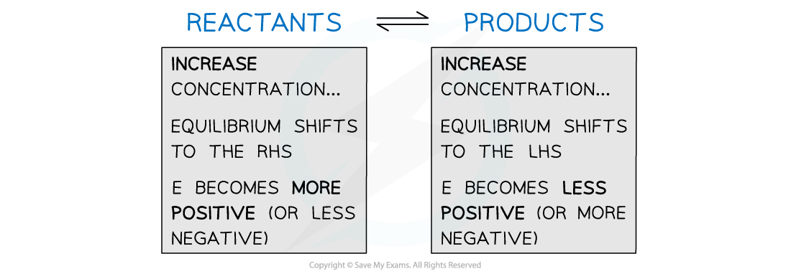

# Non-Standard Conditions

## Effect of Concentration on Electrode Potential

> **Spec point** — `spcpt_hvf4st7tCCknW7Dv`

## Effect of Concentration on Electrode Potential

- Changes in **temperature** and **concentration** of aqueous ions will affect the standard electrode potential (*E*ꝋ) of a half-cell
- Under these **non-standard conditions**, *E* is used as a symbol for the electrode potential instead of *E*ꝋ

### Increasing the concentration of the species on the left

- If the concentration of the species on the left is increased, the position of equilibrium will shift to the **right**
- This means that the species on the left gets **more** **easily** **reduced**
- The *E* value becomes **more positive **(or less negative)
- Let’s look at the half-cell below as an example

**Zn****2+**** (aq) + 2e****- ****⇌ Zn (s)        *****E*****ꝋ ****= -0.76 V**

- If the concentration of Zn2+ (**species on the left**) is **increased**, the equilibrium position will shift to the **right**
- The species on the **left **(Zn2+) will get **more easily reduced**
- Therefore, the *E* value becomes **less negative** and will change too, for example, -0.50 V instead
- This principle can also be applied to a half-cell with a positive *E*ꝋ value such as:

**Fe****3+**** (aq) + e****- ****⇌ Fe****2+**** (aq)        *****E*****ꝋ**** = +0.77 V**

- If the concentration of Fe3+ (**species on the left**) is **increased**, the equilibrium position will shift to the **right**
- The species on the **left **(Fe3+) will get more easily **reduced**
- Therefore, the *E* value becomes **more positive** and will change too, for example, +0.89 V instead

### Increasing the concentration of species on the right

- If the concentration of the species on the right is increased, the position of equilibrium will shift to the **left**
- This means that the species on the left get **less** **easily** **reduced**
- The *E* value becomes **less positive **(or more negative)
- Let’s look again at the half-cell below

**Zn****2+**** (aq) + 2e****- ****⇌ Zn (s)        *****E*****ꝋ ****= -0.76 V**

- If the concentration of Zn (**species on the right**) is **increased**, the equilibrium position will shift to the **left**
- The species on the **left **(Zn2+) will get less easily **reduced**
- Therefore, the *E* value becomes **more negative** and will change too, for example, -0.82 V instead
- This principle can, again, also be applied to a half-cell with a positive *E*ꝋ value:

**Fe****3+**** (aq) + e****- ****⇌ Fe****2+**** (aq)        *****E*****ꝋ**** = +0.77 V**

- If the concentration of Fe2+ (**species on the right**) is **increased**, the equilibrium position will shift to the **left**
- The species on the **left **(Fe3+) will get less easily **reduced**
- Therefore, the *E* value becomes **less positive** and will change too, for example, +0.56 V instead

#### Effect of concentration on the electrode potential

*Summarising the effects of changing the concentration of reactants and products*
