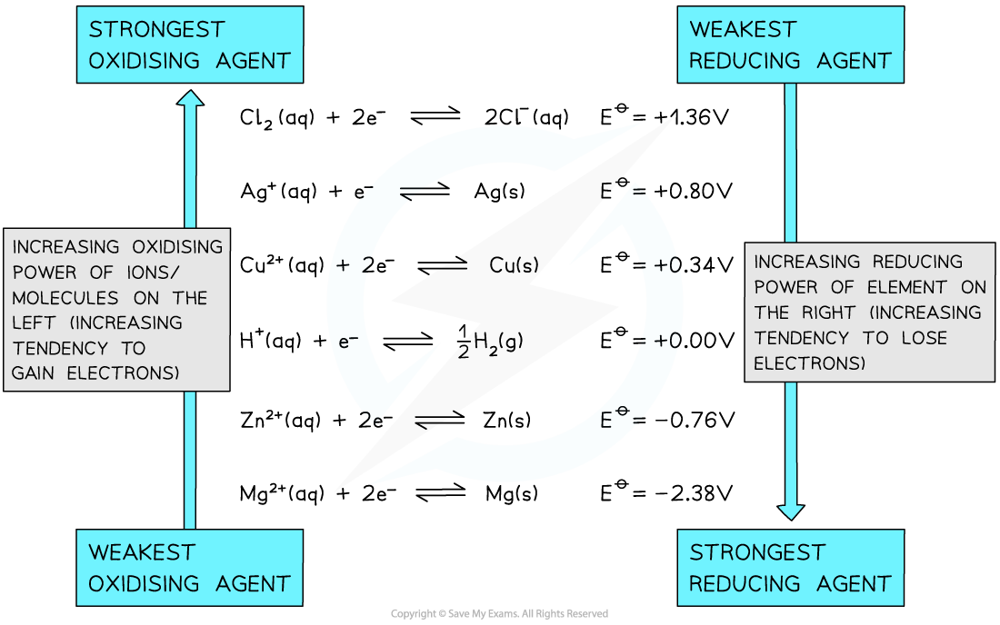

# Standard Cell Potential: Calculations, Electron Flow & Feasibility

## Standard Cell Potential Calculations

> **Spec point** — `spcpt_zJ3sxYXqq83ptdB6`

## Standard Cell Potential Calculations

- Once the ***E***ꝋ of a half-cell is known, the **potential difference** or **voltage** or** emf** of an **electrochemical cell **made up of any two half-cells can be calculated

  - These could be **any** half-cells and neither have to be a standard hydrogen electrode
- The **standard cell potential (***E**cell*ꝋ) can be calculated by **subtracting **the **less** **positive** *E*ꝋ from the **more positive ***E*ꝋ value

  - The half-cell with the more positive *E*ꝋ value will be the **positive** pole
  - By convention this is shown on the right-hand side in a conventional cell diagram, so is termed ** *****E******right*****ꝋ**
- The half-cell with the less positive *E*ꝋ value will be the **negative **pole

  - By convention this is shown on the left-hand side in a conventional cell diagram, so is termed ** *****E******left*****ꝋ**

***E******cell*****ꝋ**** = *****E******right*****ꝋ ****- *****E******left*****ꝋ   **

- Since oxidation is always on the left and reduction on the right, you can also use this version

***E******cell*****ꝋ**** = *****E******reduction*****ꝋ ****- *****E******oxidation******ꝋ***

> **Worked Example**
> **Calculating the standard cell potential**
> 
> Calculate the standard cell potential for the electrochemical cell below and explain why the Cu2+ / Cu half-cell is the positive pole. The half-equations are as follows:
> 
> **Cu****2+ ****(aq) + 2e****- ****⇌ Cu (s)      *****E*****ꝋ ****= +0.34 V**
> 
> **Zn****2+ ****(aq) + 2e****- ****⇌ Zn (s)      *****E*****ꝋ ****= −0.76 V**
> 
> **Answer**
> 
> - **Step 1: **Calculate the standard cell potential. The copper is more positive so must be the right hand side.
> 
> *E**cell*ꝋ = *E**right*ꝋ - *E**left*ꝋ   
> 
> *E**cell*ꝋ = (+0.34) - (-0.76) = +1.10 V
> 
> - **Step 2: **Determine the positive and negative poles
> 
> 
> 
> - The Cu2+ / Cu  half-cell is the **positive** pole as its *E*ꝋ is more positive than the *E*ꝋ value of the Zn2+ / Zn half-cell

> **Exam Hint**
> - Students often confuse the redox process that take place in voltaic cells and electrolytic cells.
> - An easy way to remember is the phrase RED CATS: REDuction takes place at the CAThode.  OR AN OX. OXidation takes place at the ANode

## Electrochemical Series

> **Spec point** — `spcpt_yF7qm8h6B4HYtHhS`

## Electrochemical Series

- The *E*ꝋ values of a species indicate how **easily **they can get **oxidised **or **reduced**
- In other words, they indicate the relative **reactivity **of elements, compounds and ions as **oxidising agents** or **reducing agents**
- The **electrochemical series **is a list of various **redox equilibria** in order of decreasing *E*ꝋ values
- **More positive **(less negative) *E*ꝋ values indicate that:

  - The species is easily **reduced**
  - The species is a better **oxidising agent**
- **Less positive **(more negative) *E*ꝋ values indicate that:

  - The species is easily **oxidised**
  - The species is a better **reducing agent**

#### An example electrochemical series

*In this example electrochemical series the equilibria are arranged in order of decreasing Eꝋ values. These values can then be used to identify the strongest and weakest reducing / oxidising agents.*
