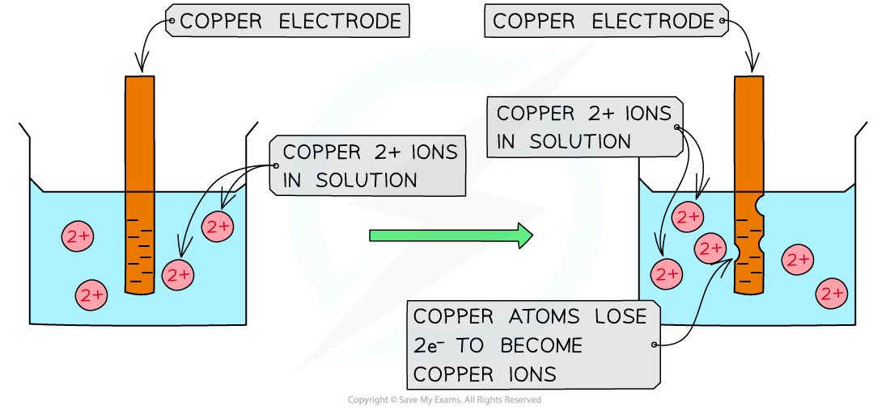
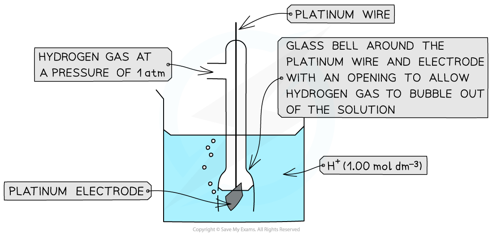

# Standard Electrode & Cell Potentials

## Standard Electrode & Standard Cell Potentials

> **Spec point** — `spcpt_fFh7hPWmj22BJ5tJ`

## Standard Electrode & Standard Cell Potentials

### Electrode potential

- The **electrode (reduction) potential **(***E***) is a value which shows how easily a substance is **reduced**
- These are demonstrated using reversible half equations

  - This is because there is a redox equilibrium between two related species that are in different oxidation states
  - For example, if you dipped a zinc metal rod into a solution which contained zinc ions, there would be zinc atoms losing electrons to form zinc ions and at the same time, zinc ions gaining electrons to become zinc atoms
  - This would cause a redox equilibrium

#### Half equations

- When writing half equations for this topic, the electrons will always be written on the left-hand side (demonstrating reduction)
- The position of equilibrium is different for different species, which is why different species will have electrode (reduction) potentials
- The more **positive** (or less negative) an electrode potential, the **more likely** it is for that species to undergo **reduction**

  - The equilibrium position lies more to the **right**
- For example, the positive electrode potential of bromine below, suggests that it is likely to get reduced and form bromide (Br-) ions

**Br****2**** (l) + 2e****- ****⇌ 2Br****- ****(aq)        voltage = +1.09 V**

- The more **negative** (or less positive) the electrode potential, the less likely it is that reduction of that species will occur

  - The equilibrium position lies more to the **left**
- For example, the negative electrode potential of sodium suggests that it is unlikely that the sodium (Na+) ions will be reduced to sodium (Na) atoms

**Na****+**** (aq) + e****- ****⇌ Na (s)        voltage = -2.71 V**

### Standard electrode potential

- The position of equilibrium and therefore the electrode potential depends on factors such as:

  - Temperature
  - Pressure of gases
  - Concentration of reagents
- So, to be able to compare the electrode potentials of different species, they all have to be measured against a common reference or standard

#### Standard conditions

- **Standard** **conditions** also have to be used when comparing electrode potentials
- These standard conditions are:

  - An ion concentration of 1.00 mol dm-3
  - A temperature of 298 K
  - A pressure of 1 atm

- The electrode potentials are measured relative to something called a **standard hydrogen electrode**
- The standard hydrogen electrode is given a value of 0.00 V, and all other electrode potentials are compared to this standard
- This means that the electrode potentials are always referred to as a **standard electrode potential** **(*****E*****ꝋ****)**
- The **standard electrode potential** **(*****E*****ꝋ****) **is the voltage produced when a **standard half-cell** is connected to a **standard hydrogen cell** under standard conditions
- For example, the standard electrode potential of bromine suggests that relative to the hydrogen half-cell it is more likely to get reduced, as it has a **more positive** *E*ꝋ value

**Br****2**** (l) + 2e****- ****⇌ 2Br****-**** (aq)        *****E*****ꝋ**** = +1.09 V**

**2H****+**** (aq) + 2e****- ****⇌ H****2**** (g)        *****E*****ꝋ**** = 0.00 V**

- The standard electrode potential of sodium, on the other hand, suggests that relative to the hydrogen half-cell it is less likely to get reduced as it has a **more negative** *E*ꝋ value

**Na****+**** (aq) + e****- ****⇌ Na (s)        *****E*****ꝋ**** = -2.71 V**

**2H****+ ****(aq) + 2e****- ****⇌ H****2**** (g)        *****E*****ꝋ**** = 0.00 V**

### Standard cell potential

- Once the ***E*****ꝋ** of a half-cell is known, the **voltage **of an **electrochemical cell** made up of two half-cells can be calculated

  - These could be **any **half-cells and neither have to be a standard hydrogen electrode

- This is also known as the **standard cell potential** (***E*****cell****ꝋ**)
- The standard cell potential can be determined by two methods:

  1. Using the equation ***E*****cell****ꝋ**** **= ***E*****reduction****ꝋ***** – E*****oxidation****ꝋ**
  
    - Use of this equation does require knowledge of which reaction is reduction and which is oxidation
    - The reduction reaction has the higher / more positive *E**ꝋ** *value
  2. ***E*****cell****ꝋ**** **is the difference in *E*ꝋ between two half-cells
- For example, an electrochemical cell consisting of bromine and sodium half-cells has an ***E*****cell****ꝋ**** **of:

  - ***E*****cell****ꝋ**** **= (+1.09) - (-2.71)
  - ***E*****cell****ꝋ**** **= +3.80 V

## Standard Hydrogen Electrode

> **Spec point** — `spcpt_QhHpZhQKXvBXsCfw`

## Standard Hydrogen Electrode

- When a metal rod is placed in an aqueous solution, a **redox equilibrium **is established between the metal ions and atoms

  - For example, the copper atoms get **oxidised** and enter the solution as copper ions

**Cu (s) → Cu****2+**** (aq) + 2e****-**

#### Oxidation of copper ions

*During oxidation, copper atoms lose 2 electrons to form copper ions*

- The copper ions gain electrons from the metal rod and deposit as metal atoms on the rod

**Cu****2+**** (aq) + 2e****- ****→ Cu (s)**

#### Reduction of copper ions

*During reduction, copper ions gain 2 electrons to form copper atoms*

- When equilibrium is established, the **rate** of oxidation and reduction of copper is **equal**

- The position of the redox equilibrium is different for different metals

  - Copper is more easily **reduced**, thus the equilibrium lies further over to the **right**

**Cu****2+**** (aq) + 2e****- ****⇌ Cu (s)**

- Vanadium is more easily **oxidised**, thus the equilibrium lies further over to the **left**

**V****2+**** (aq) + 2e****- ****⇌ V(s)**

- The metal atoms and ions in solution cause an **electric potential **(**voltage**)
- This potential cannot be measured **directly** however the potential between the metal/metal ion system and **another** system **can** be measured
- This value is called the **electrode potential** (***E***) and is measured in **volts**

  - The electrode potential is the **voltage** measured for a half-cell compared to another half-cell
  - Often, the half-cell used for comparison is the **standard** **hydrogen** **electrode**

### Standard hydrogen electrode

- The **standard hydrogen electrode **is a half-cell used as a **reference electrode** and consists of:

  - Hydrogen gas in equilibrium with H+ ions of concentration 1.00 mol dm-3 (at 1 atm)

**2H****+**** (aq) + 2e****-**** ⇌ H****2 ****(g)**

- An **inert** **platinum **electrode that is in contact with the hydrogen gas and H+ ions
- When the standard hydrogen electrode is connected to another half-cell, the **standard electrode potential **of that half-cell can be read off a voltmeter

#### The standard hydrogen electrode (SHE)

*The standard electrode potential of a half-cell can be determined by connecting it to a standard hydrogen electrode*
