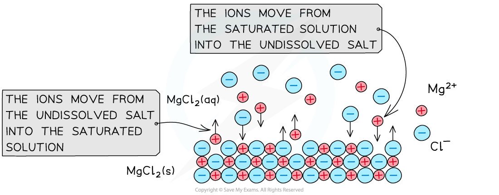

# Solubility Product

## The Solubility Product, Ksp

> **Spec point** — `spcpt_phqcyxJvJchDcTMN`

## The Solubility Product, Ksp

- **Solubility **is defined as the **number of grams **or **moles **of compound needed to **saturate **100 g of **water**, or it can also be defined in terms of 1 kg of water, at a given temperature

  - For example, sodium chloride (NaCl) is considered to be a **soluble **salt as a saturated solution contains 36 g of NaCl per 100 g of water
  - Lead chloride (PbCl2) on the other hand is an **insoluble **salt as a saturated solution only contains 0.99 g of PbCl2 per 100 g of water

### Solubility product

- The **solubility product **(***K******sp***) is:

  - The product of the concentrations of each ion in a saturated solution of a relatively soluble salt
  - At 298 K
  - Raised to the power of their relative concentrations

**C (s) ⇌ aA****x+**** (aq) + bB****y-**** (aq)**

***K******sp****** *****= [A****x+**** (aq)]****a**** [B****y-**** (aq)]****b**

- When an **undissolved ionic compound** is in contact with a **saturated solution of its ions**, an equilibrium is established
- The ions move from the solid to the saturated solution at the same rate as they move from the solution to the solid

  - For example, the undissolved magnesium chloride (MgCl2) is in equilibrium with a saturated solution of its ions

**MgCl****2**** (s) ⇌ Mg****2+**** (aq) + 2Cl****-**** (aq)**

#### Ions in a saturated solution

*When the undissolved magnesium chloride salt comes in contact with its ions in a saturated solution, an equilibrium between the salt and ions is established*

- The **solubility product **for this equilibrium is:

***K******sp****** =***** [Mg****2+**** (aq)] [Cl****-**** (aq)]****2**

- The *K**sp* is only useful for **sparingly soluble salts**
- The smaller the value of *K**sp*, the lower the solubility of the salt

## Ksp Expressions

> **Spec point** — `spcpt_y57yCcdf7wxdpZr9`

## Ksp Expressions

- The general equilibrium expression for the **solubility product** (*K**sp*) is:

**C (s) ⇌ aA****x+**** (aq) + bB****y-**** (aq)**

***K******sp****** *****= [A****x+**** (aq)]****a**** [B****y-**** (aq)]****b**

> **Worked Example**
> **Expressing *****K******sp***** of ionic compounds**
> 
> - Give the equilibrium expressions, including units, for the solubility products of the following ionic compounds:
> 
>   1. Ca(OH)2
>   2. Fe2O3
>   3. SnCO3
> 
> **Answer 1 - Ca(OH)****2****:**
> 
> - **Step 1** - Write the balanced chemical equation:
> 
> Ca(OH)2 (s) $\rightleftharpoons$ Ca2+ (aq) + 2OH– (aq)
> 
> - **Step 2** - Write the *K**sp** *expression:
> 
> *K**sp* = [Ca2+ (aq)] [OH– (aq)]2
> 
> - **Step 3 **- Deduce the units:
> 
> *K**sp* = [mol dm-3] x [mol dm-3]2
> 
> *K**sp* = [mol dm-3]3
> 
> *K**sp** *= mol3 dm-9
> 
> **Answer 2 - Fe****2****O****3****:**
> 
> - **Step 1** - Write the balanced chemical equation:
> 
> Fe2O3 (s) $\rightleftharpoons$ 2Fe3+ (aq) + 3O2– (aq)
> 
> - **Step 2** - Write the *K**sp** *expression:
> 
> *K**sp* = [Fe3+ (aq)]2 [O2– (aq)]3
> 
> 1. **Step 3 **- Deduce the units:
> 
> *K**sp* = [mol dm-3]2 x [mol dm-3]3
> 
> *K**sp* = [mol dm-3]5
> 
> *K**sp** *= mol5 dm-15
> 
> **Answer 3 - SnCO****3****:**
> 
> - **Step 1** - Write the balanced chemical equation:
> 
> SnCO3 (s) $\rightleftharpoons$ Sn2+ (aq) + CO32– (aq)
> 
> - **Step 2** - Write the *K**sp** *expression:
> 
> *K**sp* = [Sn2+ (aq)] [CO32– (aq)]
> 
> - **Step 3 **- Deduce the units:
> 
> *K**sp* = [mol dm-3] x [mol dm-3]
> 
> *K**sp* = [mol dm-3]2
> 
> *K**sp** *= mol2 dm-6
