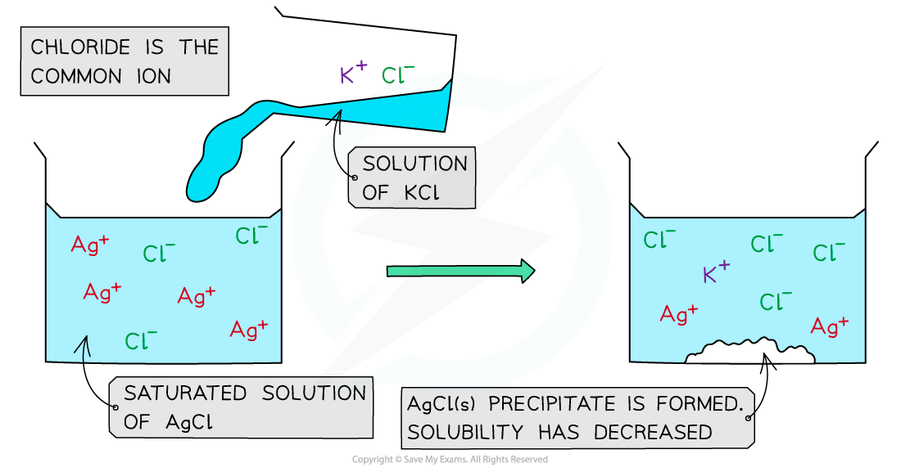

# The Common Ion Effect

## The Solubility Product & the Common Ion Effect

> **Spec point** — `spcpt_mjhMDJVnvhydvMWZ`

## The Solubility Product & the Common Ion Effect

- A **saturated solution **is a solution that contains the **maximum **amount of dissolved salt
- If a second compound, which has an ion **in common **with the dissolved salt, is added to the saturated solution, the solubility of the salt reduces, and a solid **precipitate **will be formed
- This is also known as the **common ion effect**
- For example, if a solution of **potassium chloride **(KCl) is added to a **saturated solution of silver chloride** (AgCl) a precipitate of silver chloride will be formed

  - The chloride ion is the common ion
- The **solubility product** can be used to predict whether a precipitate will form or not

  - A precipitate will form if the product of the ion concentrations is **greater than** the solubility product (*K**sp*)

### Common ion effect in silver chloride

- When a **KCl** solution is added to a saturated solution of **AgCl**, an AgCl precipitate forms
- In a **saturated** AgCl solution, the silver chloride is in equilibrium with its ions

**AgCl (s) ⇌ Ag****+**** (aq) + Cl****-**** (aq)**

- When a solution of potassium chloride is added:

  - Both KCl and AgCl have the common Cl- ion
  - There is an increased Cl- concentration so the equilibrium position shifts to the left
  - The increase in Cl- concentration also means that [Ag+ (aq)] [Cl-(aq)] is **greater** than the *K**sp* for AgCl
  - As a result, the AgCl is **precipitated**

#### The common ion effect with KCl (aq) and AgCl (aq)

*The addition of potassium chloride to a saturated solution of silver chloride results in the precipitate of silver chloride*

> **Worked Example**
> **Calculations using the *****K******sp***** values and the concentration of the common ion**
> 
> Predict whether a precipitate of CaSO4 will form if a saturated solution of 1.0 x 10-3 mol dm-3 CaSO4 is mixed with an equal volume of 1.0 x 10-3 mol dm-3 Na2SO4.
> 
> *K**sp** *CaSO4 = 2.0 x 10-5 mol2 dm-6.
> 
> **Answer**
> 
> - **Step 1: **Determine the equilibrium reaction of CaSO4:
> 
> **CaSO****4**** (s) ⇌ Ca****2+**** (aq) + SO****4****2-**** (aq)**
> 
> - **Step 2: **Write down the equilibrium expression for *K**sp*:
> 
> ***K******sp***** = [Ca****2+**** (aq)] [SO****4****2-**** (aq)]**
> 
> - **Step 3: **Determine the concentrations of the ions:
> 
>   - There are equal volumes of each solution
>   - This means that the total solution was diluted by a factor of 2
>   - The new concentration of the Ca2+ ion is **halved**:
>   
>     - [Ca2+] =  $\frac{1.0\times10^{-3}}{2}$
>     - [Ca2+] = 5.0 x 10-4 mol dm-3
>   - The sulfate ion concentration remains the same as it is a common ion and its concentration is the same in both solutions
> 
> - **Step 4: **Substitute the values into the expression:
> 
>   - Product of the ion concentrations = [Ca2+ (aq)] x [SO42- (aq)]
>   - Product of the ion concentrations = (5.0 x 10-4) x (1.0 x 10-3)
>   - Product of the ion concentrations = 5.0 x 10-7 mol2 dm-6
> 
> - **Step 5: **Determine if a precipitate will form:
> 
>   - As the product of the ion concentration (5.0 x 10-7 mol dm-3) is smaller than the *K**sp* value (2.0 x 10-5 mol2 dm-6), the CaSO4 precipitate will **not** be formed
