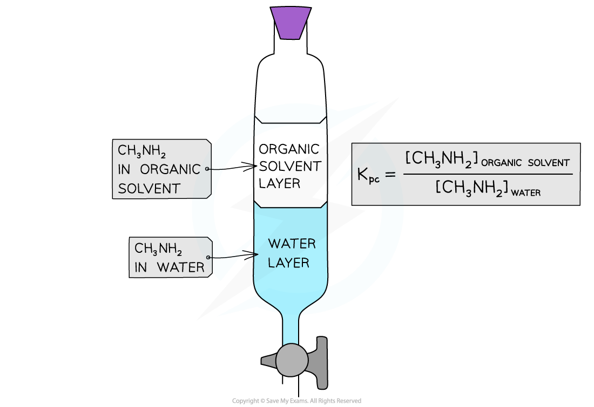

# Partition Coefficients

## The Partition Coefficient

> **Spec point** — `spcpt_tXywm7qJbKnHM9FS`

## The Partition Coefficient

- The **partition coefficient (*****K******pc*****) **is the ratio of the concentrations of a **solute** in two different immiscible solvents in contact with each other when equilibrium has been established (at a particular temperature)
- For example, **methylamine (CH****3****NH****2****) **is dissolved in two immiscible solvents:

  - Water
  - An organic solvent
- A **separating funnel **is shaken with the organic solvent and aqueous methylamine
- The methylamine is **soluble **in both solvents, so when the mixture is left to settle an **equilibrium **is established

  - The **rate** of methylamine molecules moving from the organic layer into the aqueous layer is **equal** to the rate of molecules moving from the aqueous layer to the organic layer

**CH****3****NH****2 ****(aq) ⇌ CH****3****NH****2 ****(organic solvent)**

- The value of its **equilibrium constant **is also called the **partition coefficient**

***K******pc****** = ***$\frac{[ CH_{3} NH_{2} ( \text{organic} \text{solvent} ) ]}{[ CH_{3} NH_{2} ( \text{aq} ) ]}$

#### Defining the partition coefficient

*The partition coefficient is the ratio of methylamine molecules in the organic and aqueous layer once equilibrium has been established*

## Partition Coefficient Calculations

> **Spec point** — `spcpt_ZBsV3XrYB3nJbxCz`

## Partition Coefficient Calculations

- The **partition** **coefficient** (*K**pc*) for a system in which the solute is in the same physical state in the two solvents can be calculated using the equilibrium expression

> **Worked Example**
> **Calculating the partition coefficient**
> 
> 100 cm3 of a 0.150 mol dm-3 solution of aqueous methylamine (CH3NH2) was shaken with 75.0 cm3 of an organic solvent at 25 °C and left in the separating funnel to allow an equilibrium to be established.
> 
> Only 50.0 cm3 of the aqueous layer was run off and titrated against 0.225 mol dm-3 dilute hydrochloric acid (HCI) with an end-point of 14.1 cm3 of HCI.
> 
> Calculate the partition coefficient of methylamine between the organic solvent and water.
> 
> **Answer**
> 
> - **Step 1: **Write down the equilibrium equation:
> 
> **CH****3****NH****2 ****(aq) ⇌ CH****3****NH****2 ****(organic solvent)**
> 
> - **Step 2: **Write down the equilibrium expression:
> 
> ***K******pc****** = ***$\frac{[ CH_{3} NH_{2} ( \text{organic} \text{solvent} ) ]}{[ CH_{3} NH_{2} ( \text{aq} ) ]}$
> 
> - **Step 3: **Determine how many moles of CH3NH2 have reacted with HCl at the end-point:
> 
>   - At the **end-point,** all CH3NH2 (aq) has been neutralised by HCl (aq)
> 
> CH3NH2 (aq) + HCl (aq) → CH3NH3Cl (aq)
> 
> - CH3NH2 and HCl react in a ratio of 1:1
> 
> Mol (HCl) = mol (CH3NH2) = 0.225 x 0.0141
> 
> Mol (CH3NH2) = 3.1725 x 10-3 mol
> 
> - **Step 4: **Determine the number of moles of CH3NH2 present in the aqueous layer:
> 
>   - Only 50.0 cm3 of the aqueous layer was used to titrate against HCl
>   - Thus, 3.1725 x 10-3 mol of CH3NH2 was present in only 50.0 cm3 of the aqueous layer
>   - The number of moles of CH3NH2 in 100 cm3 **aqueous layer **is, therefore:
> 
> Mol (CH3NH2 aqueous layer) = 3.1725 x 10-3 x 2 = 6.345 x 10-3 mol
> 
> - **Step 5: **Determine the number of moles of CH3NH2 in the organic layer:
> 
> Mol CH3NH2 (organic layer) = mol CH3NH2 (total) - mol CH3NH2 (aqueous layer)
> 
> Mol CH3NH2 (total) = 0.100 x 0.150 = 0.015 mol
> 
> Mol CH3NH2 (organic layer) = 0.015 - 6.345 x 10-3
> 
> Mol CH3NH2 (organic layer) = 8.655 x 10-3 mol
> 
> - **Step 6: **Change the number of moles into **concentrations:**
> 
>   - Aqueous layer:
> 
> Concentration (CH3NH2 in aqueous layer) = $\frac{6.345\times10^{-3}}{0.100}$
> 
> Concentration (CH3NH2 in aqueous layer) = 0.06345 mol dm-3
> 
> - Organic layer:
> 
> Concentration (CH3NH2 in organic layer) = $\frac{8.655\times10^{-3}}{0.075}$
> 
> Concentration (CH3NH2 in organic layer) = 0.1154 mol dm-3
> 
> - **Step 7: **Substitute the values into the *K**pc* expression:
> 
> *K**pc* *=* $\frac{0.1154}{0.06345}$
> 
> *K**pc**=* 1.82
> 
> - Since the value of *K**pc* is **larger than 1**, methylamine is more soluble in the organic solvent than in water

## Factors Affecting the Partition Coefficient

> **Spec point** — `spcpt_TP6qxp9zNWzKKzHR`

## Factors Affecting the Partition Coefficient

- The partition coefficient (*K**pc**)* depends on the **solubilities **of the **solute **in the two **solvents**
- The degree of solubility of a solute is determined by how strong the **intermolecular bonds **between **solute** and **solvent**  are
- The strength of these intermolecular bonds, in turn, depends on the **polarity **of the **solute **and **solvent molecules**
- For example, ammonia is more soluble in water than in an organic solvent such as carbon tetrachloride (CCl4)

  - Ammonia and water are both polar molecules that form **hydrogen bonds **with each other
  - Ammonia forms **permanent dipole-induced dipole **forces with the non-polar CCl4 molecules
  - Since these forces are **much** weaker than hydrogen bonding, ammonia is **less soluble **in CCl4
- When *K**pc* is < 1 the **solute **is more soluble in water than the organic solvent
- When *K**pc* is > 1 the **solute **is more soluble in the organic solvent than the water
