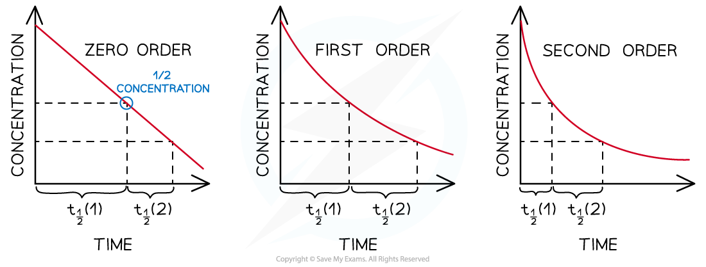
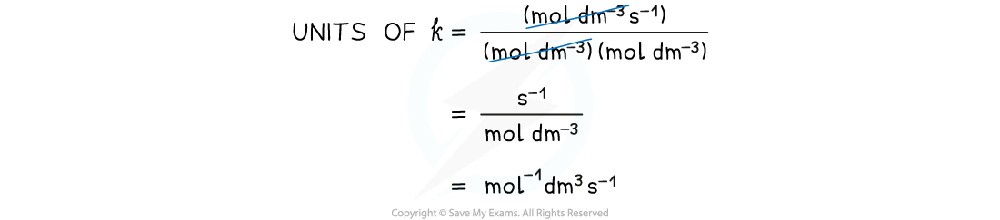

# Chemical Kinetics Calculations

## Chemical Kinetics Calculations

> **Spec point** — `spcpt_SbTsrshCdzPGYxtC`

## Chemical Kinetics Calculations

### Order of reaction

- The **order of reaction **shows how the concentration of a reactant affects the rate of reaction

**Rate = *****k***** [A]****m**** [B]****n**

- When m or n is zero = the concentration of the reactants does not affect the rate
- When **the order of reaction** (m or n) of a reactant is 0, its concentration is ignored
- The **overall order of reaction** is the sum of the powers of the reactants in a rate equation
- For example, in the reaction below, the overall order of reaction is 2 (1 + 1)

**Rate = *****k***** [NO****2****] [Cl****2****]**

### Order of reaction from concentration-time graphs

- In a** zero-order **reaction, the concentration of the reactant decreases linearly with time

  - The graph is a **straight line with a negative gradient**

#### A zero-order concentration-time graph

*A zero-order concentration-time graph is a straight line*

- In a **first-order **reaction, the concentration of the reactant decreases with time

  - The graph is a curve going downwards and eventually plateaus

#### A first-order concentration-time graph

*A first-order concentration-time graph is a smooth curve*

- In a **second-order** reaction, the concentration of the reactant decreases more steeply with time

  - The concentration of reactant decreases **more** with increasing time compared to in a first-order reaction
  - The graph is a steeper curve going downwards

#### A second-order concentration-time graph

*A second-order concentration-time graph is a smooth and steep curve*

#### Order of reaction from initial rate

- The **progress** of the reaction can be followed by measuring the **initial** **rates** of the reaction using various **initial concentrations **of each reactant
- These rates can then be plotted against concentration in a rate-concentration graph
- In a** zero-order **reaction, the rate doesn’t depend on the concentration of the reactant

  - The rate of the reaction therefore remains constant throughout the reaction
  - The graph is a **horizontal line**
  - The rate equation is **rate = *****k***

#### A zero-order rate-concentration graph

*A zero-order rate-concentration graph is a flat line*

- In a **first-order **reaction, the rate is directly proportional to the concentration of a reactant

  - The rate of the reaction decreases as the concentration of the reactant decreases when it gets used up during the reaction
  - The graph is a **straight line**
  - The rate equation is **rate = *****k***** [A]**

#### A first-order rate-concentration graph

*A first-order rate-concentration graph is a straight line with a fixed gradient, k*

- In a **second-order** reaction, the rate is directly proportional to the square of concentration of a reactant

  - The rate of the reaction decreases more as the concentration of the reactant decreases when it gets used up during the reaction
  - The graph is a **curved line**
  - The rate equation is **rate = *****k***** [A]****2**

#### A second-order rate-concentration graph

*A second-order rate-concentration graph is a smooth curve*

### Order of reaction from half-life

- The order of a reaction can also be deduced from its **half-life (t****1/2 ****)**
- For a **zero-order **reaction, the successive half-lives decrease with time

  - This means that it would take **less** time for the concentration of reactant to halve as the reaction progresses
- The half-life of a **first-order **reaction remains **constant **throughout the reaction

  - The amount of time required for the concentration of reactants to halve will be the same during the entire reaction
- For a **second-order **reaction, the half-life increases with time

  - This means that as the reaction is taking place, it takes more time for the concentration of reactants to halve

#### Half-lives of zero, first and second-order reactions

*Zero-order reactions have a decreasing half-life, first-order reactions have a constant half-life and second-order reactions have an increasing half-life *

### Calculating the initial rate

- The **initial rate **can be calculated by using the **initial concentrations **of the reactants in the rate equation
- For example, in the reaction of bromomethane (CH3Br) with hydroxide (OH-) ions to form methanol (CH3OH):

**CH****3****Br + OH****-**** → CH****3****OH + Br****-**** **

- The rate **equation** is:

**Rate = *****k***** [CH****3****Br] [OH****-****]**

- Where *k* = 1.75 x 10-2 dm-2 mol-1 s-1
- If the **initial concentrations **of CH3Br and OH- are 0.0200 and 0.0100 mol dm-3 respectively, the **initial rate** of reaction is:

  - Rate = *k* [CH3Br] [OH-]
  - Initial rate = 1.75 x 10-2 x (0.0200) x (0.0100)
  - Initial rate = 3.50 x 10-6 mol dm-3 s-1

### Calculating Units

- When you are asked to calculate the rate constant, *k*, for a reaction you must also be able to deduce the units
- This is done by replacing the values in the rearranged rate equation with the units of that value
- The units can then be combined or cancelled as required
- For example, to calculate the units for the above reaction:

