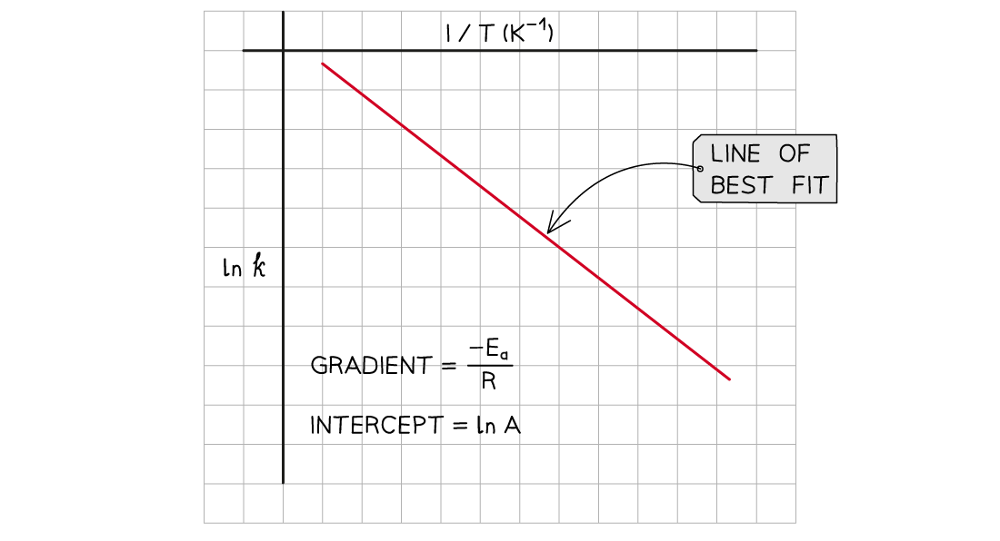

# Factors affecting Rate Constant

## Effect of Temperature on the Rate Constant

> **Spec point** — `spcpt_tdDd42XcBrjsNCKg`

## Effect of Temperature on the Rate Constant

- At higher temperatures, a greater proportion of molecules have energy greater than the activation energy
- Since the **rate constant **and **rate of reaction **are **directly proportional **to the fraction of molecules with energy equal or greater than the activation energy, then at higher temperatures:

  - The **rate constant** increases
  - The **rate of reaction** increases
- The relationship between the rate constant and the temperature is given by the following equation:

$\mathrm{ln}k=\mathrm{ln}A-\frac{E_{a}}{RT}$

- Where:

  - **ln *****k*** = natural logarithm of the rate constant
  - ***A*** = constant related to the collision frequency and orientation of the molecules
  - ***E******a***** **= activation energy (joules, J)
  - ***R*** = gas constant (8.31 J K-1 mol-1)
  - ***T*** = temperature (kelvin, K)
- ***A*** varies only a little bit with temperature, it can be considered a constant
- ***E******a*** and ***R*** are also constants

- A graph of ln *k* against $\frac{1}{T}$ gives a line with an equation of the form y = mx + c

$\mathrm{ln}k=\frac{-E_{a}}{R}\frac{1}{T}+\mathrm{ln}A$

- Where:

  - y = ln *k*
  - x = $\frac{1}{T}$
  - m = $\frac{-E_{a}}{R}$ (the gradient)
  - c = ln *A* (the y-intercept)

- The equation shows that an **increase **in temperature (higher value of *T*) gives a **greater **value of ln *k* (and therefore a higher value of *k*)
- Since the **rate of the reaction **depends on the **rate constant **(*k*) an increase in *k* also means an increased rate of reaction

#### Example graph of ln k over 1/T

*The graph of ln k over 1/T is a straight line with gradient -Ea/R*

> **Exam Hint**
> You are not required to learn this equation however it is helpful in understanding the effects of temperature on the rate constant.
