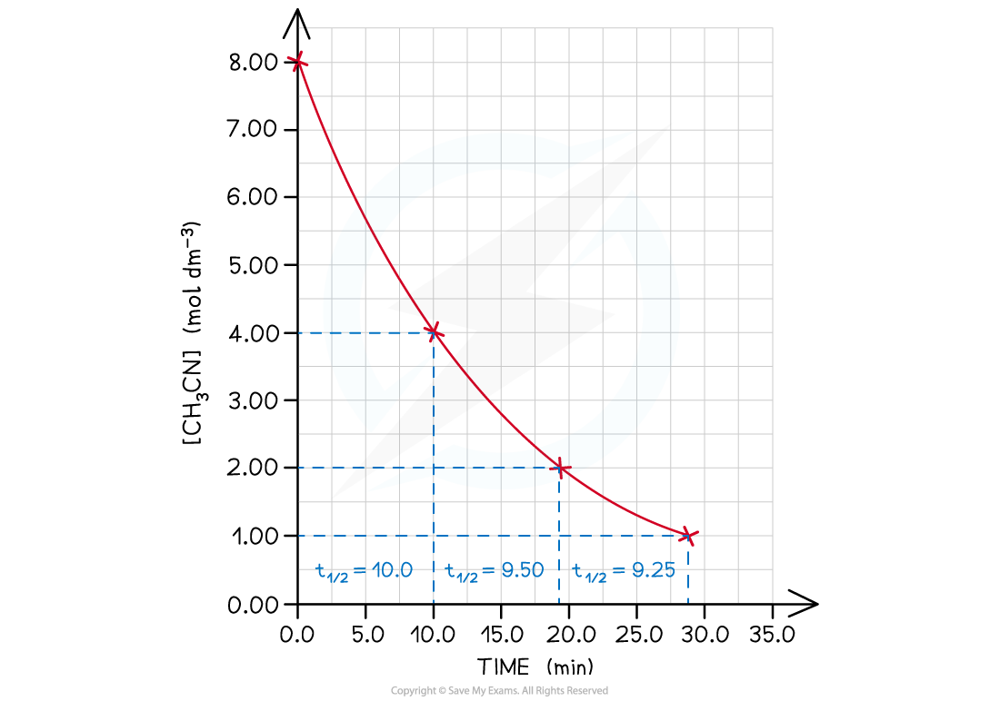

# Half-Life

## First Order Reaction Half-life

> **Spec point** — `spcpt_qrns7rFJ3XYbdN3M`

## First Order Reaction Half-life

- The **half-life** of a **first-order** reaction is **independent **of the concentration of reactants

  - This means that despite the **concentrations of the reactants decreasing **during the reaction
  - The amount of time taken for the **concentrations of the reactants to halve** will remain the same throughout the reaction
  - The concentration-time graph for a first-order reaction is a downward curve with a constant half-life.
- The **rearrangement** of the **methyl group **(CH3) in ethanenitrile (CH3CN) is an example of a first-order reaction with rate equation **rate = *****k***** [CH****3****CN]**

#### Rearrangement of the CH3 group in CH3CN

**CH****3****CN (g) → CH****3****NC (g)**

- Experimental data on the changes in concentration over time suggests that the **half-life** is constant

  - Even if the half-lives are slightly different from each other, they can still be considered to remain constant
- This means that no matter what the original concentration of the CH3CN is, the half-life will always be around 10.0 minutes

#### Half-life table

| **Change in [CH****3****CN] (mol dm****-3****)** | **Half-life (minutes)** |
|---|---|
| 8.00 - 4.00 | 10.0 |
| 4.00 - 2.00 | 9.50 |
| 2.00 - 1.00 | 9.25 |

#### Graph of  [CH3CN] over time

*Since this is a first-order reaction, the time taken for the concentration to halve remains constant*

> **Worked Example**
> **Using the half-life of first-order reactions in calculations**
> 
> The change in concentration of a reactant over time is recorded in the following table:
> 
> | **Time ** **(s)** | **0** | **200** | **400** | **600** | **800** | **1000** | **1200** | **1400** | **1600** |
> |---|---|---|---|---|---|---|---|---|---|
> | **[reactant] x10****-4**** (mol dm****-3****)** | 5.8 | 4.4 | 3.2 | 2.5 | 1.7 | 1.2 | 0.8 | 0.5 | 0.3 |
> 
> 1. Draw a graph of concentration against time for these results.
> 2. Determine the first and second half-lives and hence determine the order of the reaction.
> 
> **Answer**
> 
> 1. Draw a graph of concentration against time for these results. 
> 2. Determine the first and second half-lives and hence determine the order of the reaction.
> 
>   - Find the first and second half-lives by determining when the concentrations halve using the graph:
> 
> |   | **Change in [reactant]** **(x10****-4**** mol dm****-3****)** | **Half-life** **(s)** |
> |---|---|---|
> | **First half-life** | 5.80 - 2.90 | 470 - 0 = 470 |
> | **Second half-life** | 2.90 - 1.45 | 920 - 470 = 450 |
> 
> - Determine the reaction order
> 
>   - It is a first-order reaction
>   - The successive half-lives remain reasonably constant (around 450 seconds) throughout the reaction
