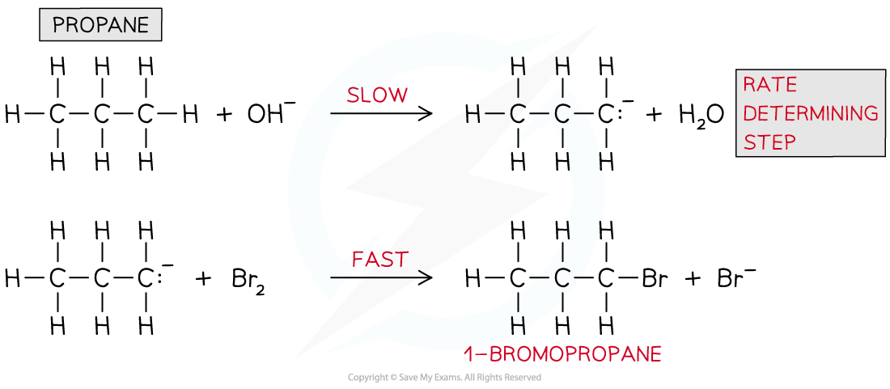
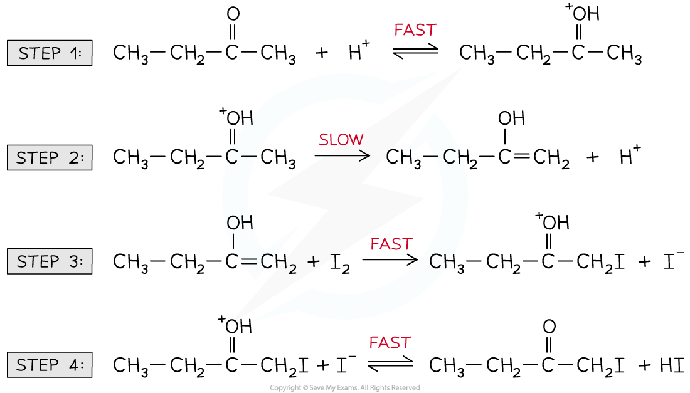

# Multi-Step Reactions

## Kinetics of Multi-Step Reactions

> **Spec point** — `spcpt_7CpJ4YCHWydphVQr`

## Kinetics of Multi-Step Reactions

- The **reaction** **mechanism** of a reaction describes how many steps are involved in the **making **and **breaking** of bonds during a chemical reaction
- It is the slowest step in a reaction and includes the reactants that have an impact on the reaction rate when their concentrations are changed

  - Therefore, all reactants that appear in the **rate equation **will also appear in the rate-determining step
  - This means that zero-order reactants and **intermediates **will not be present in the rate-determining step

### Predicting the reaction mechanism

- The **overall reaction equation** and **rate equation** can be used to predict a possible reaction mechanism of a reaction
- For example, nitrogen dioxide (NO2) and carbon monoxide (CO) react to form nitrogen monoxide (NO) and carbon dioxide (CO2)
- The overall reaction equation is:

**NO****2**** (g) + CO (g) → NO (g) + CO****2**** (g)**

- The rate equation is:

**Rate = *****k***** [NO****2****]****2**

- From the rate equation, it can be concluded that the reaction is **zero order** with respect to CO (g) and **second order** with respect to NO2 (g)
- This means that there are **two molecules** of NO2 (g) involved in the **rate-determining step**
- A possible reaction mechanism could therefore be:

  - **Step 1:**
  
    - **2NO****2**** (g) → NO (g) + NO****3**** (g)**     **slow **(rate-determining step)
  - **Step 2:**
  
    - **NO****3**** (g) + CO (g) → NO****2**** (g) + CO****2**** (g)**     **fast**
  - **Overall:**
  
    - **2****NO****2**** (g) + ****NO****3**** (g)**** + CO (g) → NO (g) + ****NO****3**** (g)**** + ****NO****2**** (g) ****+ CO****2**** (g)**
    - Which simplifies to** NO****2**** (g) + CO (g) → NO (g) + CO****2**** (g)**

### Predicting the reaction order & deducing the rate equation

- The **order** of a reactant and thus the rate equation can be deduced from a reaction mechanism given that the rate-determining step is known
- For example, the reaction of nitrogen oxide (NO) with hydrogen (H2) to form nitrogen (N2) and water

**2NO (g) + 2H****2**** (g) → N****2**** (g) + 2H****2****O (l)**

- The reaction mechanism for this reaction is:

  - **Step 1:**
  
    - **NO (g) + NO (g) → N****2****O****2 ****(g)**     **fast**
  - **Step 2:**
  
    - **N****2****O****2**** (g) + H****2**** (g) → H****2****O (l) + N****2****O (g) **    **slow **(rate-determining step)
  - **Step 3:**
  
    - **N****2****O (g) + H****2**** (g) → N****2**** (g) + H****2****O (l)     fast**
  - The second step in this reaction mechanism is the **rate-determining step**
  - The rate-determining step consists of:
  
    - N2O2 which is formed from the reaction of **two NO molecules**
    - **One H****2**** molecule**
- The reaction is, therefore, **second order **with respect to NO and **first order **with respect to H2

  - So, the **rate** **equation** becomes:

**Rate = *****k***** [NO]****2**** [H****2****]**

- The reaction is, therefore, **third-order overall**

### Identifying the rate-determining step

- The rate-determining step can be identified from a rate equation given that the reaction mechanism is known
- For example, propane (CH3CH2CH3) undergoes bromination under alkaline solutions
- The overall reaction is:

**CH****3****CH****2****CH****3**** + Br****2**** + OH****-**** → CH****3****CH****2****CH****2****Br + H****2****O + Br****-**

- The reaction mechanism is:

*Reaction mechanism of the bromination of propane under alkaline conditions*

- The rate equation is:

**Rate = *****k***** [CH****3****CH****2****CH****3****] [OH****-****]**

- From the rate equation, it can be deduced that only CH3COCH3 and OH- are involved in the **rate-determining step** and not bromine (Br2)
- CH3COCH3 and OH- are only involved in step 1

  - Therefore, the **rate-determining step **is step 1 of the reaction mechanism

### Identifying intermediates & catalyst

- When a rate equation includes a species that is not part of the chemical reaction equation then this species is a **catalyst**
- For example, the halogenation of butanone under acidic conditions
- The reaction mechanism is:

**CH****3****CH****2****COCH****3**** + I****2**** **$\overset{H^{+}}{\rightarrow}$** CH****3****CH****2****COCH****2****I + HI**

- The reaction mechanism is:

*Reaction mechanism of the halogenation of butanone under acidic conditions*

The rate equation is:

**Rate = *****k***** [CH****3****CH****2****COCH****3****] [H****+****]**

- The H+ is not present in the **chemical reaction equation** but **does **appear in the rate equation

  - H+ must therefore be a **catalyst**
- Furthermore, the rate equation suggests that CH3CH2COCH3 and H+ must be involved in the rate-determining (slowest) step
- The CH3CH2COCH3 and H+ appear in the rate-determining step in the form of an **intermediate **(which is a combination of the two species)

#### The intermediate formed in the reaction of CH3CH2COCH3 and H+

*This intermediate is formed in the rate-determining step*
