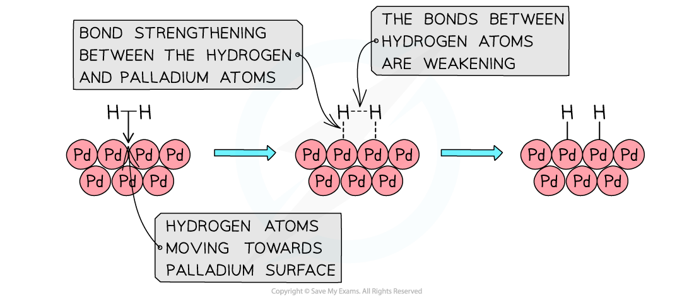
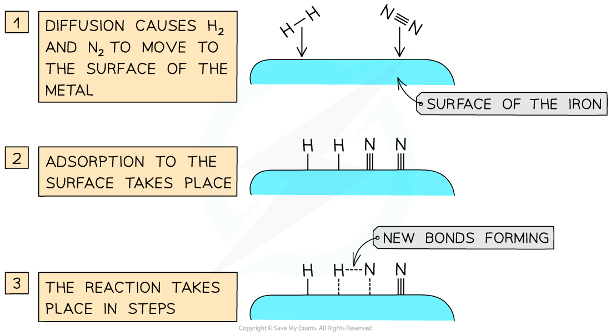
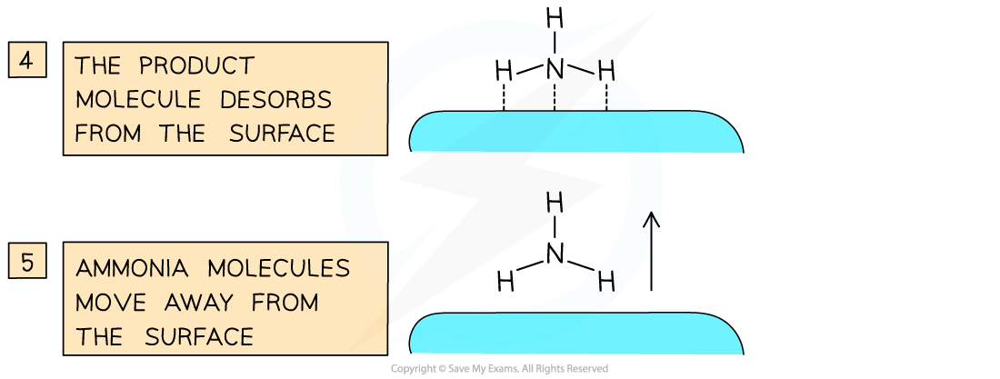
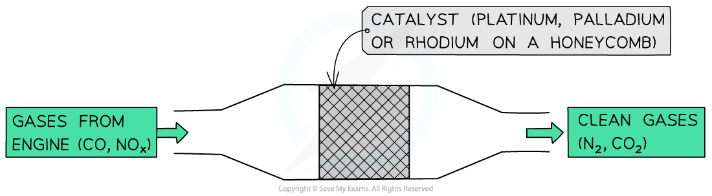
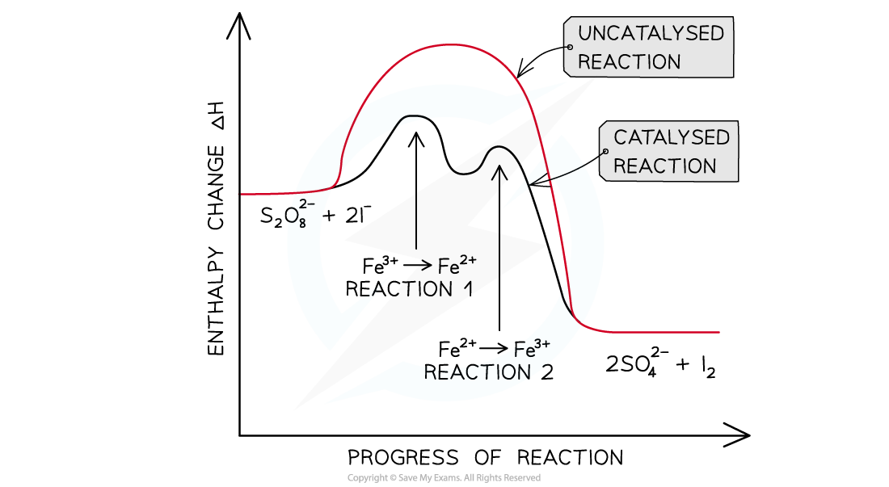

# Homogeneous & Heterogeneous Catalysts

## Homogeneous & Heterogeneous Catalysis

> **Spec point** — `spcpt_WYqwz3Hhvhm6sW8N`

## Homogeneous & Heterogeneous Catalysis

- **Catalysts **increase the rate of reaction by providing an alternative pathway which has a lower **activation energy**
- Catalysts can be either **homogeneous **or **heterogeneous**

### Homogeneous catalysts

- Homogeneous catalysts are those that are in the same phase as the reaction mixture
- For example, in the esterification of ethanoic acid (CH3COOH) with ethanol (CH3CH2OH) to form ethyl ethanoate (CH3COOCH2CH3) under acidic conditions:

**CH****3****COOH (aq) + CH****3****OH (aq) **$\overset{H^{+}(\mathrm{aq})}{\rightarrow}$** CH****3****COOC****2****H****5**** (aq) + H****2****O (l)**

- The H+ is a homogeneous catalyst and like the reactants and product it is in the **aqueous** phase

### Heterogeneous catalysts

- Heterogeneous catalysts are those that are in a different phase to the rest of the reaction mixture
- For example, in the Born-Haber process to form ammonia (NH3) from nitrogen (N2) and hydrogen (H2) an iron (Fe) catalyst is used:

**N****2**** (g) + 3H****2**** (g) **$\overset{\mathrm{Fe}(s)}{\rightarrow}$** 2NH****3**** (g)**

- The Fe catalyst is a heterogeneous catalyst as it is in **the** solid phase, whereas the reactants and products are all in the **gas **phase

## Heterogeneous Catalysis

> **Spec point** — `spcpt_rHGZxjZnWsjC43vN`

## Heterogeneous Catalysis

- In **heterogeneous catalysis,** the molecules react at the surface of a solid catalyst
- The mode of action of a heterogeneous catalyst consists of the following steps:
- **Adsorption **(or **chemisorption**) of the reactants on the catalyst surface

  - The reactants diffuse to the surface of the catalyst
  - The reactant is **physically** **adsorbed** onto the surface by **weak** **forces**
  - The reactant is **chemically** **adsorbed** onto the surface by **stronger** **bonds**
  - Chemisorption causes **bond** **weakening** between the atoms of the reactants
- **Desorption** of the products

  - The bonds between the products and catalyst weaken so much that the products break away from the surface
- For example, the adsorption of hydrogen molecules onto a palladium (Pd) surface

#### How heterogeneous catalysts generally work

*The reactants are adsorbed on the catalyst surface causing bond weakening and eventually desorption of the products*

### Iron in the Haber process

- In the **Haber** **process** ammonia (NH3) is produced from nitrogen (N2) and hydrogen (H2)
- An **iron** **catalyst** is used which speeds up the reaction by bringing the reactants close together on the metal surface
- This increases their likelihood to react with each other
- The mode of action of the iron catalyst is as follows:

  - **Diffusion **of the nitrogen and hydrogen gas to the iron surface
  - **Adsorption **of the reactant molecules onto the iron surface by forming bonds between the iron and reactant atoms
  
    - These bonds are so strong that they weaken the covalent bonds between the nitrogen atoms in N2 and hydrogen atoms in H2
    - But they are weak enough to break when the catalysis has been completed
  - **The reaction **takes place between the adsorbed nitrogen and hydrogen atoms which react with each other on the iron surface to form NH3
  - **Desorption **occurs when the bonds between the NH3 and iron surface are weakened and eventually broken
  - The formed NH3 **diffuses **away from the iron surface

#### Iron as a heterogeneous catalyst in the Haber Process

*Iron brings the nitrogen and hydrogen closer together so that they can react and hence increases the rate of reaction*

### Heterogeneous catalysts in catalytic converters

- Heterogeneous catalysts are also used in the **catalytic** **removal** of oxides of nitrogen from the exhaust gases of car engines
- The catalysts speed up the conversion of:

  - Nitrogen oxides (NOy) into **harmless nitrogen gas** (N2)
  - Carbon monoxide (CO) into carbon dioxide (CO2)
- The catalytic converter has a **honeycomb **structure containing small beads coated with **platinum, palladium, **or **rhodium metals** which act as **heterogeneous catalysts**
- The mode of action of the catalysts is as follows:

  - **Adsorption **of the nitrogen oxides and CO onto the catalyst surface
  - **The weakening **of the covalent bonds within nitrogen oxides and CO
  
    - Formation of new bonds between:
    - Adjacent nitrogen atoms to form N2 molecules
    - CO and oxygen atoms to form CO2 molecules
  - **Desorption **of N2 and CO2 molecules which eventually **diffuse **away from the metal surface

#### Heterogeneous catalysts in car exhausts

*The metals in catalytic converters speed up the conversion of nitrogen oxides and carbon monoxide into nitrogen  and carbon dioxide respectively*

## Homogeneous Catalysis

> **Spec point** — `spcpt_rYtBqPq5HShRbMTc`

## Homogeneous Catalysis

- **Homogeneous catalysis** often involves **redox reactions **in which the ions involved in catalysis undergo changes in their **oxidation number**

  - As ions of transition metals can change oxidation number they are often good catalysts
- Homogeneous catalysts are used in one step and are reformed in a later step

### The iodine-peroxydisulfate reaction

- This is a very **slow **reaction in which the peroxydisulfate (S2,O82- ) ions **oxidise **the **iodide **to **iodine**

**S****2****O****8****2-**** (aq) + 2I****-**** (aq) → 2SO****4****2-**** (aq) + I****2**** (aq)**

- Since both the S2O82- and I- ions have a negative charge, it will require a lot of energy for the ions to overcome the **repulsive** **forces** and collide with each other
- Therefore, Fe3+ (aq) ions are used as a **homogeneous catalyst**
- The catalysis involves two **redox reactions**:

  - First, Fe3+ ions are **reduced** to Fe2+ by  I**-**

**2Fe****3+**** (aq) + 2I****-**** (aq) → 2Fe****2+**** (aq) + I****2**** (aq)**

- Then, Fe2+ is **oxidised **back to Fe**3+** by S2O82-

**2Fe****2+**** (aq) + S****2****O****8****2-**** (aq) → 2Fe****3+**** (aq) + 2SO****4****2-****  (aq)**

- By reacting the reactants with a positively charged Fe ion, there are no repulsive forces, and the activation energy is significantly lowered
- The order of the two reactions does not matter

  - So, Fe2+ can be first oxidised to Fe3+ followed by the reduction of Fe3+ to Fe2+

#### The reaction pathway diagram for a two-stage catalysed reaction

*The catalysed reaction has two energy ‘humps’ because it is a two-stage reaction*

### Nitrogen oxides & acid rain

- As fossil fuels contain sulfur, burning the fuels will release sulfur dioxide which oxidises in air to sulfur trioxide, and then **dilute sulfuric acid **(H2SO4) is formed by reaction with water. The result is acidification of rain:

**SO****3 ****(g) + H****2****O (l) → H****2****SO****4 ****(aq)**

- Nitrogen oxides can act as **catalysts **in the formation of acid rain by catalysing the oxidation of SO2 to SO3

**NO****2 ****(g) + SO****2 ****(g) → SO****3 ****(g) + NO (g)**

- The formed NO gets oxidised to regenerate NO2

**NO (g) + ½ O****2 ****(g) → NO****2 ****(g)**

- The regenerated NO2 molecule can again oxidise another SO2 molecule to SO3 which will react with rainwater to form H2SO4 and so on
