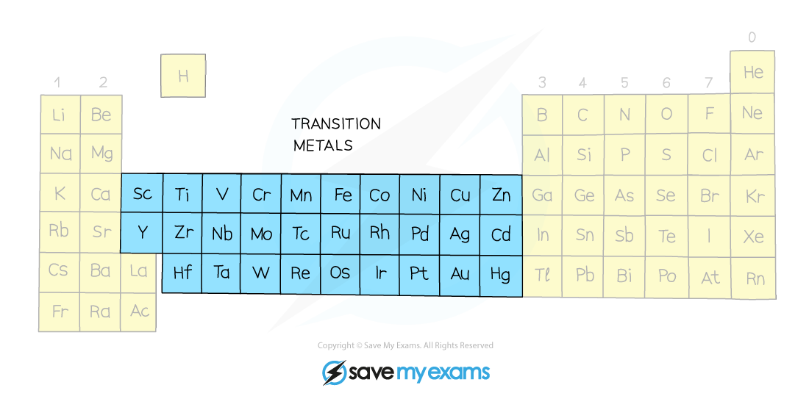
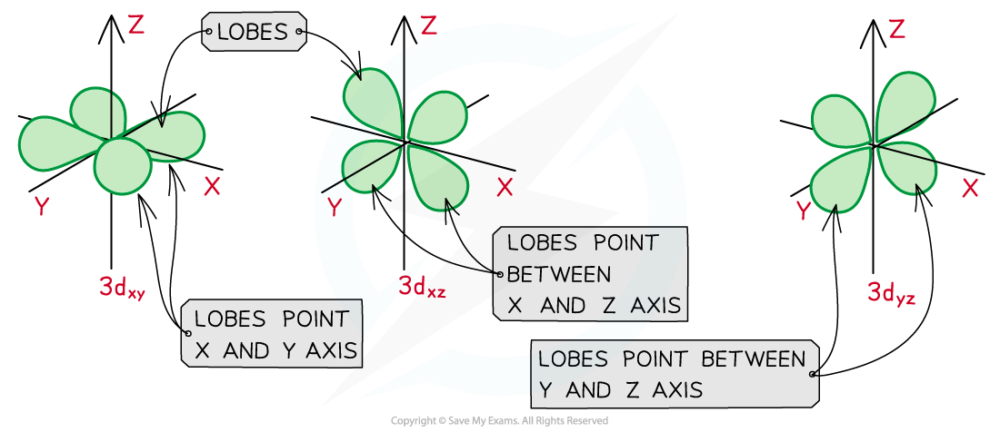
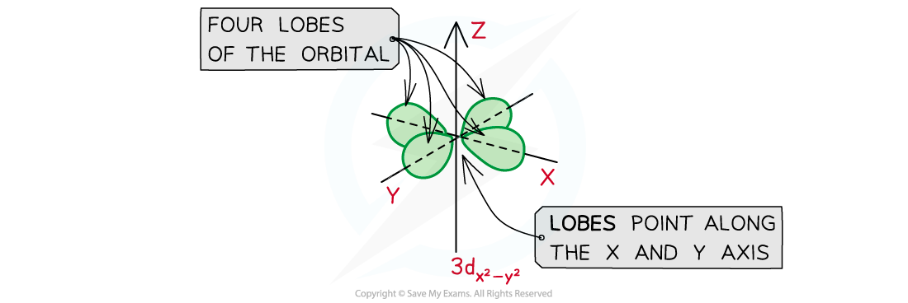
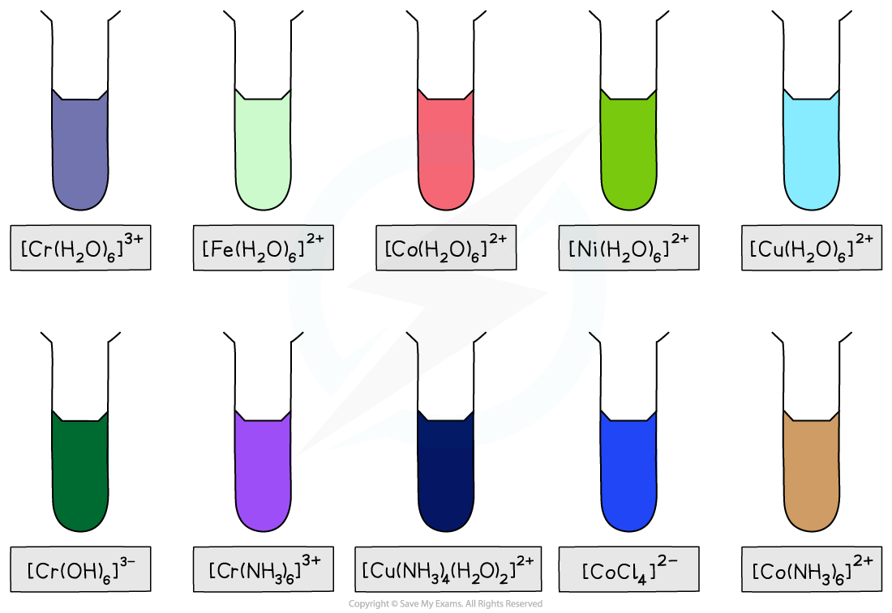

# The Transition Elements: Titanium to Copper

## Definition of a Transition Element

> **Spec point** — `spcpt_H7SJdYbRm6qYMXvq`

## Definition of a Transition Element

- **Transition elements **are d-block elements which form **one** or **more** **stable** **ions** with an **incomplete d subshell**
- They are all metals found in the d-block of the Periodic Table, between Groups 2 and 13

  - Sometimes they are referred to as transition metals
- Not all d-block elements are classed as transition elements: scandium and zinc, for example, are not classed as transition elements, despite being in the d-block
- **Scandium** is not classed as a transition element because:

  - It only forms **one **ion, Sc3+
  - The Sc3+ion has **no electrons** in its 3d subshell; it has the electronic configuration of [Ar]
- **Zinc** is also not classed as a transition element because:

  - It also forms only **one** ion, Zn2+
  - The Zn2+ ion has a **complete** 3d subshell; it has the electronic configuration [Ar]3d10

#### The transition elements on the periodic table

*The transition elements are in the central d-block on the Periodic Table*

## Shape of 3dxy & 3dz2 Orbitals

> **Spec point** — `spcpt_NbNYhht9c3VfCWbp`

## Shape of 3d(xy) & 3d(z2) Orbitals

- The transition elements all have **incomplete **d subshells
- There are five orbitals in a d subshell. Some of these orbitals may have similar **shapes **but different **orientations**, whereas others may have completely different **shapes**
- The five orbitals are

  - 3dyz
  - 3dxz
  - 3dxy
  - 3dx2 - y2
  - 3dz2
- Note that students are required to sketch the shapes of the **3d****xy**** **and **3d****z****2**** **orbitals **only**

### Shapes of the 3d orbitals

- The 3dyz, 3dxz, and 3dxy orbitals are orbitals which lie in the y-z, x-z and x-y plane respectively

  - They all have **four lobes** that point **between **the two axes

#### The 3dyz, 3dxz, and 3dxy orbitals

*The 3dyz, 3dxz, and 3dxy orbitals all have four lobes which are similar in shape but point between different axes*

- The 3dx2 - y2 orbital looks like the 3dyz, 3dxz, and 3dxy orbitals, as it also consists of **four lobes**
- The difference is that these lobes point **along **the x and y axes and **not **between them

#### The 3dx2-y2 orbital

*The four lobes in a 3dx2-y2 orbital point along the axes*

- The 3dz2 orbital is different from the other orbitals, as there are two main lobes which form a **dumbbell shape**
- The two main lobes point **along** the z-axis and there is a “doughnut” ring around the centre

#### The 3dz2 orbital

*The 3dz2 orbital has a dumbbell shape with a ring around the centre*

## Properties of the Transition Elements

> **Spec point** — `spcpt_w3P5KDR2PgWJNHqC`

## Properties of the Transition Elements

- Although the** transition elements** are metals, they have some properties unlike those of other metals on the periodic table, such as:

  - Variable **oxidation states**
  - Behave as **catalysts**
  - Form **complex ions**
  - Form **coloured compounds**

### Ions of transition metals

- Like other metals on the periodic table, the transition elements will lose electrons to form positively charged ions
- However, unlike other metals, transition elements can form more than one positive ion

  - They are said to have **variable oxidation states**
- Due to this, Roman numerals are used to indicate the oxidation state of the metal ion

  - For example, the metal sodium (Na) will only form Na+ ions (no Roman numerals are needed, as the ion formed by Na will always have an oxidation state of +1)
  - The transition metal iron (Fe) can form Fe2+ (Fe(II)) **and **Fe3+ (Fe(III)) ions
- The table below shows the most common oxidation states of a few transition metals

#### Oxidation states of transition elements table

| **Transition element** | **Common oxidation states** |
|---|---|
| **Ti** | +3, +4 |
| **V** | +2, +3, +4, +5 |
| **Cr** | +3, +6 |
| **Mn** | +2, +4, +6, +7 |
| **Fe** | +2, +3 |
| **Ni** | +2 |
| **Cu** | +1, +2 |

### Coloured complex

- Another characteristic property of transition elements is that their compounds are often **coloured**

  - For example, the colour of the [Cr(OH)6]3- complex (where the oxidation number of Cr is +3) is **dark green**
  - Whereas the colour of the [Cr(NH3)6]3+ complex (where the oxidation number of Cr is still +3) is **purple**

#### Colours of common transition metal complexes

*Examples of some transition metal ions and their coloured complexes*

### Transition elements as catalysts

- Since transition elements can have variable oxidation states, they make excellent **catalysts**
- During catalysis, the transition element can change to various oxidation states by gaining electrons or donating electrons from reagents within the reaction

  - For example, iron (Fe) is commonly used as a catalyst in the Haber Process, switching between the +2 and +3 oxidation states
- Substances can also be adsorbed onto their surface and activated in the process

### Complex ions

- Another property of transition elements caused by their ability to form variable oxidation states is their ability to form **complex ions**
- A complex ion is a molecule or ion, consisting of a central metal atom or ion, with a number of molecules or ions surrounding it
- The molecules or ions surrounding the central metal atom or ion are called **ligands**
- Due to the different oxidation states of the central metal ions, a different number and wide variety of ligands can form bonds with the transition element

  - For example, the chromium(III) ion can form [Cr(NH3)6]3+, [Cr(OH)6]3- and [Cr(H2O)6]3+ complex ions
