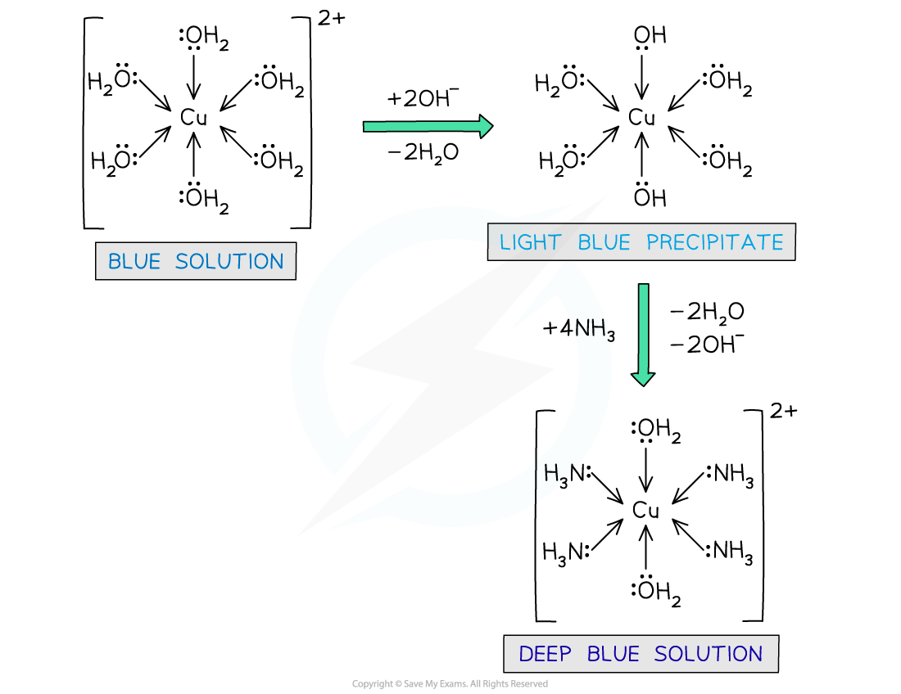
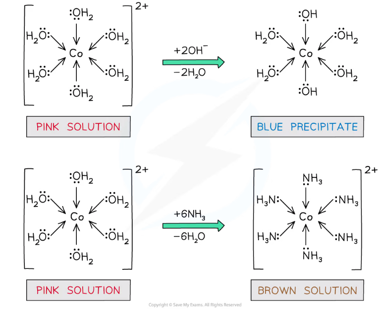

# Ligand Exchange

## Ligand Exchange

> **Spec point** — `spcpt_shV2fZB7wCbyWhsJ`

## Ligand Exchange

- **Ligand exchange **(or **ligand** **substitution**) is when one **ligand** in a complex is replaced by another
- Ligand exchange forms a new complex that is **more stable** than the original one
- The ligands in the original complex can be **partially** or **entirely** substituted by others
- There are no changes in coordination number, or the geometry of the complex if the ligands are of a** similar** **size**
- But, if the ligands are of a **different size**, for example, water ligands and chloride ligands, then a change in coordination number and the geometry of the complex will occur

### Substitution in copper(II) complexes

- When a transition element ion is in solution, it can be assumed that it exists as a **hexaaqua** complex ion (i.e. it has six water ligands attached to it)

  - For example, Cu2+(aq) is [Cu(H2O)6]2+(aq)
- The [Cu(H2O)6]2+ (aq) complex ion is **blue** in colour
- Upon **dropwise** addition of sodium hydroxide (NaOH) solution, a **light blue precipitate** is formed
- **Partial** ligand substitution of two water ligands by two hydroxide ligands has occurred

| **[Cu(H****2****O)****6****]****2+**** (aq)** | **+ 2OH****–**** (aq) →** | **[Cu(H****2****O)****4****(OH)****2****] (s)** | **+ 2H****2****O (l)** |
|---|---|---|---|
| **Blue solution** |   | **Pale blue precipitate** |   |

- Upon addition of **excess** **concentrated** ammonia (NH3) solution, the pale blue precipitate dissolves to form a **deep blue solution**
- Again, **partial** ligand substitution has occurred

| **[Cu(H****2****O)****4****(OH)****2****] (s)** | **+ 4NH****3**** (aq) →** | **[Cu(NH****3****)****4****(H****2****O)****2****]****2+**** (aq)** | **+ 2H****2****O (l) + 2OH****–**** (aq)** |
|---|---|---|---|
| **Pale blue precipitate** |   | **Deep blue solution** |   |

- If you were to add **concentrated ammonia** (NH3) solution **dropwise** to the [Cu(H2O)6]2+ (aq), rather than sodium hydroxide (NaOH) solution, the same** light blue precipitate** would form
- Again, the pale blue precipitate will **dissolve** to form a deep blue solution, if **excess** ammonia solution is then added

#### Examples of ligand exchange with copper(II) complexes

***Water ligands are exchanged by hydroxide and ammonia ligands in the copper(II)  complex***

- The water ligands in [Cu(H2O)6]2+ can also be substituted by **chloride** ligands, upon addition of **concentrated** hydrochloric acid (HCl)
- The **complete** substitution of the water ligands causes the **blue** solution to turn **yellow**

| **[Cu(H****2****O)****6****]****2+**** (aq)** | **+ 4Cl****–**** (aq) →** | **[CuCl****4****]****2–**** (aq)** | **+ 6H****2****O (l)** |
|---|---|---|---|
| **Blue solution** |   | **Yellow solution** |   |

- The** coordination number** has changed from **6 to 4**, because the chloride ligands are larger than the water ligands, so only 4 will fit around the central metal ion
- The geometry of the complex has also changed from **octahedral to tetrahedral**
- This is a reversible reaction, and some of the [Cu(H2O)6]2+ complex ion will still be present in the solution

  - The mixture of blue and yellow solutions in the reaction mixture will give it a **green **colour
- Adding **water** to the solution will cause the **chloride** ligands to be **displaced by the water **molecules, and the [Cu(H2O)6]2+ (aq) ion and the **blue solution** will return

#### Example of ligand exchange with copper(II) complexes and chloride ions

***Water ligands are exchanged by chloride ligands in the copper(II) complex***

### Substitution in cobalt(II) complexes

- The [Co(H2O)6]2+(aq) complex ion is **pink** in colour
- Upon **dropwise** addition of sodium hydroxide (NaOH) solution, a **blue **precipitate is formed
- **Partial** ligand substitution of two water ligands by two hydroxide (OH-) ligands has occurred

  - If the alkali is added in **excess**, the blue precipitate will turn **red** when warmed

| **[Co(H****2****O)****6****]****2+**** (aq)** | **+ 2OH****–**** (aq) →** | **[Co(H****2****O)****4****(OH)****2****] (s)** | **+ 2H****2****O (l)** |
|---|---|---|---|
| **Pink solution** |   | **Blue precipitate** |   |

- If** excess** **concentrated** ammonia solution is added to [Co(H2O)6]2+, a **brown **solution will also be formed

  - There will be no precipitate formed in this instance, as the ammonia has been added in excess and not dropwise
- **Complete** ligand substitution of the water ligands by ammonia ligands has occurred

| **[Co(H****2****O)****6****]****2+**** (aq)** | **+ 6NH****3**** (aq) →** | **[Co(NH****3****)****6****]****2+**** (aq)** | **+ 6H****2****O (l)** |
|---|---|---|---|
| **Pink solution** |   | **Brown solution** |   |

- The ammonia ligands make the cobalt(II) ion so **unstable **that it readily gets **oxidised **in air to cobalt(III), [Co(NH3)6]3+

#### Examples of ligand exchange with cobalt(II) complexes

***Water ligands are exchanged by hydroxide and ammonia ligands in the cobalt(II) complex***

- The water ligands in [Co[H2O)6]2+ can also be substituted by **chloride** ligands, upon addition of **concentrated** hydrochloric acid
- The **complete** substitution of the water ligands causes the **pink** solution to turn **blue**

| **[Co(H****2****O)****6****]****2+**** (aq)** | **+ 4Cl****–**** (aq) →** | **[CoCl****4****]****2–**** (aq)** | **+ 6H****2****O (l)** |
|---|---|---|---|
| **Pink solution** |   | **Blue solution** |   |

- Like with [Cu(H2O)6]2+ above, the** coordination number** has changed from **6 to 4**, because the chloride ligands are larger than the water ligands, so only 4 will fit around the central metal ion
- The geometry of the complex has also changed from **octahedral **to** tetrahedral**
- Adding **water** to the solution will cause the **chloride** ligands to be **displaced by the water **molecules, and the [Co(H2O)6]2+ (aq) ion and the **pink solution** will return

#### Example of ligand exchange with cobalt(II) complexes and chloride ions

***Water ligands are exchanged by chloride ligands in the cobalt(II) complex***
