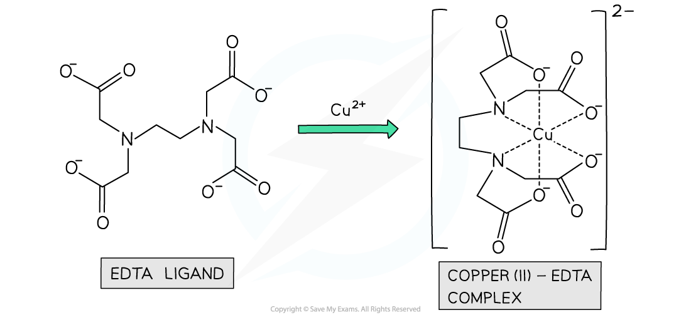

# Ligands

## Define Ligand

> **Spec point** — `spcpt_PY5ZP65g25YBSxDb`

## Define Ligand

- A **ligand **is a molecule or ion that has **one **or **more **lone pairs of electrons
- These lone pairs of electrons are donated by the ligand, to form **dative covalent bonds** to a central metal atom or ion

#### Examples of ligands table

| **Ligand name** | **Ligand formula** |
|---|---|
| **Water** | H2O |
| **Ammonia** | NH3 |
| **Chloride** | Cl– |
| **Cyanide** | CN– |
| **Thiocyanate** | SCN– |
| **Ethanedioate (ox)** | –COO–COO– C2O42– |
| **1,2-diaminoethane** | H2NCH2CH2NH2 |

#### Example of a complex formed between a central Fe2+ ion and water ligands

***The complex of a central Fe******2+****** ion and water ligands is formed with dative covalent bonds***

## Types of Ligands

> **Spec point** — `spcpt_n66frSkpVhDzjr6t`

## Types of Ligands

- Different** ligands** can form different numbers of dative bonds to the central metal ion in a complex.

  - Some ligands can form **one** dative bond to the central metal ion
  - Other ligands can form **two** dative bonds, and some can form **multiple** dative bonds

### Monodentate ligands

- **Monodentate** ligands can form only **one **dative bond to the central metal ion
- Examples of monodentate ligands are:

  - Water (H2O) molecules
  - Ammonia (NH3) molecules
  - Chloride (Cl-) ions
  - Cyanide (CN-) ions

#### Examples of complexes with monodentate ligands

***Smaller monodentate ligands tend to form octahedral complexes, while larger monodentate ligands tend to form tetrahedral complexes***

### Bidentate ligands

- **Bidentate** ligands can each form **two **dative bonds to the central metal ion
- This is because each ligand contains **two **atoms with lone pairs of electrons
- Examples of bidentate ligands are:

  - 1,2-diaminoethane (H2NCH2CH2NH2) which is also written as **‘en’**
  - Ethanedioate ion (C2O42- ) which is sometimes written as **‘ox’**

#### Examples of complexes with bidentate ligands

***The en and ox bidentate ligands form coordinate bonds through the lone pairs on the nitrogen and oxygen atoms respectively***

### Polydentate ligands

- Some ligands contain more than two atoms with lone pairs of electrons
- These ligands can form more than two dative bonds to the central metal ion and are said to be **polydentate** ligands
- An example of a polydentate ligand is EDTA4- , which is a **hexadentate **ligand as it forms 6 dative covalent bonds to the central metal ion

#### Example of a polydentate ligand complex

***The EDTA******4-****** ligand forms 6 coordinate bonds to the central metal ion***
