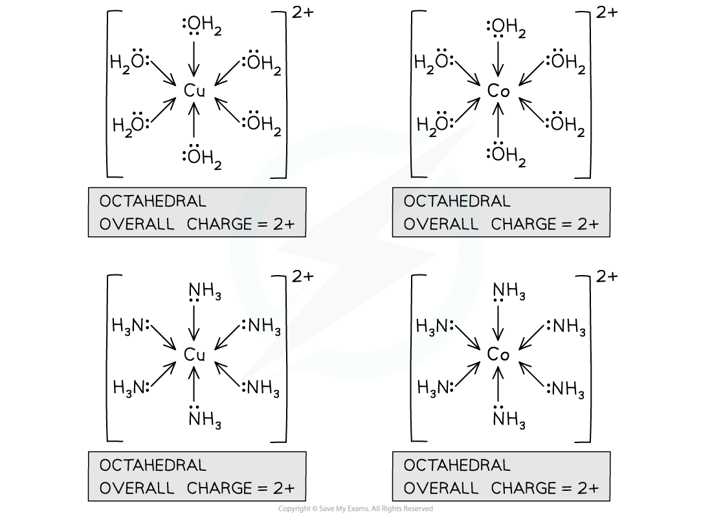
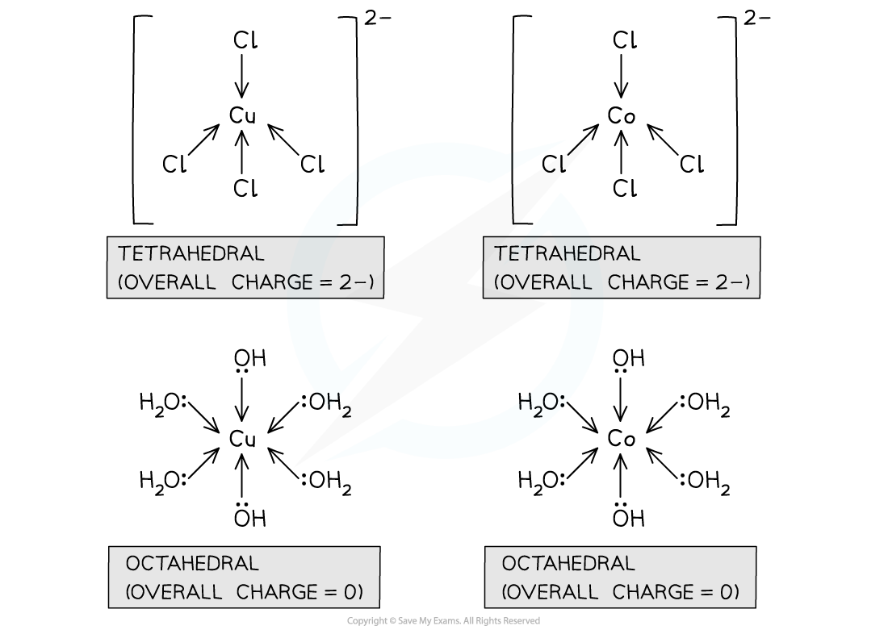

# Transition Metal Complexes

## Complex Formation

> **Spec point** — `spcpt_Fb3h47gy8cCcwBTX`

## Complex formation

### What is a complex?

- A **complex **is a molecule or ion formed by a **central metal atom** **or ion** surrounded by one or more **ligands**
- A [ligand](https://www.savemyexams.com/a-level/chemistry/cie/25/revision-notes/28-chemistry-of-transition-elements/28-2-general-characteristic-chemical-properties-of-the-first-set-of-transition-elements-titanium-to-copper/ligands/) is a species with a lone pair of electrons that can be donated to the metal ion

  - Ligands form **dative covalent bonds** with the metal by donating their lone pair of electrons** **
- For example, [Al(H2O)6]3+ (aq):

*Al(III) is the central metal ion with 6 water ligands, each donating a lone pair*

### Transition metal complex formation

- Transition metal ions readily form **complexes **with **ligands**
- Copper(II) and cobalt(II) ions will be used as examples of the central metal ions, in the complexes with:

  - Water (H2O)
  - Ammonia (NH3)
  - Hydroxide (OH-)
  - Chloride (Cl-)

### Co(II) and Cu(II) complexes with water & ammonia

- Water and ammonia are **neutral **ligands

  - Water donates a lone pair from the oxygen atom
  - Ammonia donates a lone pair from the nitrogen atom
- Water and ammonia are small ligands

  - Up to 6 water or ammonia ligands can fit around a central metal ion
  - This results in 6 dative covalent bonds
- 6 dative covalent bonds give:

  - An octahedral shape
  - A coordination number of 6
  
    - The **coordination** **number** of a complex is the number of dative covalent bonds formed between the central metal ion and the ligands

#### Cobalt(II) and copper(II) complexes with water and ammonia

*Cobalt(II) and copper(II) form octahedral complexes with ammonia and water ligands*

- The overall charge of a complex is the sum of the charge on the central metal ion, and the charges on each of the ligands
- For a cobalt(II) or copper(II) complex with 6 water or ammonia ligands:

  - The central metal ion has a charge of **2+**
  - The ligands have a charge of **0**
  - So, the **overall charge** of the complex is (2+) + (6 x 0) = **2+**

### Complexes with hydroxide & chloride ions

- Hydroxide ions, OH-, and chloride ions, Cl-, are **negatively **charged ligands

  - Each donates a lone pair of electrons to form a dative covalent bond with the central metal ion

#### Hydroxide complexes

- Hydroxide ions are small ligands

  - Up to 6 hydroxide ions can fit around a central metal ion
  - This results in:
  
    - 6 dative covalent bonds
    - An octahedral shape
    - A coordination number of 6

> **Exam Hint**
> Although up to 6 hydroxide ions can fit around a central metal ion, in many examples only 2 hydroxide ions are present alongside 4 water ligands

#### Chloride complexes

- Chloride ions are large ligands

  - Up to 4 chloride ligands can fit around a central metal ion
  - This results in 4 dative covalent bonds
- 4 dative covalent bonds give:

  - A tetrahedral shape
  - A coordination number of 4

#### Charges of Co(II) complexes with hydroxide and chloride ligands

- Co(II) ions commonly form complexes with 2 hydroxide ion ligands

  - The remaining ligands are water
- For this cobalt(II) complex:

  - The central metal ion has a charge of **2+**
  - The water ligands have a charge of **0**
  - The 2 hydroxide ligands have a charge of 2 x (-1) = **-2**
  - So, the **overall charge** of the complex is (2+) + (4 x 0) + (-2) = **0**

[Co(H2O)4(OH)2]

- Co(II) ions commonly form complexes with 4 chloride ion ligands
- For this cobalt(II) complex:

  - The central metal ion has a charge of **2+**
  - The 4 chloride ligands have a charge of 4 x (-1) = **-4**
  - So, the **overall charge** of the complex is (2+) + (-4) = **-2**

[CoCl4]2-

#### Charges of Cu(II) complexes with hydroxide and chloride ligands

- Cu(II) ions commonly form complexes with 2 hydroxide ion ligands

  - The remaining ligands are water
- For this copper(II) complex:

  - The central metal ion has a charge of **2+**
  - The water ligands have a charge of **0**
  - The 2 hydroxide ligands have a charge of 2 x (-1) = **-2**
  - So, the **overall charge** of the complex is (2+) + (4 x 0) + (-2) = **0**

[Cu(H2O)4(OH)2]

- Cu(II) ions commonly form complexes with 4 chloride ion ligands
- For this copper(II) complex:

  - The central metal ion has a charge of **2+**
  - The 4 chloride ligands have a charge of 4 x (-1) = **-4**
  - So, the **overall charge** of the complex is (2+) + (-4) = **-2**

[CuCl4]2-

#### Comparing copper(II) and cobalt(II) complexes with chloride and water / hydroxide ions

*Cobalt(II) and copper(II) form tetrahedral complexes with chloride and octahedral complexes with water and hydroxide ligands*
