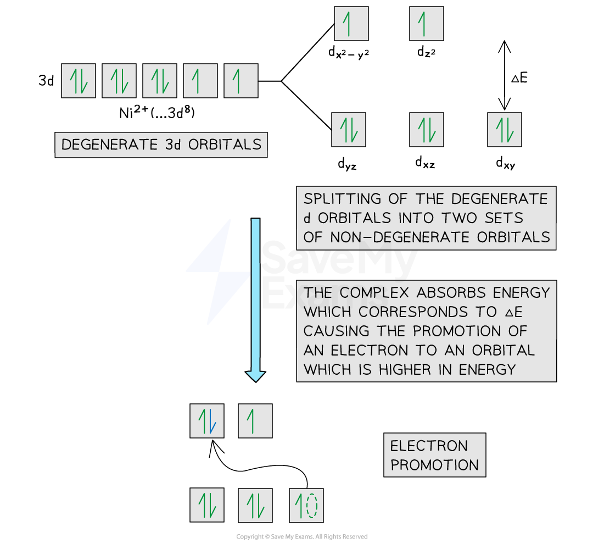
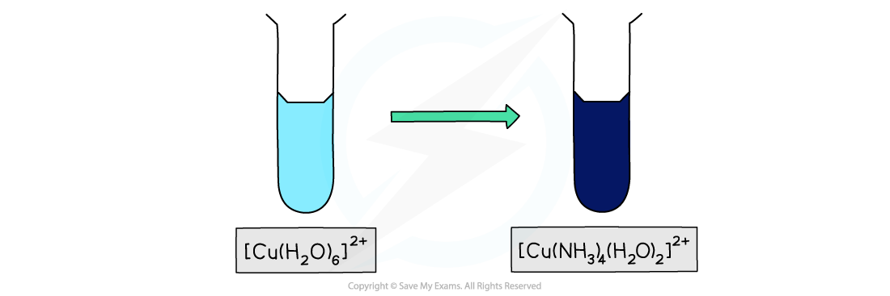
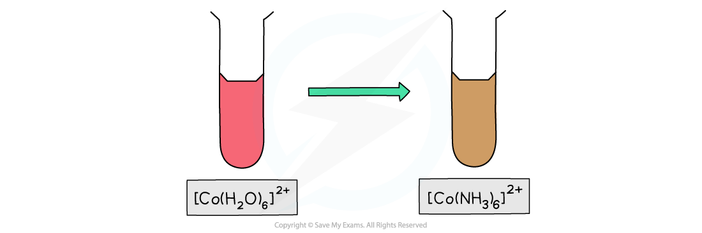
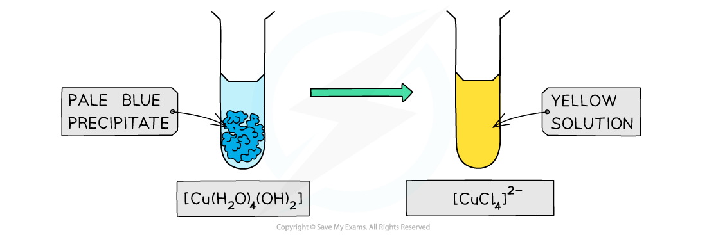
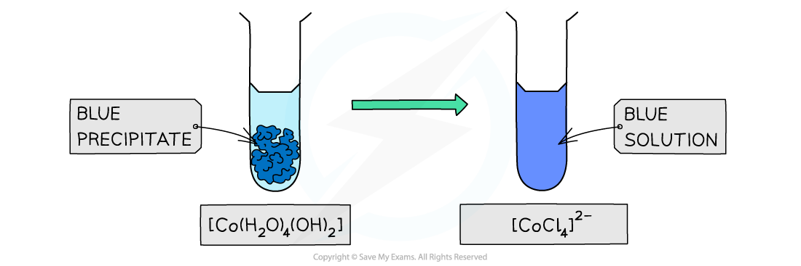

# Coloured Complexes

## Coloured Compounds & Electron Promotion

> **Spec point** — `spcpt_VSPfBfJqdn5Q3SRP`

## Coloured Compounds & Electron Promotion

- Most transition element complexes are **coloured**
- A transition element complex solution which is coloured, **absorbs** part of the electromagnetic spectrum in the visible light region
- The observed colour is the **complementary colour** which is made up of light with frequencies that are **not **absorbed

  - For example, copper(II) ions absorb light from the **red** end of the spectrum
  - The complementary colour observed is therefore **pale blue** (cyan)

#### The visible light region of the electromagnetic spectrum

***The visible light region ranges from red to violet***

### Electron promotion

- In an **isolated** **transition** **element** **ion **(which is not bonded to any ligands), all of the 3d orbitals are **degenerate**
- However, when ligands are attached to the central metal ion through dative covalent bonds, these orbitals are split into two sets of **non-degenerate orbitals**
- The difference in energy between these two sets of orbitals is* *Δ*E*
- When light shines on a solution containing a transition element complex, an electron will absorb this exact amount of energy (Δ*E*)
- The amount of energy absorbed can be worked out by the equation:

**Δ*****E***** = *****h *****x *****v***

- Where:

  - ***h***** = Planck's constant (6.626 x 10****-34**** m****2**** kg s****-1****)**
  - ***v***** = frequency (Hertz, Hz or s****-1****)**
- The electron uses the energy from the light to jump into a higher, non-degenerate energy level

  - This is also called **electron promotion**
- The other frequencies of light which are **not absorbed** combine to make the **complementary colour**
- The diagram below shows an example of electron promotion in an octahedral complex of a nickel(II) Ni2+ ion

#### Electron promotion in a Ni(II) complex when light shines on the solution

***An electron gains enough energy to be promoted from a lower energy non-degenerate orbital to a higher energy non-degenerate orbital***

## Effects of Ligands on Complementary Colour

> **Spec point** — `spcpt_w3tWK7TQtV5bvwkk`

## Effects of Ligands on Complementary Colour

- Transition element complexes absorb the frequency of light which corresponds to the exact energy difference (*ΔE*) between their **non-degenerate** d orbitals
- The frequencies of light which are not absorbed combine to make the **complementary colour **of the complex
- It is the complementary colour which is seen
- However, the exact energy difference (Δ*E*) is affected by the different ligands which surround the transition element ion
- Different ligands will split the d orbital by a different amount of energy
- This depends on the **repulsion** that the d orbital experiences from these ligands
- Therefore, the **size** of Δ*E* and thus the **frequency** of light absorbed by the electrons will be slightly different
- As a result, a different colour of light is absorbed by the complex solution and a different **complementary colour** is observed
- This means that complexes with **similar** **transition elements** **ions,** but **different** **ligands, **can have different colours

  - For example, in copper complexes:
  - [Cu(H2O)6]2+ complex has a **light blue **colour
  - [Cu(NH3)4 (H2O)2]2+ has a **dark blue **colour
  - Despite the copper ion having an oxidation state of +2 in both complexes
  - This is evidence that the ligands surrounding the **complex ion** affect the colour of the complex

## Ligand Exchange in Copper(II) & Cobalt(II) Complexes

> **Spec point** — `spcpt_9tcRdS2xNXpgQ5XY`

## Ligand Exchange in Copper(II) & Cobalt(II) Complexes

- Different ligands may affect the complementary colour of a transition ion complex solution
- This is shown by ligand exchange reactions in copper(II) and cobalt(II) complexes, as this causes a change in colour of the complexes

### Copper(II) & cobalt(II) ions

- The ligand exchange of [Cu(H2O)6]2+ and [Co(H2O)6]2+ by NH3 ligands causes a change in the colour of the solutions

  - [Cu(H2O)6]2+ is **light blue **in colour whereas [Cu(NH3)4(H2O)2)]2+ is **deep blue **in colour
  - [Co(H2O)6]2+ is a **pink **solution whereas [Co(NH3)6]2+ is a **brown **solution
- The colour change results from the ammonia ligands, which cause the d orbitals to split by a different amount of energy (Δ*E)*
- Therefore, the size of Δ*E* and the frequency of light absorbed by the electrons will be slightly different
- As a result, a different colour of light is absorbed and thus a different **complementary colour** is observed

#### Ligand exchange of hexaaqua copper(II) by ammonia

***Ligand exchange of the water ligands by ammonia ligands causes a change in the colour of the copper(II) complex solution from blue to dark blue***

#### Ligand exchange of hexaaqua cobalt(II) by ammonia

***Ligand exchange of the water ligands by ammonia ligand causes a change in the colour of the cobalt(II) complex solution from pink to brown***

- Similarly, full ligand exchange by chloride ions in copper(II) and cobalt(II) complexes results in a change in complementary colour

  - [Cu(H2O)4(OH)2] is a **pale blue precipitate **whereas [CuCl4)]2– is a **yellow solution**
  - [Co(H2O)4(OH)2] is a **blue precipitate **whereas [CoCl4)]2– is a **blue solution**
- The colour change results from the chloride ligands, which cause the d orbitals to split by a different amount of energy (Δ*E)*
- Therefore, the size of Δ*E* and the frequency of light absorbed by the electrons will be slightly different
- As a result, a different colour of light is absorbed and thus a different **complementary colour** is observed

#### Ligand exchange of [Cu(H2O)4(OH)2] by chloride ions

***Ligand exchange by chloride ligands causes a colour and state change in the colour of the copper(II) complex from a pale blue precipitate to a yellow solution***

#### Ligand exchange of [Co(H2O)4(OH)2] by chloride ions

***Ligand exchange by chloride ligands causes a colour and state change in the colour of the cobalt(II) complex from a blue precipitate to a blue solution***

- As before, this suggests that different ligands will split the d orbitals differently
