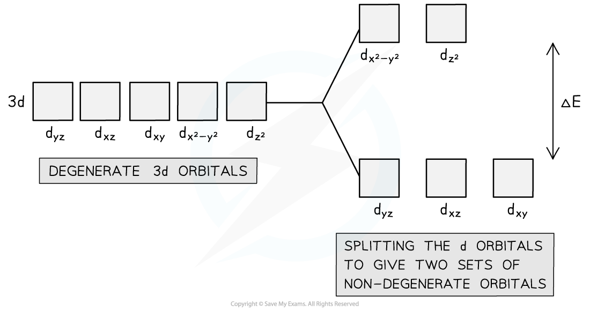
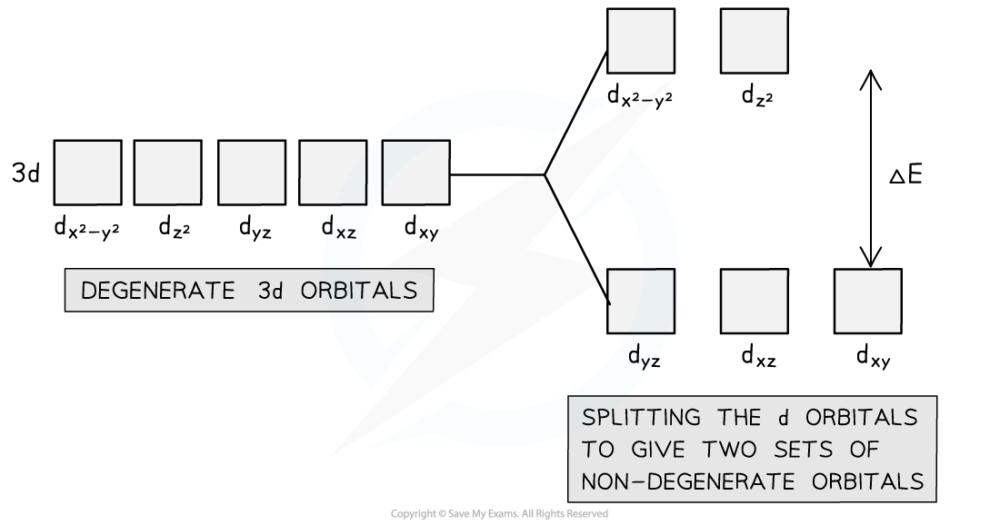
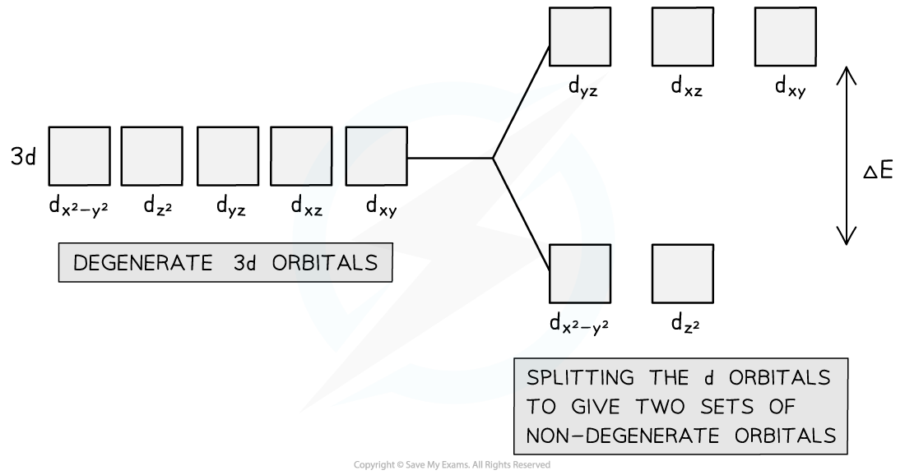

# Degenerate & non-Degenerate d Orbitals

## Degenerate & non-Degenerate d Orbitals Definitions

> **Spec point** — `spcpt_snnbxDBw36pG5vTj`

## Degenerate & non-Degenerate d Orbitals Definitions

- There are **five d orbitals** in an **isolated** transition element atom or ion

  - An isolated transition element is one that is not bonded to anything else
- These d orbitals are all at the same energy level (they are equal in energy) and are therefore said to be **degenerate orbitals**
- When ligands are attached, the transition element ion is **not **isolated anymore
- The dative bonding from the ligands causes the five d orbitals to split into two sets
- These two sets are **not** equal in energy and are described as being **non-degenerate orbitals**

#### Degenerate orbitals forming non-degenerate orbitals

***Upon binding to ligands, the d orbitals of the transition element ion split into two non-degenerate sets of orbitals***

## Degenerate d Orbital Splitting

> **Spec point** — `spcpt_GyYYDz2vHgxs5hQm`

## Degenerate d Orbital Splitting

- An isolated transition element has five **degenerate** 3d orbitals
- Upon dative covalently bonding to a ligand, these d orbitals are split into two sets of non-degenerate orbitals

### Splitting in octahedral complexes

- In **octahedral** complexes, there are six ligands arranged around the **central metal ion**
- The lone pairs of the ligands repel the electrons in the x2-y2 and z2 orbitals of the metal ion **more than** they repel the electrons in the 3dyz, 3dxz, and 3dxy orbitals
- This is because the 3dx2-y2 and 3dz2 orbitals line up with the dative bonds in the complex’s octahedral shape
- This is because the ligands are attached to or approaching the central metal ion along the x, y and z axes, and the 3dx2-y2 and 3dz2 orbitals have lobes along these axes
- The electrons in these two orbitals are closer to the bonding electrons, so there is more **repulsion**
- This means that when the d orbitals split, the 3dx2-y2 and 3dz2 orbitals are at a slightly higher energy level than the other three
- The difference in energy between the **non-degenerate** d orbitals is labelled as Δ*E*

#### Splitting of 3d orbitals in an octahedral complex

***The 3d******x******2******-y******2****** and 3d******z******2****** non-degenerate orbitals are slightly higher in energy than the 3d******yz******, 3d******xz****** and 3d******xy****** non-degenerate orbitals***

### Splitting in tetrahedral complexes

- In **tetrahedral** complexes, there are four ligands arranged around the central metal ion
- The bonding pair of electrons from the four ligands now line up with the 3dyz, 3dxz, and 3dxy orbitals of the central metal ion
- Now, the 3dx2-y2 and 3dz2 orbitals lie between the metal-ligand bonds
- Therefore, there is less repulsion with the 3dx2-y2 and 3dz2 orbitals
- When the d orbitals split this time, the 3dx2-y2 and 3dz2 orbitals are at **lower** and **more** **stable** energy level than the other three

#### Splitting of 3d orbitals in a tetrahedral complex

***The 3d******yz******, 3d******xz****** and 3d******xy******  non-degenerate orbitals are slightly higher in energy than the 3d******x******2******-y******2****** and 3d******z******2****** non-degenerate orbitals***
