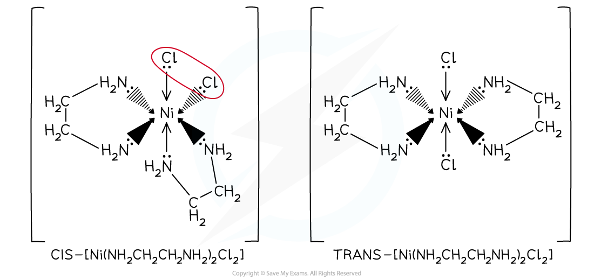
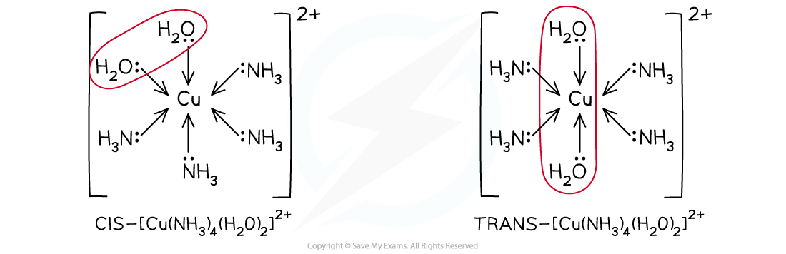
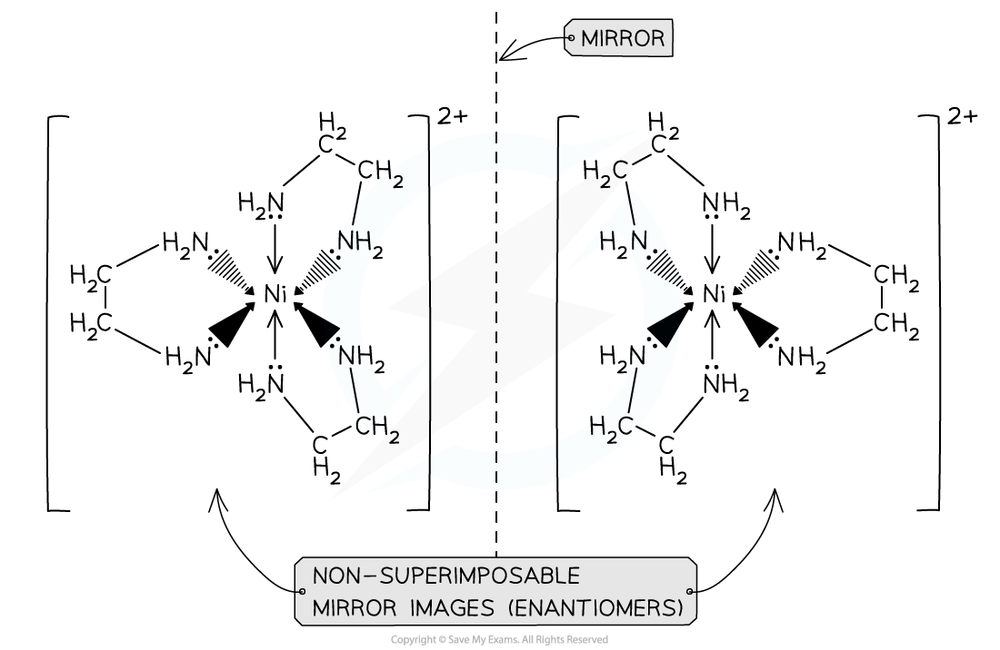
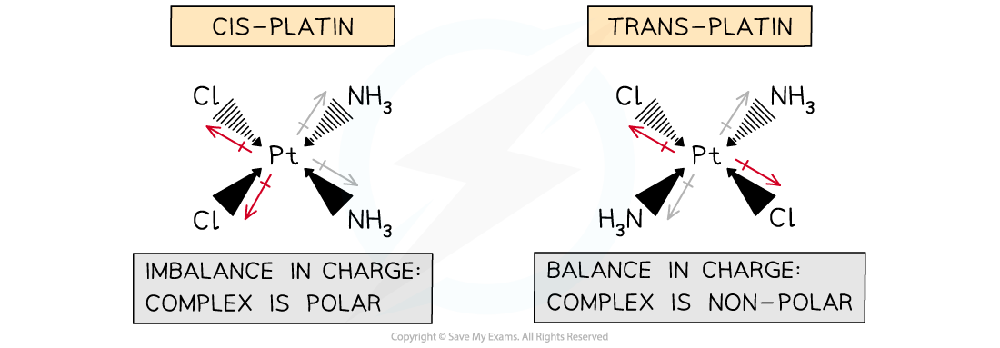
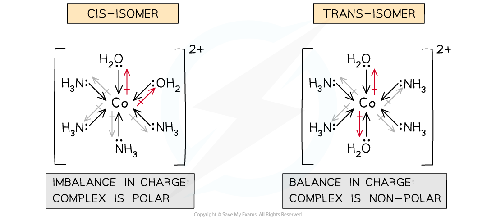

# Stereoisomerism in Transition Element Complexes

## Geometrical & Optical Stereoisomerism in Complexes

> **Spec point** — `spcpt_2ThbMTgPgvQbtpTc`

## Geometrical & Optical Stereoisomerism in Complexes

- Transition element complexes can exhibit **stereoisomerism**

### Geometrical (cis-trans) isomerism

- Even though transition element complexes do not have a **double bond**, they can still have **geometrical** **isomers**
- **Square planar **and **octahedral **complexes with **two pairs** **of different** ligands exhibit *cis*-*trans* isomerism
- An example of a square planar complex with two pairs of ligands is the anti-cancer drug **cisplatin**

  - Cisplatin has beneficial medical effects by binding to DNA in cancer cells
  - Whereas, transplatin cannot be used in cancer treatment

#### Cisplatin is a square planar transition element complex

***Cisplatin has 2 adjacent chloride ligands while transplatin has 2 chloride ligands opposite each other, meaning they exhibit geometrical isomerism***

- As long as an octahedral complex ion has two ligands attached to it that are different to the rest, then the complex can display geometric isomerism
- Examples of octahedral complexes that exhibit geometrical isomerism are the [Co(NH3)4(H2O)2]2+ and [Ni(H2NCH2CH2NH2)2(H2O)2]2+ complexes

  - [Ni(H2NCH2CH2NH2)2(H2O)2]2+ can also be written as [Ni(en)2(H2O)2]2+
- Like in the square planar complexes, if the two ‘different’ ligands are next to each other then that is the ‘cis’ isomer, and if the two ‘different’ ligands are opposite each other then this is the ‘trans’ isomer

  - In [Co(NH3)4(H2O)2]2+, the two water ligands are next door to each other in the cis isomer and are opposite each other in the trans isomer

#### Octahedral transition metal complexes exhibiting geometrical isomerism

***Octahedral complexes exhibit geometrical isomerism when they have 2 ligands attached that are different to the rest***

### Optical isomerism

- **Octahedral **complexes with **bidentate ligands** also have **optical isomers**
- This means that the two forms are **non-superimposable mirror images **of each other

  - They have no plane of symmetry, and one image cannot be placed directly on top of the other
- The optical isomers only differ in their ability to rotate the plane of polarised light in opposite directions
- Examples of octahedral complexes that have optical isomers are the [Ni(H2NCH2CH2NH2)3]2+and [Ni(H2NCH2CH2NH2)2(H2O)2]2+ complexes

  - The ligand H2NCH2CH2NH2 can also be written as ‘en’ instead

#### Octahedral transition metal complexes exhibiting optical isomerism

***The orientation of the ligands can cause the complex to exhibit optical isomerism***

## Polarity of Complexes

> **Spec point** — `spcpt_QjFxKmmb8JZYK57R`

## Polarity of Complexes

- The isomers of transition elements complexes may be **polar** or **non-polar**
- This is caused by differences in **electronegativity** of the atoms in the ligands that form the dative bond to the complex ion

### Polarity in square planar complexes

- In cisplatin, the two chlorine atoms are on the same side

  - These atoms have a stronger pull on the electrons in the dative bond and will carry a **partial negative charge**
  - As a result, there is an imbalance of charge causing the complex to become **polar**
- In transplatin, the same ligands are on opposite sides of each other

  - The pull on electrons in the dative bonds to the complex ion is therefore balanced
  - The overall charge is balanced and the complex is **non-polar**
- Therefore, transplatin does not have the same medical benefits as cisplatin

#### Polarity in a square planar complex

***The polar and non-polar complexes are due to the geometric isomers***

### Polarity in octahedral complexes

- Again, the *trans*-isomer in octahedral complexes is **non-polar** whereas the *cis*-isomer is slightly **polar**
- In *cis*-[Co(NH3)4(H2O)2]2+ for example, the oxygen atoms in the H2O ligands are more electronegative than the nitrogen atoms in the NH3 ligands
- This causes the side of the water ligands to be **partially negative**
- Resulting in a charge imbalance causing the complex to become **polar**
- The **symmetrical arrangement** in the *trans* isomers means that the charge is evenly distributed in the complex
- *Trans*-isomers are therefore **non-polar**

#### Polarity in an octahedral complex

***The polar and non-polar complexes are due to the geometric isomers***
