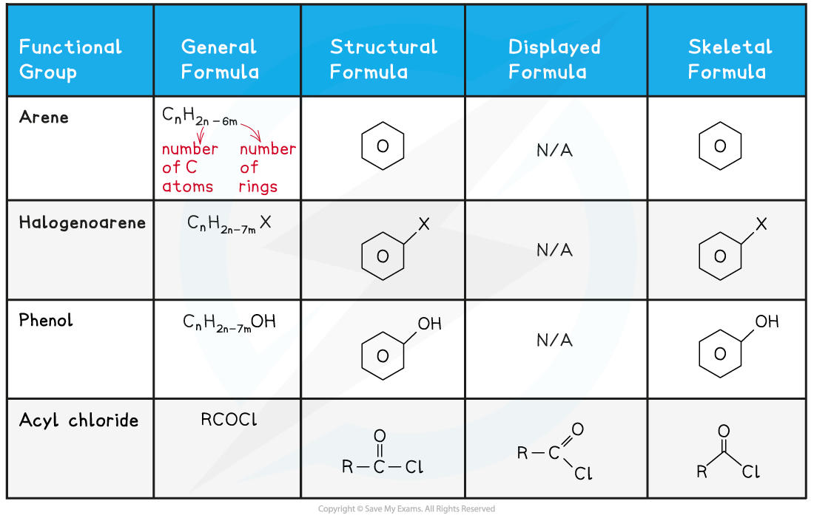
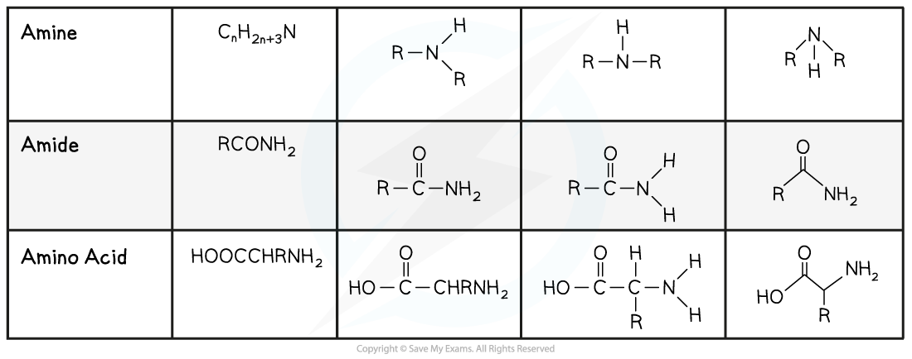

# Formulae of Functional Groups

## Formulae of Organic Compounds (AL)

> **Spec point** — `spcpt_jWY47tYndC23Nb6v`

## Formulae of Organic Compounds (AL)

- Students are expected to interpret and use the following formulae of organic compounds

  - General formula
  - Structural formula
  - Displayed formula
  - Skeletal formula

#### Formulae of organic compounds table

