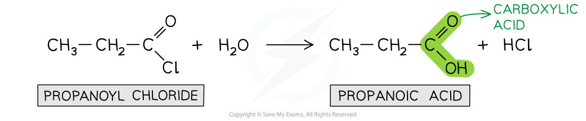
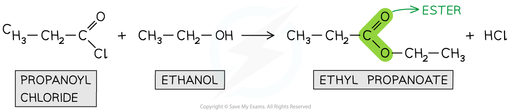
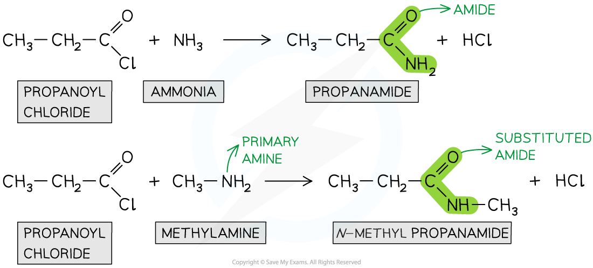

# Organic Chemistry Terminology

## Organic Chemistry Terminology

> **Spec point** — `spcpt_yWJy5QZzqdvSHZh7`

## Organic Chemistry Terminology

- Organic reactions are often associated with **terminology **students should be familiar with
- Two of these important terms include:

  - Electrophilic substitution
  - Addition-elimination

### Electrophilic substitution

- **Electrophiles **are species that are **electron deficient **and can act as an **electron pair acceptor**

  - Electrophiles are ‘electron loving’ species
- **Substitution reactions **are reactions that involve the replacement of one atom or group of atoms by another
- Electrophilic substitution reactions are therefore reactions in which an atom or group of atoms are **replaced **by an **electrophile** after an initial attack by the electron-deficient species
- An example of an electrophilic substitution reaction is the reaction of **benzene **with **bromine** in the presence of **anhydrous aluminium bromide catalysts**

  - The bromine acts as an **electrophile **and attacks the **electron-rich benzene ring**
  - A hydrogen atom is substituted by a bromine atom to form bromobenzene and hydrogen bromide
- Benzene undergoes substitution reactions rather than addition reactions because of the stability of the benzene ring

#### Electrophilic substitution of benzene by bromine

***A hydrogen atom in benzene is substituted by a bromine atom, which acts as an electrophile***

### Addition-elimination

- **Acyl chlorides **are **reactive **organic compounds that undergo many reactions such as **nucleophilic addition-elimination **reactions
- In nucleophilic addition-elimination reactions, the **nucleophilic addition** of a small molecule across the C=O bond takes place followed by **elimination** of a small molecule
- Examples of these nucleophilic addition-elimination reactions include:

  - **Hydrolysis**
  - Reaction with alcohols to form **esters**
  - Reaction with ammonia and primary amines to form **amides**

### Hydrolysis

- The **hydrolysis **of acyl chlorides results in the formation of a **carboxylic acid **and **HC*****l ***molecule
- This is a **nucleophilic addition-elimination **reaction

  - A **water molecule **adds across the C=O bond
  - A hydrochloric acid (HCl) molecule is **eliminated**

#### Hydrolysis of propanoyl chloride to form propanoic acid and HCl

***Acyl chlorides are hydrolysed to carboxylic acids via nucleophilic addition-elimination***

### Formation of esters

- Acyl chlorides can react with **alcohols **to form esters
- The esterification of acyl chlorides is also a **nucleophilic addition-elimination **reaction

  - The alcohol adds across the C=O bond
  - A HCl molecule is eliminated

#### Esterification of propanoyl chloride to form ethyl propanoate and HCl

***Acyl chlorides are esterified with alcohols to form esters via nucleophilic addition-elimination***

### Formation of amides

- Acyl chlorides can form **amides **with **primary** **amines **and **concentrated** **ammonia**
- The nitrogen atom in ammonia and primary amine has a lone pair of electrons which can be used to attack the carbonyl carbon atom in the acyl chlorides
- The product is an** **amide (when reacted with ammonia) or*** N-*****substituted **amide (when reacted with primary amines)
- This is also an example of a **nucleophilic addition-elimination **reaction as

  - The amine or ammonia molecule adds across the C=O bond
  - A HCl molecule is eliminated

#### Forming amides from propanoyl chloride

***Acyl chlorides undergo reactions with ammonia and primary amines to form amides via nucleophilic addition-elimination***
