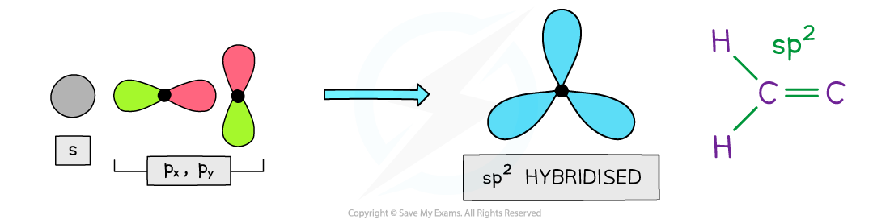
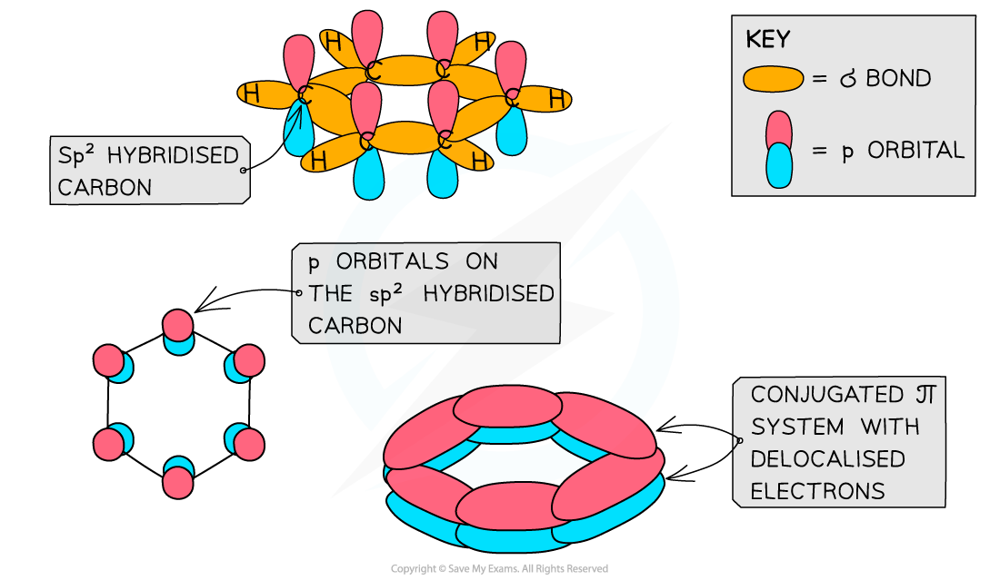

# The Shape of Aromatic Molecules

## Shape of Benzene & Aromatic Molecules

> **Spec point** — `spcpt_9wVFH97PwHmF5hzh`

## Shape of Benzene & Aromatic Molecules

- **Aromatic molecules** consist of one or more rings with **conjugated π systems**
- **Conjugated π systems **arise from alternating double and single bonds in which the electrons are **delocalised**
- Aromatic compounds are called ‘aromatic’ as they often have pleasant odours

#### Examples of aromatic compounds table

| **Functional group** | **Example** | **Name** |
|---|---|---|
| **Arene** |  | Propyl benzene |
| **Chlorobenzene** |  | 2-methylchlorobenzene |
| **Phenol** |  | 2,3-dimethyl phenol |

### Shape of benzene & aromatic compounds

- Benzene and other aromatic compounds contain sp2 hybridised carbons as **two **of their **p **orbitals have mixed with an s orbital
- This means that each carbon atom in benzene and other aromatic compounds has **one p orbital**

#### sp2 hybridisation

***The carbon atoms in aromatic compounds are sp******2 ******hybridised as two of their p orbitals mix with an s orbital***

- Each carbon atom in the ring forms three σ bonds using the sp2 orbitals
- The remaining **p orbital **overlaps laterally with p orbitals of neighbouring carbon atoms to form a π bond
- This extensive sideways overlap of p orbitals results in the electrons being delocalised and able to freely spread over the entire ring
- Benzene and other aromatic compounds are **regular **and **planar** compounds with bond angles of 120o
- The delocalisation of electrons means that all of the carbon-carbon bonds in these compounds are identical and have both **single **and **double bond **character
- The bonds all being the same length is evidence for the delocalised ring structure of benzene

#### The planar structure of benzene

***Like other aromatic compounds, benzene has a planar structure due to the sp*****2***** hybridisation of carbon atoms and the conjugated π system in the ring***
