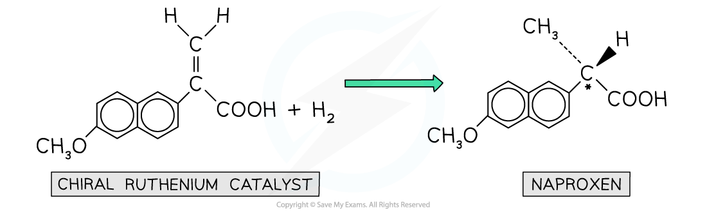

# Chirality & Drug Production

## Chirality & Drug Production

> **Spec point** — `spcpt_HFSQ8QyKzkt8jzTP`

## Chirality & Drug Production

- Most of the drugs that are used to treat diseases contain **one or more **chiral centres
- These drugs can therefore exist as **enantiomers **which differ from each other in their ability to rotate plane polarised light
- Another crucial difference between the enantiomers is in their potential **biological** **activity** and therefore their **effectiveness **as medicines
- Drug compounds should be prepared in such a way that only one of the optical isomers is produced, in order to increase the drugs’ effectiveness

  - Some drug enantiomers can have very harmful side effects

### Potential biological activity of enantiomers

- If **conventional organic reactions **are used to make the desired drug, a **racemic mixture **will be obtained

  - In a racemic mixture, there are equal amounts of the two enantiomers
- The **physical **and **chemical **properties of the enantiomers are the same, however, they may have opposite biological activities
- For example, the drug **naproxen **is used to treat pain in patients who suffer from arthritis

  - One of the enantiomers of naproxen eases the pain, whereas another enantiomer causes liver damage
- One enantiomer of a drug used to treat tuberculosis is effective whereas another enantiomer of this drug can cause blindness
- Thalidomide is another example of a drug that used to be used to treat morning sickness, where one of the enantiomers caused very harmful side effects for the unborn baby

### Separating racemic mixtures

- Due to the different biological activities of enantiomers, it is very important to **separate **a racemic mixture into **pure single enantiomers **which are put in the drug product
- This results in **reduced side-effects **in patients

  - As a result, it protects pharmaceutical companies from legal actions if the side effects are too serious
- It also **decreases **the patient’s **dosage **by half as the pure enantiomer is more **potent **and therefore reduces production costs

  - A more potent drug has better **therapeutic activity**

### Chiral catalysts

- In order to produce single, pure optical isomers, **chiral catalysts** can be used
- The benefits of using chiral catalysts are that only **small amounts **of them are needed and they can be **reused**

  - For example, an organometallic ruthenium catalyst is used in the production of **naproxen **which is used in the treatment of arthritis

#### Using catalysts to direct the production on one enantiomer

***The organometallic ruthenium catalyst is a chiral catalyst which ensures that only one of the enantiomers is formed which can be used in treating arthritis***

- **Enzymes **are excellent biological chiral catalysts that promote **stereoselectivity **and produce single-enantiomer products only

  - **Stereoselectivity** refers to the preference of a reaction to form one enantiomer over the other
- Due to the **specific **binding site of enzymes, only one enantiomer is formed in the reaction
- The enzymes are fixed in place on **inert supports **so that the reactants can pass over them without having to later separate the product from the enzymes
- The **disadvantage **of using enzymes is that it can be **expensive **to isolate them from living organism

  - Therefore, more research has recently been carried out into designing **synthetic enzymes**
- Although using enzymes to produce pure enantiomers in drug synthesis takes longer than conventional synthetic routes, there are many advantages to it in the long run

  - For example, using enzymes to synthesise drugs is a **greener **process as fewer steps are involved compared to conventional synthetic routes
