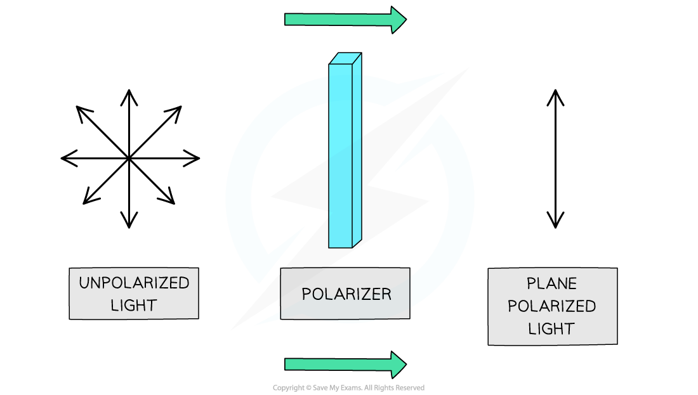
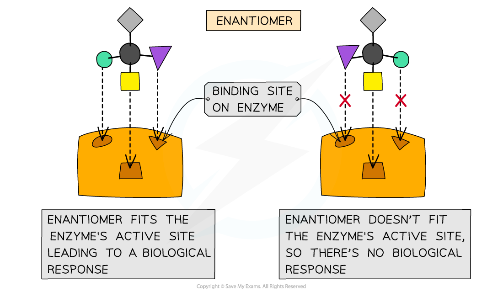
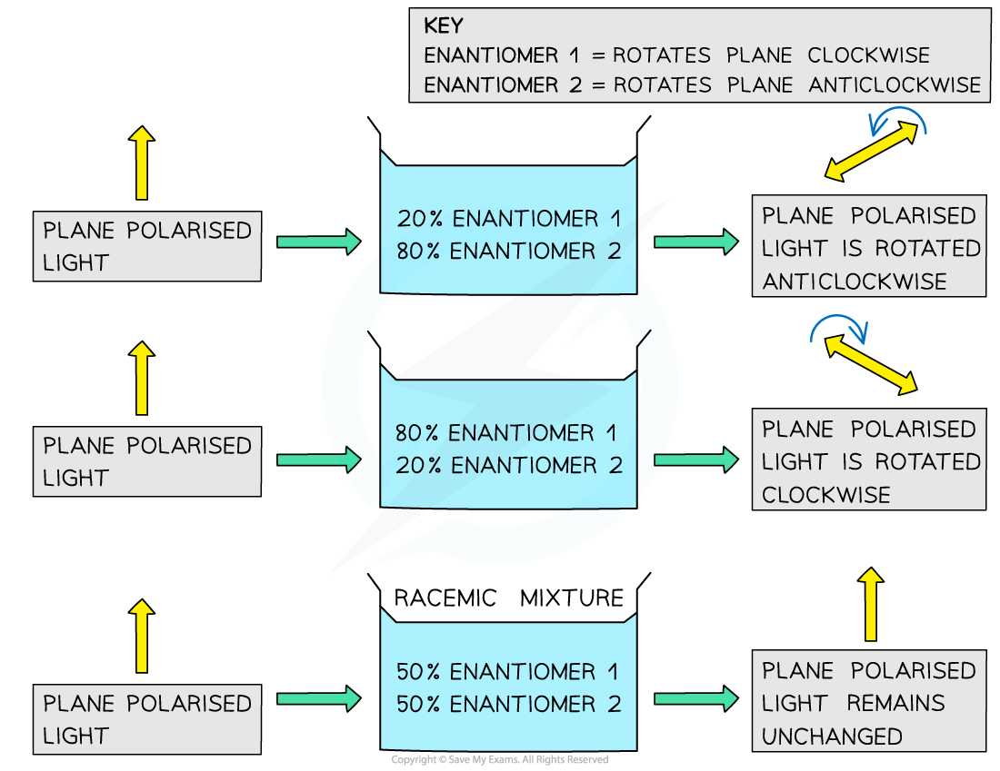
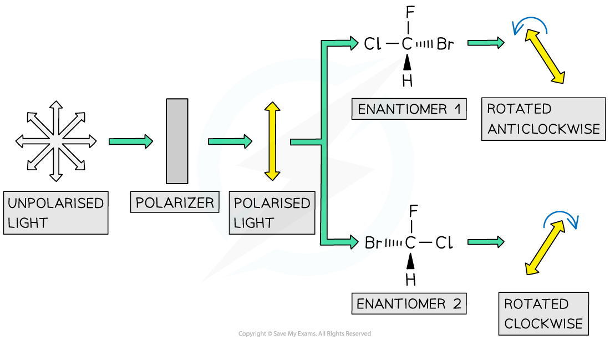

# Optical Isomers

## Properties of Enantiomers

> **Spec point** — `spcpt_PX467Y4RBSmQrSdT`

## Properties of Enantiomers

- **Stereoisomers **are molecules that have the same **structural formula **but have the atoms arranged differently in space
- There are two types of stereoisomerism

  - Geometrical (*cis */ *trans*)
  - Optical

### Optical isomerism

- A carbon atom that has **four different atoms **or **groups of atoms **attached to it is called a **chiral carbon **or **chiral centre**
- Compounds with a chiral centre (**chiral molecules**) exist as two **optical isomers **which are also known as **enantiomers**

#### How enantiomers occur

***A molecule has a chiral centre when the carbon atom is bonded to four different atoms or group of atoms; this gives rises to enantiomers***

- The enantiomers are **non-superimposable** **mirror images **of each other
- Their physical and chemical properties are **identical** but they differ in their ability to rotate **plane polarised light**

  - Hence, these isomers are called ‘optical’ isomers
  - One of the optical isomers will rotate the plane of polarised in the **clockwise **direction
  - Whereas the other isomer will rotate it in the **anti-clockwise **direction

#### How a polarizer works

***When unpolarised light is passed through a polariser, the light becomes polarised as the waves will vibrate in one plane only***

### Biological activity of enantiomers

- Enantiomers also differ from each other in terms of their **biological activity**
- **Enzymes **are **chiral **proteins that speed up chemical reactions by binding **substrates**
- They are very target-specific as they have a specific **binding site **(also called active site) and will only bind molecules that have the **exact same shape**
- Therefore, if one enantiomer binds to a chiral enzyme, the mirror image of this enantiomer will not bind **nearly as well **if at all

  - It’s like putting a right-hand glove on the left hand!

#### Enzymes acting on different biological enantiomer substrates

***Enantiomers differ from each other in their biological activity***

## Optically Active Compounds & Racemic Mixtures

> **Spec point** — `spcpt_Byw6Z9GbVwY8rGs5`

## Optically Active Compounds & Racemic Mixtures

- **Enantiomers **are optical isomers that are mirror images of each other and are **non-superimposable**
- They have similar chemical properties but differ from each other in their ability to rotate **plane polarised light **and in their **biological activity**

### Optical activity

- Let’s suppose that in a solution, there is 20% of the enantiomer which rotates the plane polarised light **clockwise **and 80% of the enantiomer which rotates the plane of polarised light **anticlockwise**
- There is an uneven mixture of each enantiomer, so the reaction mixture is said to be **optically active**

  - The net effect is that the plane of polarised light will be rotated **anticlockwise**
- Similarly, if the percentages of the enantiomers are reversed, the reaction mixture is still **optically active **but now the plane of polarised light will be rotated **clockwise**

  - In this case, there is 20% of the enantiomer, which rotates the plane **anticlockwise**
  - And 80% of the enantiomer, which rotates the plane **clockwise**
- A **racemic mixture **is a mixture in which there are **equal amounts **of enantiomers present in the solution
- A racemic mixture is **optically inactive **as the enantiomers will cancel out each other's effect and the plane of polarised light will **not change**

#### How the percentage of enantiomers affects plane polarised light

***When one of the enantiomers is in excess, the mixture is optically active; when there are equal amounts of each enantiomer the mixture is optically inactive***

## Effect of Optical Isomers on Plane Polarised Light

> **Spec point** — `spcpt_j2xqdtkdgKMYsw6q`

## Effect of Optical Isomers on Plane Polarised Light

- Molecules with a **chiral centre **exist as **optical isomers**
- These isomers are also called **enantiomers **and are non-superimposable mirror images of each other
- The major difference between the two enantiomers is that one of the enantiomers rotates plane polarised light in a **clockwise **manner and the other in an **anticlockwise **fashion

  - The enantiomer that rotates the plane **clockwise **is called the ***R*** enantiomer
  - The enantiomer that rotates the plane **anticlockwise **is called the ***S*** enantiomer
- These enantiomers are, therefore, said to be **optically active**
- Therefore, the rotation of plane polarised light can be used to determine the identity of an optical isomer of a single substance

  - For example, pass plane polarised light through a sample containing one of the two optical isomers of a single substance
  
    - Depending on which isomer the sample contains, the plane of polarised light will be rotated either clockwise or anti-clockwise
    - No effect will be observed when the sample is a **racemic mixture**

#### Using polarized light to distinguish between R and S enantiomers

***Each enantiomer rotates the plane of polarised light in a different direction***
