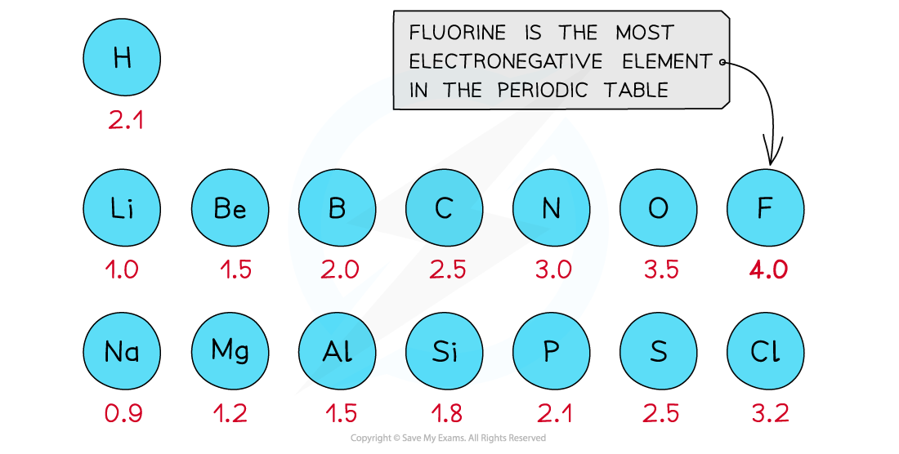
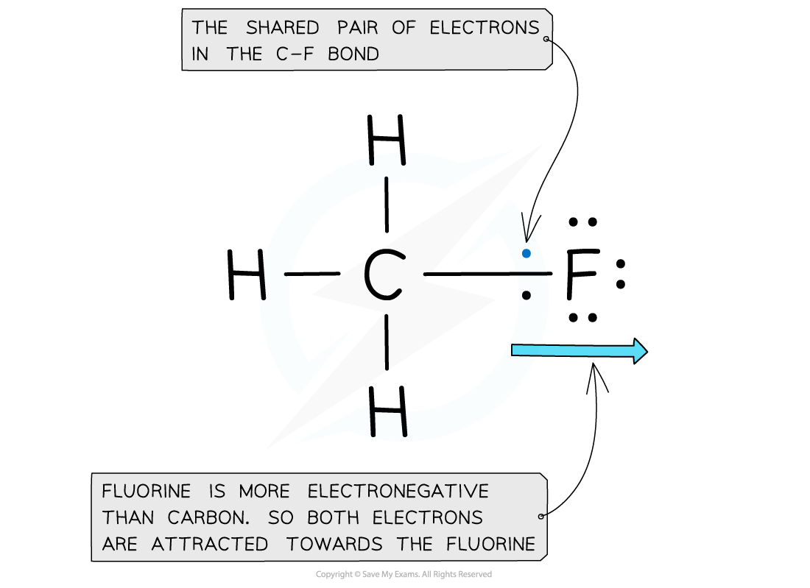
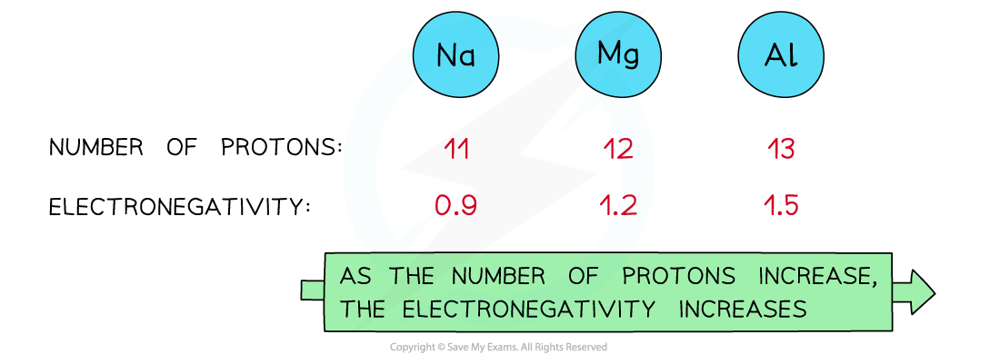
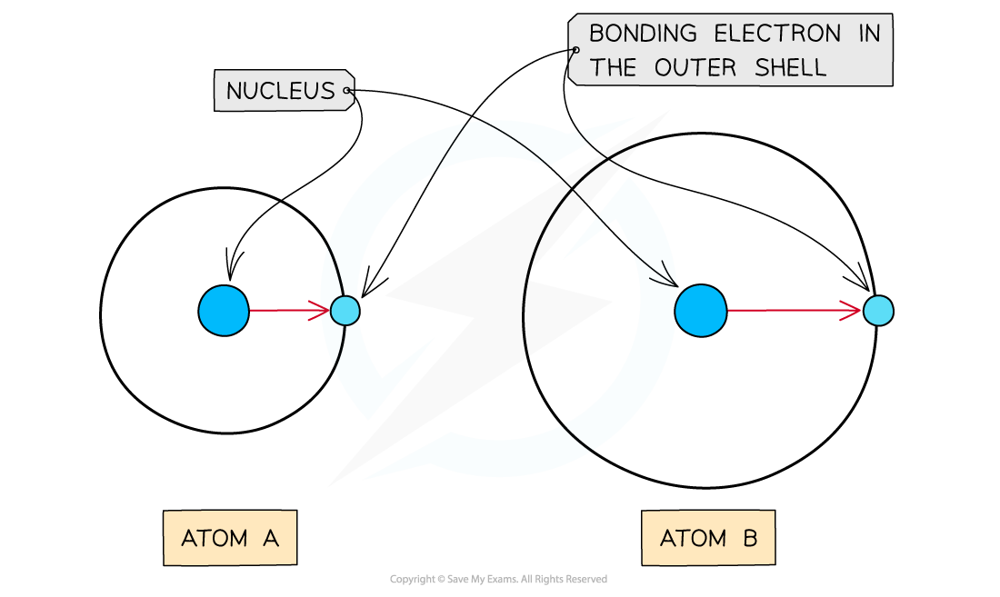
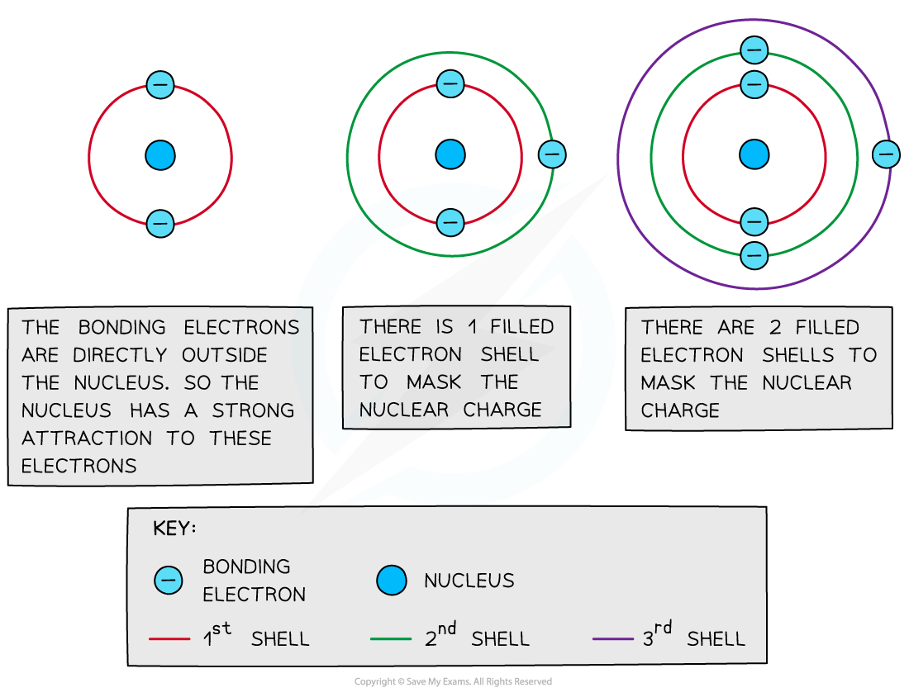

# Electronegativity

## Defining Electronegativity

> **Spec point** — `spcpt_yhKk4653BYD9KxN3`

## Defining Electronegativity

- **Electronegativity** is the ability of an atom to attract a pair of electrons towards itself in a covalent bond
- This phenomenon arises from the **positive** nucleus’s ability to attract the **negatively** charged electrons, in the outer shells, towards itself
- The **Pauling** **scale** is used to assign a value of electronegativity for each atom

#### First three rows of the periodic table showing electronegativity values

*Electronegativity generally increases across a period and decreases down a group*

- Fluorine is the most electronegative atom on the Periodic Table, with a value of 4.0 on the **Pauling Scale**
- It is best at attracting electron density towards itself when covalently bonded to another atom

#### Electron distribution in the C-F bond of fluoromethane

*The electrons in the C-F bond are closer to the fluorine due to its electronegativity*

## Factors Affecting Electronegativity

> **Spec point** — `spcpt_GqxmXbGXD9vnQ6wd`

## Factors Affecting Electronegativity

### Nuclear charge

- **Attraction** exists between the positively charged **protons** in the nucleus and negatively charged **electrons** found in the energy levels of an atom
- An **increase** in the number of **protons** leads to an **increase** in **nuclear** **attraction** for the electrons in the outer shells
- Therefore, an **increased nuclear charge **results in an **increased electronegativity**

#### Relating electronegativity values to number of protons

*As the nuclear charge increases, the electronegativity of an element increases as well*

### Atomic radius

- The **atomic** **radius** is the distance between the nucleus and electrons in the **outermost shell**
- Electrons **closer** to the nucleus are more **strongly** attracted towards its positive **nucleus**
- Those electrons **further** **away** from the nucleus are **less strongly **attracted towards the **nucleus**
- Therefore, an **increased atomic radius **results in a **decreased electronegativity**

#### How the distance from the nucleus to the outer electrons affects electronegativity

*As the atomic radius increases, the nucleus has less of an attraction for the bonding electrons causing atom A to have a higher electronegativity than atom B*

### Shielding

- **Filled** energy levels can **shield **(mask) the effect of the nuclear charge causing the outer electrons to be **less attracted **to the nucleus
- Therefore, the addition of extra **shells and subshells **in an atom will cause the outer electrons to experience **less **of the attractive force of the nucleus

  - Sodium (Period 3, Group 1) has a higher **electronegativity **than caesium (Period 6, Group 1) as it has fewer shells and therefore the outer electrons experience less shielding than in caesium
- Thus, an increased number of **inner shells and subshells **will result in a **decreased electronegativity**

#### How shielding affects nuclear attraction

*Filled inner energy levels mask the nuclear attraction from the outer bonding electrons*

** **

> **Exam Hint**
> - The **nuclear charge**, **atomic radius **and **shielding **are all linked to each other.
> - As **nuclear** **charge** **increases**, the nucleus has a **greater** **attractive** **force** on the electrons in shells given that the **shielding **doesn’t increase.
> - As a result of this, the atomic radius decreases.
