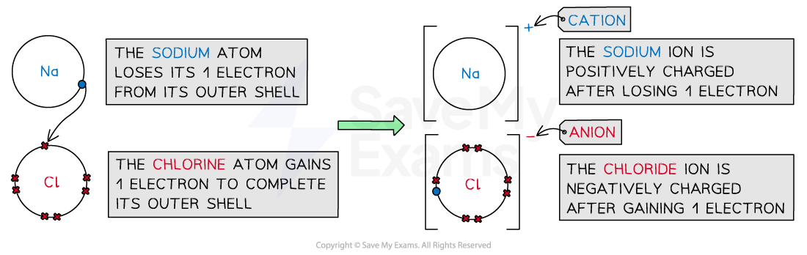
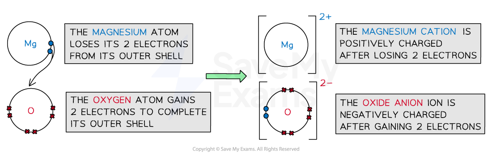
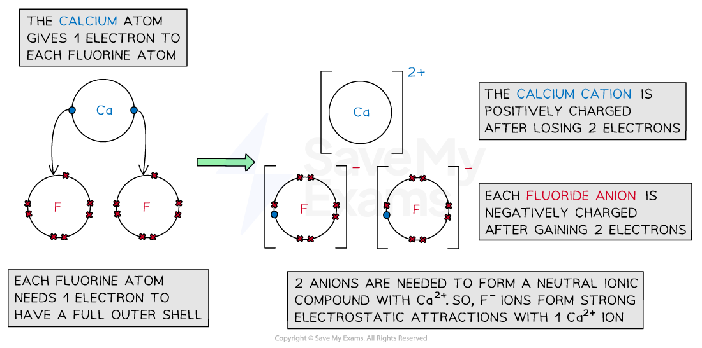

# Ionic Bonding Examples

## Examples of Ionic Bonding

> **Spec point** — `spcpt_fZcV6nrG2QTrcXH7`

## Examples of Ionic Bonding

### Sodium chloride

- Sodium is a Group 1 **metal**

  - It **loses** its outer electron to form a sodium ion with a +1 charge (Na+)
- Chlorine is a Group 7 **non-metal**

  - It **gains** 1 electron to form a chloride ion with a -1 charge (Cl-)
- The oppositely charged ions are attracted to each other by **electrostatic forces** to form NaCl (ionic bonds)
- The final ionic solid is **neutral** in charge

#### Dot and cross diagram to show the ionic bonding in sodium chloride

*Sodium gives its one outer electron to chlorine forming the ionic compound, sodium chloride*

### Magnesium oxide

- Magnesium is a Group 2 **metal**

  - It **loses** its 2 outer electrons to form a magnesium ion with a +2 charge (Mg2+)
- Oxygen is a Group 6 **non-metal**

  - It **gains** 2 electrons to form an oxide ion with a -2 charge (O2-)
- The oppositely charged ions are attracted to each other to by **electrostatic forces **to form MgO (ionic bonds)
- The final ionic solid is **neutral** in charge

#### Dot and cross diagram to show the ionic bonding in magnesium oxide

*Magnesium gives both outer electrons to oxygen forming the ionic compound, magnesium oxide*

### Calcium fluoride

- Calcium is a Group 2 **metal**

  - It **loses** its 2 outer electrons to form a calcium ion with a +2 charge (Ca2+)
- Fluorine is a Group 7 **non-metal**

  - It **gains** 1 electron to form a fluoride ion with a -1 charge (F-)
- As before, the positive and negative ions are attracted to each other via an ionic bond
- However, to cancel out the 2+ charge of the calcium ion, 2 fluorine atoms are needed

  - Each fluorine atom can only accept 1 electron from the calcium atom
  - 2 fluoride ions will be formed
- Calcium fluoride is made when 1 calcium ion and 2 fluoride ions form ionic bonds, CaF2
- The final ionic solid of CaF2 is **neutral** in charge

#### Dot and cross diagram to show the ionic bonding in calcium fluoride

*Calcium gives away both outer electrons. Each fluorine receives one of those electrons forming the ionic compound, calcium fluoride*

> **Worked Example**
> **Dot & cross lithium nitride**
> 
> Draw a dot and cross diagram for lithium nitride, Li3N.
> 
> **Answer**
> 
> - Lithium is a Group 1 **metal**
> 
>   - It **loses** its outer electron to form a lithium ion with a +1 charge (Li+)
> - Nitrogen is a Group 5 **non-metal**
> 
>   - It **gains** 3 electrons to form a nitride ion with a -3 charge (N3-)
> - To cancel out the -3 charge of the nitride ion, 3 lithium atoms are needed and 3 lithium ions will be formed
> 
>   - Lithium nitride is made when 1 nitride ion and 3 lithium ions form ionic bonds
> - The final ionic solid of Li3N is **neutral** in charge:
> 
> 

> **Worked Example**
> **Dot & cross aluminium oxide**
> 
> Draw a dot and cross diagram for aluminium oxide, Al2O3.
> 
> **Answer**
> 
> - Aluminium is a Group 3 **metal**
> 
>   - It **loses** its outer electrons to form an aluminium ion with a +3 charge (Al3+)
> - Oxygen is a Group 6 **non-metal**
> 
>   - It **gains** 2 electrons to form an oxide ion with a -2 charge (O2-)
> - To cancel out the negative and positive charges, 2 aluminium and 3 oxygen atoms are needed
> 
>   - Aluminium oxide is made when 2 aluminium ions and 3 oxygen ions form ionic bonds
> - The final ionic solid of Al2O3 is **neutral** in charge:
> 
> 
