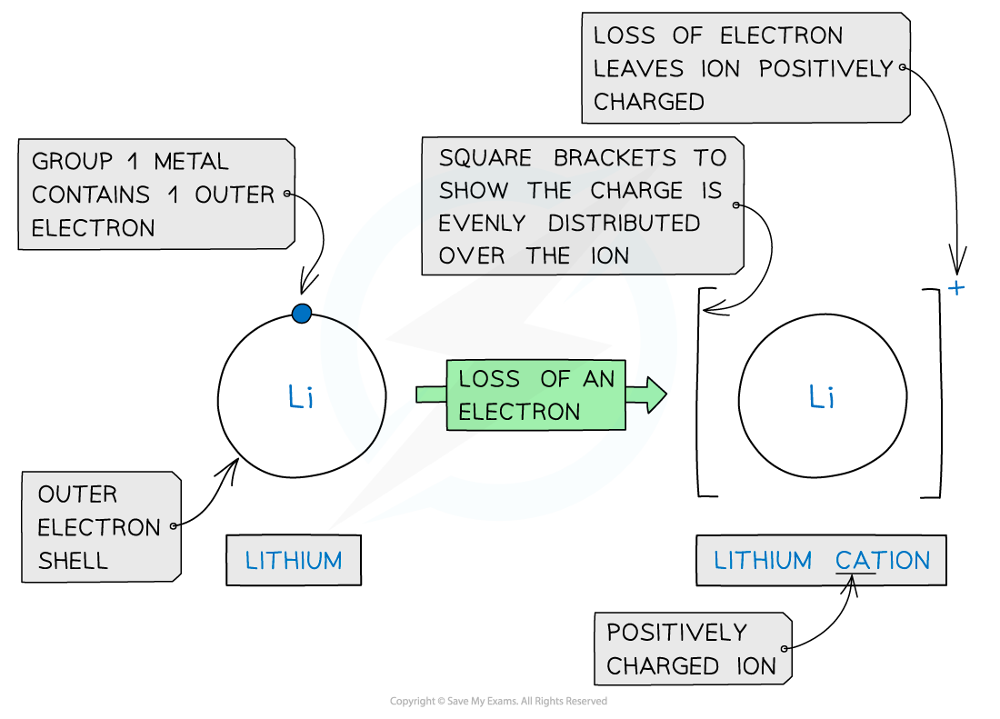
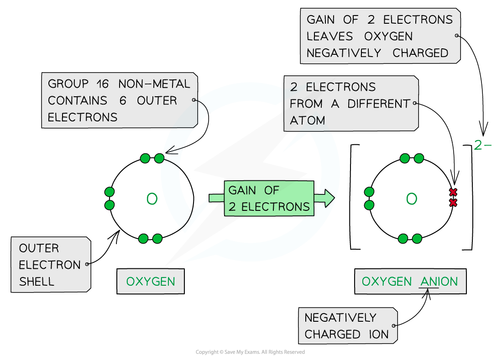
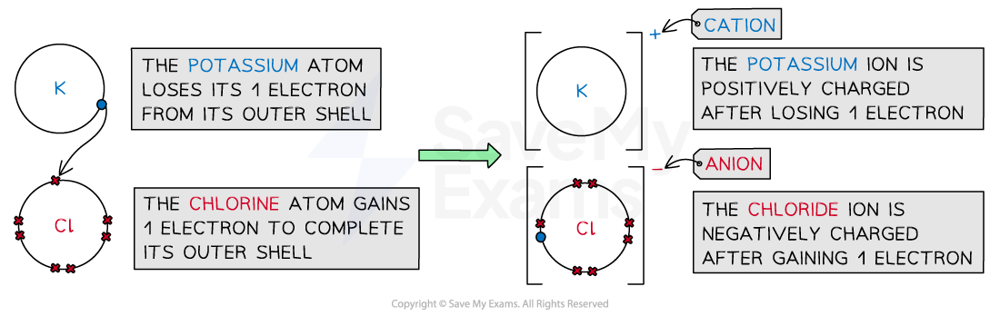
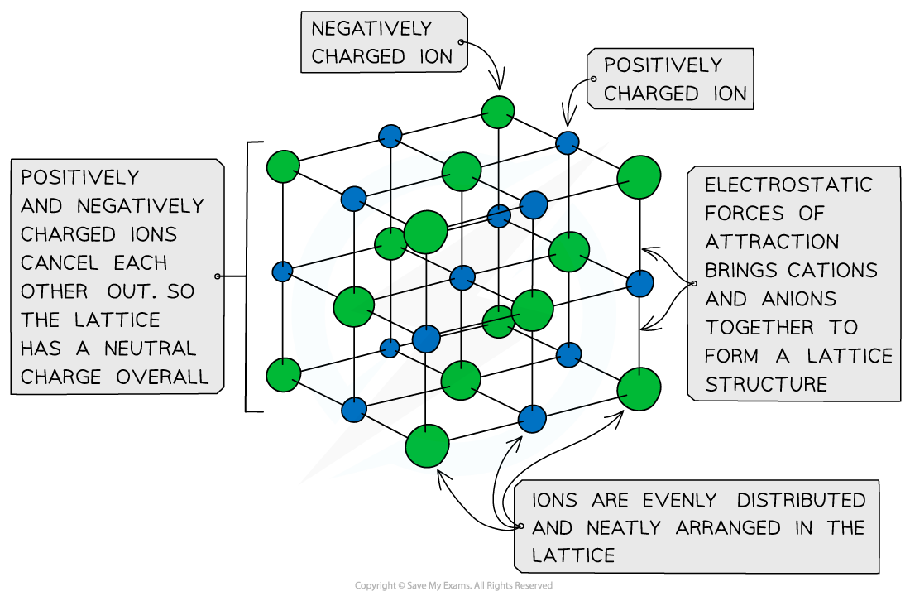

# Ionic Bonding

## Defining Ionic Bonding

> **Spec point** — `spcpt_74JsdwcVgGzqTFkb`

## Defining Ionic Bonding

- As a general rule, **metals** are on the **left** of the Periodic Table and **non-metals** are on the **right-hand** side
- **Ionic** **bonding** involves the **transfer** of electrons from a **metallic** element to a **non-metallic** element
- Transferring electrons usually leaves the metal and the non-metal with a **full** **outer** **shell**
- Metals **lose** electrons from their valence shell forming **positively charged cations**

#### Formation of cations

*Cations are formed by the removal of electrons from metals*

- Non-metal atoms **gain** electrons, forming **negatively charged anions**
- Once the atoms become ions, their electronic configurations are the same as a stable noble gas.

  - A potassium ion (K+) has the same electronic configuration as argon: [2,8,8]+
  - A chloride ion (Cl-) also has the same electronic configuration as argon: [2,8,8]-

#### Formation of anions

*Anions are formed by the addition of electrons to non-metals*

- **Cations** and **anions** are oppositely charged and therefore attracted to each other
- **Electrostatic** **attractions** are formed between the oppositely charged ions to form **ionic** **compounds**
- The **ionic bond** is the **electrostatic attraction** formed **between the oppositely charged ions**, which occurs in all directions
- This form of attraction is **very strong** and requires a **lot of energy** to overcome

  - This causes high melting points in ionic compounds

#### Using cations and anions to form ionic compounds

*Cations and anions bond together using strong electrostatic forces, which require a lot of energy to overcome*

- The ions form a **lattice** **structure** which is an evenly distributed **crystalline** structure
- Ions in a lattice are arranged in a **regular** **repeating** **pattern** so that positive charges cancel out negative charges
- The attraction between the cations and anions is occurring in all directions

  - Each ion is attracted to all the oppositely charged ions around it
- Therefore, the final lattice is overall electrically **neutral**

#### A general ionic lattice

*Ionic solids are arranged in lattice structures with alternating cations and anions*

> **Exam Hint**
> - **Metals** usually **lose** all electrons from their outer valence shell to become **cations**.
> - You can make use of the groups on the Periodic Table to work out how many electrons an atom is likely to lose or gain by looking at the **group** an atom belongs to.
> - The electrostatic attraction between oppositely charged ions is the ionic bond.
