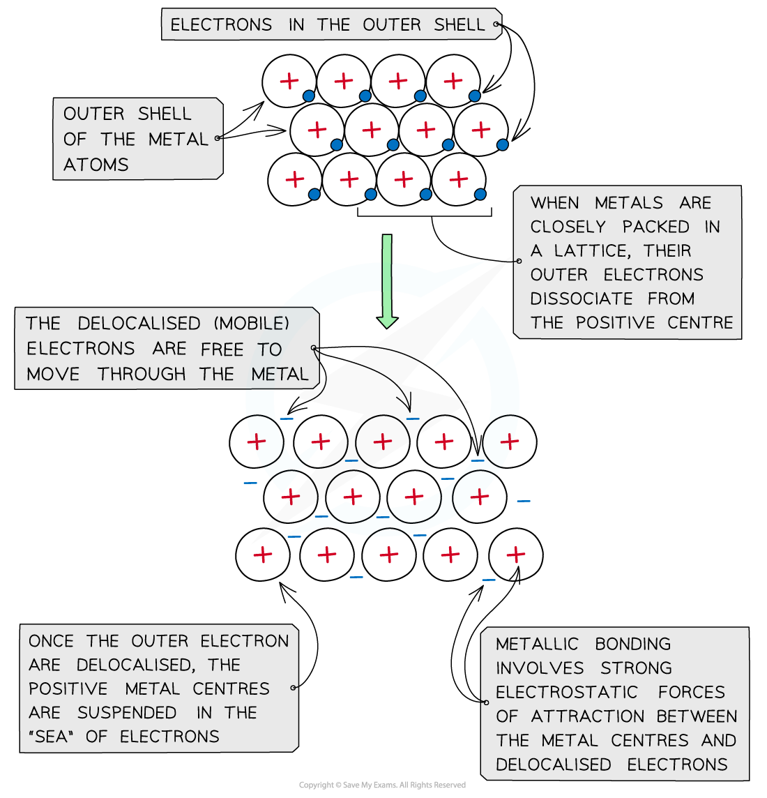

# Metallic Bonding

## Defining Metallic Bonding

> **Spec point** — `spcpt_QtmgPDPQqjtNBMz8`

## Defining Metallic Bonding

- Metal atoms are arranged in a regular, tightly packed lattice structure.
- When the metal atoms are packed together, the electrons in their outer shells **delocalise**.

  - This means that the electrons are no longer associated with any single atom.
- This process results in a lattice of positive metal ions surrounded by a mobile 'sea' of delocalised electrons.

#### Metallic bonding diagram

*The layers positive metal cations are suspended in a ‘sea’ of delocalised electrons*

- Metallic bonding is the strong electrostatic force of attraction between the positive metal ions and the surrounding delocalised electrons.
- This strong attraction:

  - Holds the ions firmly in place.
  - Counteracts the repulsion between the positive ions.
  - Maintains the stability of the metal structure.
