# Covalent Bonding

## Defining Covalent Bonding

> **Spec point** — `spcpt_WfbwJkmCX7gyZZqb`

## Defining Covalent Bonding

- **Covalent** bonding occurs between two **non-metals**
- A covalent bond involves the **electrostatic** **attraction** between nuclei of two atoms and the bonding electrons of their outer shells
- **No** **electrons** are **transferred** but only **shared **in this type of bonding

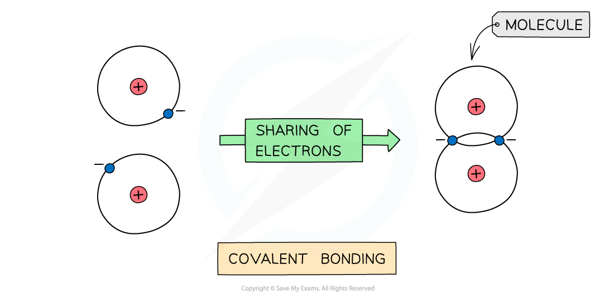

*The positive nucleus of each atom has an attraction for the bonding electrons shared in the covalent bond*

- **Non-metals** are able to **share** pairs of electrons to form different types of covalent bonds
- Sharing electrons in the covalent bond allows each of the 2 atoms to achieve an electron configuration similar to a noble gas

  - This makes each atom more stable

#### Covalent bonds & shared electrons table

- Single / C–C bond

  - **2** electrons shared
- Double / C=C bond

  - **4** electrons shared
- Triple / C$\equiv$C bond

  - **6** electrons shared

## Examples of Covalent Bonding

> **Spec point** — `spcpt_FCG6wCWXhVz8jMdM`

## Examples of Covalent Bonding

### Dot & cross diagrams

- **Dot and cross diagrams** are used to represent covalent bonding
- They show just the **outer** **shell** of the atoms involved
- To differentiate between the two atoms involved, **dots** for electrons of one atom and **crosses** for electrons of the other atom are used
- Electrons are shown in **pairs** on dot-and-cross diagrams

### Single covalent bonding

#### Hydrogen, H2

- Each hydrogen atom has one outer electron
- By sharing their outer electrons, the two hydrogen atoms are able to form a hydrogen molecule

  - The molecule contains a single covalent bond due to one shared pair of electrons

#### Covalent bonding in hydrogen, H2

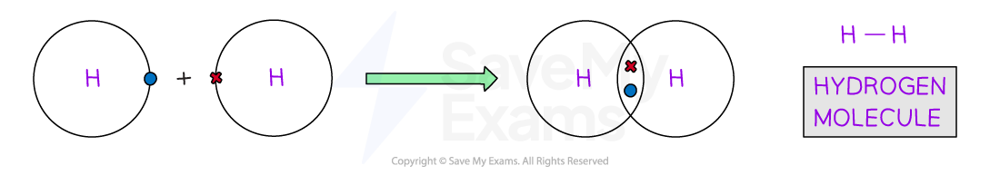

#### Chlorine, Cl2

- Each chlorine atom has seven outer electrons

  - Six electrons are paired and one electron is unpaired
- By sharing their unpaired outer electrons, the two chlorine atoms are able to form a chlorine molecule

  - The molecule contains a single covalent bond due to one shared pair of electrons

#### Covalent bonding in chlorine, Cl2

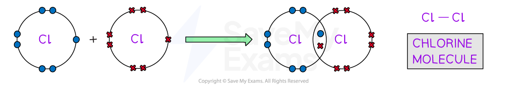

#### Hydrogen chloride, HCl

- The hydrogen atom has one outer electron and the chlorine atom has seven outer electrons

  - The chlorine atom has six paired electrons and one unpaired electron
- When the hydrogen atom pairs its outer electron with the unpaired electron from chlorine, the two atoms are able to form a hydrogen chloride molecule

  - The molecule contains a single covalent bond due to one shared pair of electrons

#### Covalent bonding in hydrogen chloride, HCl

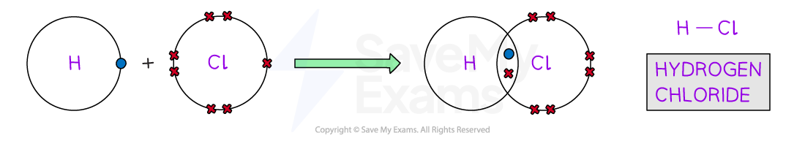

#### Ammonia, NH3

- The hydrogen atoms have one outer electron and the nitrogen atom has five outer electrons

  - The nitrogen atom has one lone pair of electrons and three unpaired electrons
- When each hydrogen atom pairs its outer electron with each of the unpaired electrons from nitrogen, the nitrogen and hydrogen atoms are able to form an ammonia molecule

  - The molecule contains three single covalent bonds due to three shared pairs of electrons

#### Covalent bonding in ammonia, NH3

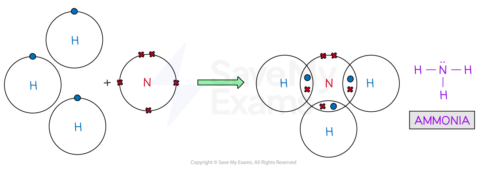

#### Methane, CH4

- The hydrogen atoms have one outer electron and the carbon atom has four outer electrons

  - The carbon atom has four unpaired electrons
- When each hydrogen atom pairs its outer electron with each of the unpaired electrons from carbon, the carbon and hydrogen atoms are able to form a methane molecule

  - The molecule contains four single covalent bonds due to four shared pairs of electrons

#### Covalent bonding in methane, CH4

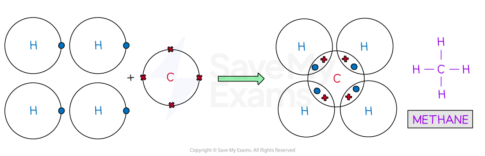

#### Ethane, C2H6

- The hydrogen atoms have one outer electron and the carbon atoms have four outer electrons

  - The carbon atom has four unpaired electrons
- Each carbon atom shares one of its unpaired electrons with the other carbon atom

  - This results in the formation of a single covalent bond between the two carbon atoms
- When each hydrogen atom pairs its outer electron with the remaining unpaired electrons from carbon, the carbon and hydrogen atoms form six single covalent C-H bonds

  - This results in a methane molecule, which contains six single covalent C-H bonds and one single covalent C-C bond

#### Covalent bonding in ethane, C2H6

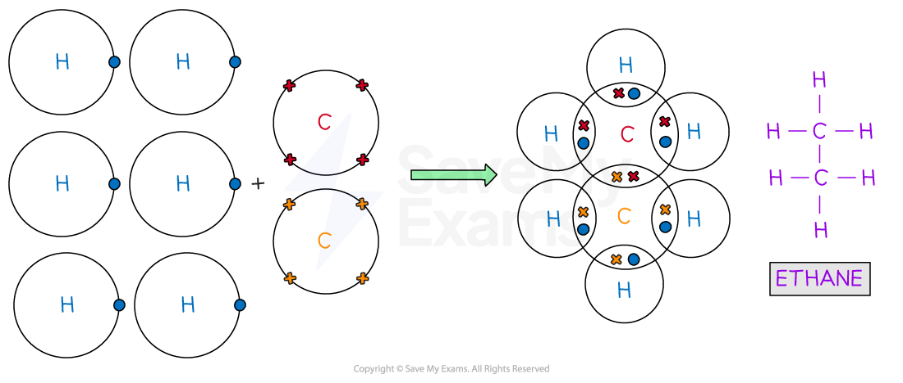

### Double covalent bonding

#### Oxygen, O2

- Each oxygen atom has six outer electrons
- By sharing two of their outer electrons, the two oxygen atoms are able to form an oxygen molecule

  - The molecule contains a double covalent bond due to two shared pair of electrons

#### Covalent bonding in oxygen, O2

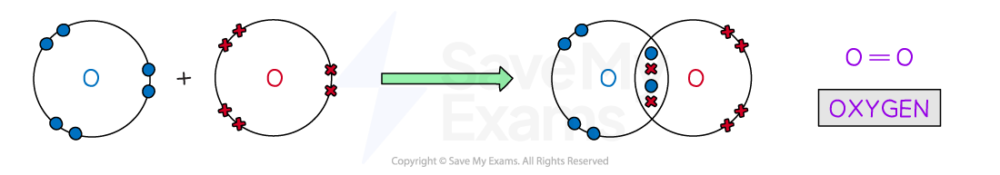

#### Carbon dioxide, CO2

- Each oxygen atom has six outer electrons and the carbon atom has four outer electrons
- Each oxygen atom shares two of its outer electrons with the carbon atom, which forms a carbon dioxide molecule

  - The molecule contains two double covalent bonds due to two sets of two shared pairs of electrons

#### Covalent bonding in carbon dioxide, CO2

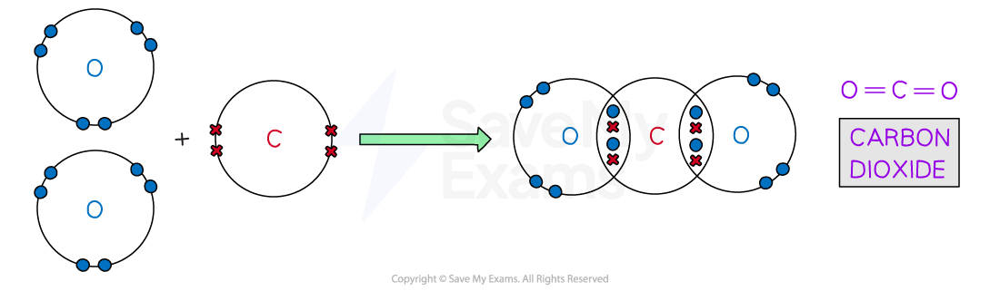

#### Ethene, C2H4

- Each hydrogen atom has one outer electron and the carbon atoms have four outer electrons
- Each carbon atom shares two of its outer electrons with the other carbon atom

  - This results in the formation of a double covalent bond between the two carbon atoms

- When each hydrogen atom pairs its outer electron with the remaining unpaired electrons from carbon, the carbon and hydrogen atoms form four single covalent C-H bonds

  - This results in an ethene molecule, which contains four single covalent C-H bonds and one double covalent C=C bond

#### Covalent bonding in ethene, C2H4

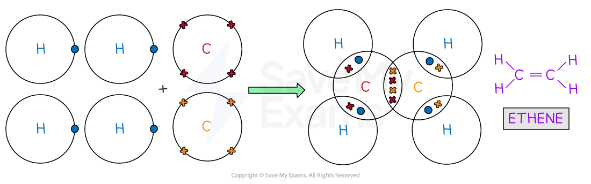

### Triple covalent bonding

#### Nitrogen, N2

- Each nitrogen atom has five outer electrons
- By sharing three of their outer electrons, the two nitrogen atoms are able to form a nitrogen molecule

  - The molecule contains a triple covalent bond due to three shared pairs of electrons

#### Covalent bonding in nitrogen, N2

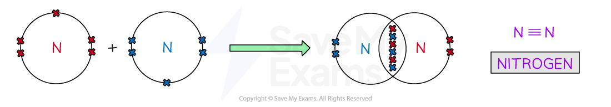

- In some instances, the central atom of a covalently bonded molecule can accommodate **more** or **less** than 8 electrons in its outer shell
- Being able to accommodate **more** than 8 electrons in the outer shell is known as **‘expanding the octet rule’**
- Accommodating **less** than 8 electrons in the outer shell means than the central atom is **‘electron deficient’**
- Some examples of this occurring can be seen with Period 3 elements

#### Sulfur dioxide, SO2

- Each oxygen atom has six outer electrons and the sulfur atom, also, has six outer electrons
- Each oxygen atom shares two of its outer electrons with the sulfur atom, which forms a sulfur dioxide molecule

  - The molecule contains two double covalent bonds due to two sets of two shared pairs of electrons
- Sulfur now has an expanded octet as it has a share of 10 electrons

#### Sulfur dioxide, SO2 – dot and cross diagram

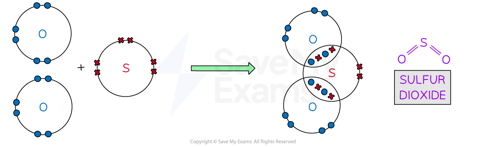

#### Phosphorus pentachloride, PCl5

- Each chlorine atom has seven outer electrons and the phosphorous atom has five outer electrons

  - The chlorine atom has six paired electrons and one unpaired electron
- When each chlorine atom pairs its unpaired outer electron with one outer electron from phosphorous, a single covalent P-Cl bond forms

  - The overall phosphorous pentachloride molecule contains five single covalent bonds
- Phosphorous now has an expanded octet as it has a share of 10 electrons

#### Phosphorus pentachloride, PCl5 – dot and cross diagram

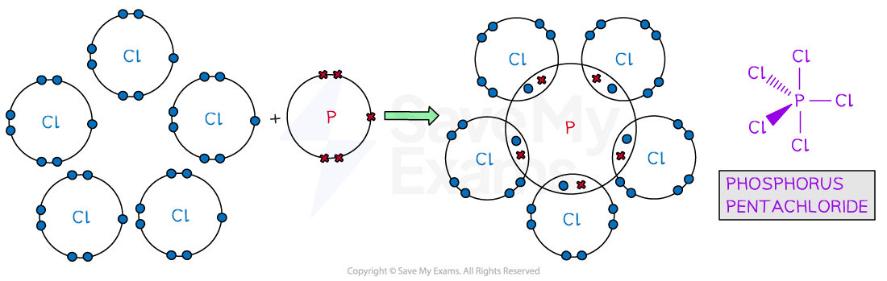

#### Sulfur hexafluoride, SF6

- Each fluorine atom has seven outer electrons and the sulfur atom has six outer electrons

  - The fluorine atom has six paired electrons and one unpaired electron
- When each fluorine atom pairs its unpaired outer electron with one outer electron from sulfur, a single covalent S-F bond forms

  - The overall sulfur hexafluoride molecule contains six single covalent bonds
- Sulfur now has an expanded octet as it has a share of 12 electrons

#### Sulfur hexafluoride, SF6 – dot and cross diagram

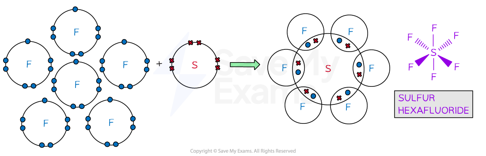

> **Exam Hint**
> - Covalent bonding takes place between non-metal atoms.
> - Remember to use the Periodic Table to decide how many electrons are in the outer shell of a non-metal atom.
