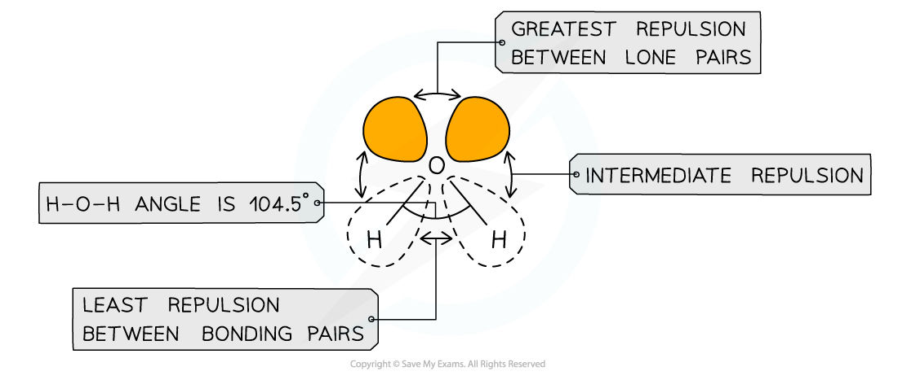
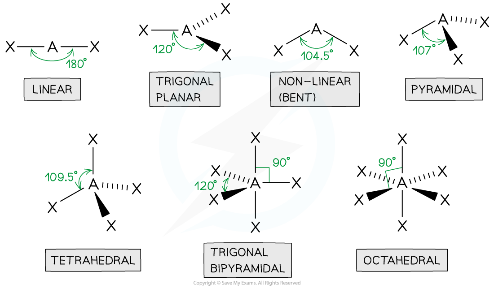
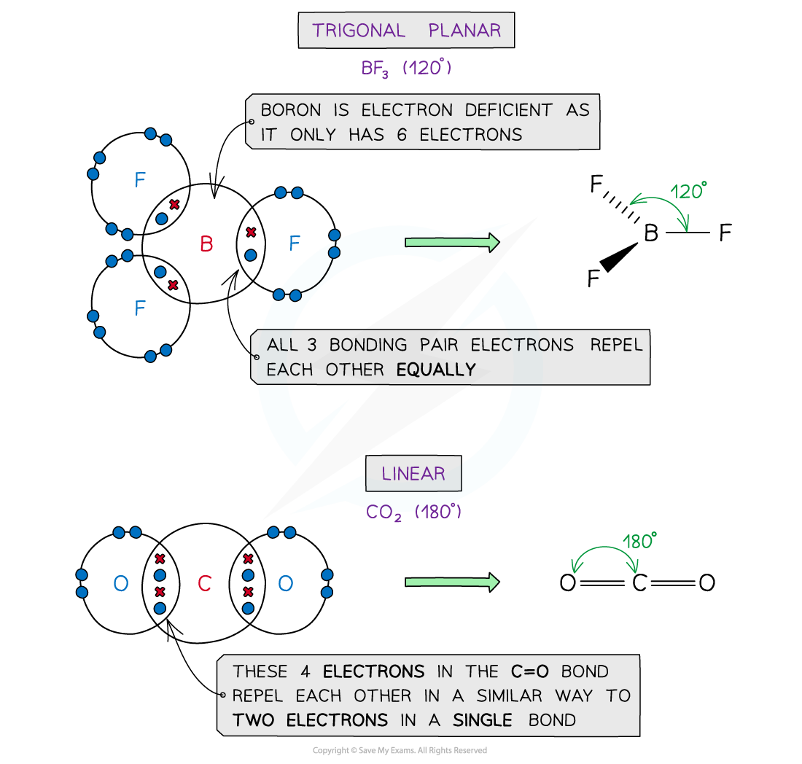
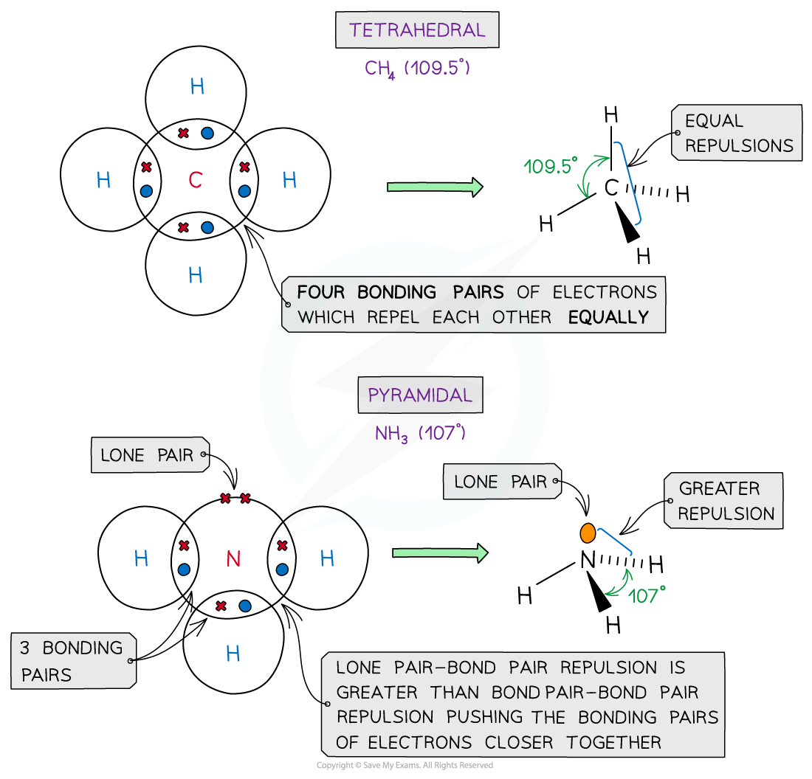
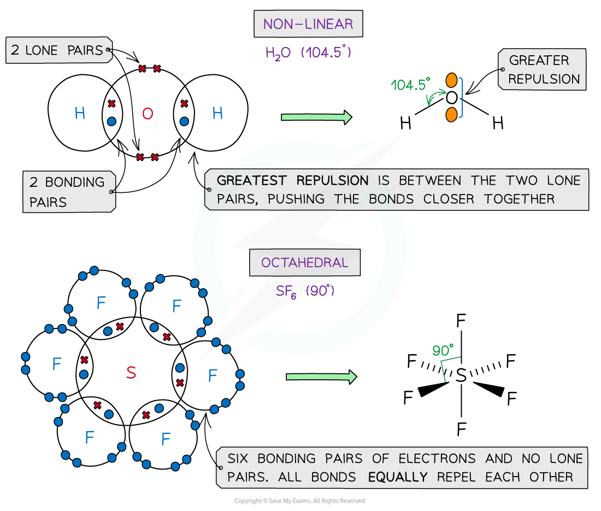
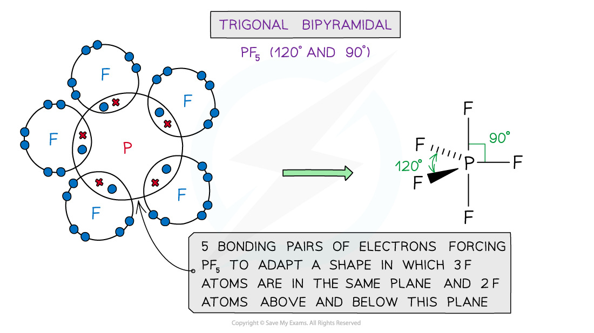

# Shapes of Molecules

## VSEPR Theory

> **Spec point** — `spcpt_G57NmSHkVfNqRmDK`

## VSEPR Theory

- Bonding and non-bonding electron pairs around a central atom behave like **negatively charged clouds** that **repel each other**
- To minimise repulsion, these electron pairs arrange themselves as **far apart as possible** in three-dimensional space
- VSEPR theory follows three key rules:

  1. **All electron pairs (bonding and lone pairs) spread out as far as possible**
  2. **Lone pairs repel more strongly than bonding pairs**
  3. **Multiple bonds behave like a single bond when determining shape**
- Using the **valence shell electron pair repulsion theory (VSEPR)**, this allows us to predict:

  - The **shape of the molecule**
  - The **angles between the bonds**
- Each region of electron density around the central atom is called an **electron domain**

  - A domain may contain one, two, or three pairs of electrons

#### Repulsion between different types of electron pairs

*Different types of electron pairs have different repulsive forces*

- Molecules can adapt the following shapes and bond angles:

#### Bond shapes and bond angles

*Molecules of different shapes can adapt with their corresponding bond angles*

#### Examples of molecules with different shapes and bond angles

*Each different shape has a specific name and specific bond angle(s)*

> **Worked Example**
> **VSEPR & shapes of molecules**
> 
> Draw the shape of the following molecules and compounds:
> 
> 1. Phosphorous(V) chloride
> 2. N(CH3)3
> 3. CCl4
> 
> **Answer 1**
> 
> - Phosphorous has a +5 charge so 5 Cl– ions are needed to neutralise the charge
> 
>   - Therefore, the phosphorous(V) chloride is PCl5
> - P is in Group 5 and has 5 valence / outer electrons
> - Cl is in Group 7 (17) and has 7 valence / outer electrons
> - All 5 electrons of phosphorous are used to form single covalent bonds to the 5 chlorines
> 
>   - There are no lone pairs
> - So, phosphorous(V) chloride has a trigonal bipyramidal shape
> 
> 
> 
> **Answer 2**
> 
> - Nitrogen is in Group 5 and has 5 valence / outer electrons
> - The carbon in the -CH3 groups is in Group 4 and has 4 valence / outer electrons
> 
>   - 3 of these electrons are already used in covalent bonds with hydrogen
> - 3 of N's valence / outer electrons are involved in bonding pairs with the carbon from the -CH3 groups
> 
>   - This leaves one pair of electrons as a lone pair
> - So, N(CH3)3 has a pyramidal shape
> 
> 
> 
> **Answer 3**
> 
> - Carbon is in Group 4 and has 4 valence / outer electrons
> - Cl is in Group 7 (17) and has 7 valence / outer electrons
> - All 4 valence / outer electrons of carbon are used as bonding pairs with the 4 chlorines
> 
>   - There are no lone pairs
> - So, the shape of CCl4 is tetrahedral
> 
> 
